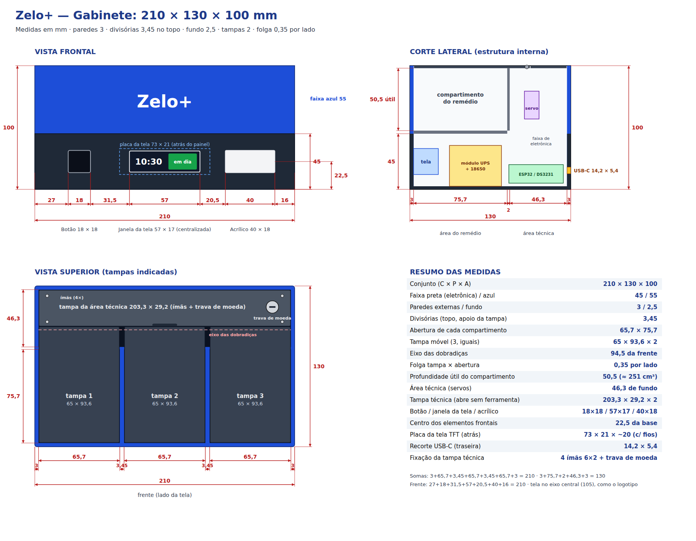

# Zelo+ — Especificação para modelagem 3D

> Este documento reúne as medidas e os requisitos de construção do gabinete do dispenser
> Zelo+, para a modelagem 3D e a impressão das peças. Todas as medidas estão em
> milímetros. Os arquivos de referência citados estão na pasta [`cad/`](cad/) do
> repositório do projeto.

---

## Sumário

- [1. Convenções](#1-convenções)
- [2. Dimensões gerais](#2-dimensões-gerais)
- [3. Compartimentos e tampas](#3-compartimentos-e-tampas)
- [4. Tampa técnica e trava de moeda](#4-tampa-técnica-e-trava-de-moeda)
- [5. Parede frontal](#5-parede-frontal)
- [6. Paredes laterais](#6-paredes-laterais)
- [7. Apoios internos e fundo removível](#7-apoios-internos-e-fundo-removível)
- [8. Acionamento das tampas](#8-acionamento-das-tampas)
- [9. Componentes a acomodar](#9-componentes-a-acomodar)
- [10. Peças, impressão e ferragens](#10-peças-impressão-e-ferragens)
- [11. Requisitos de verificação](#11-requisitos-de-verificação)

---

## 1. Convenções

| Item | Definição |
|---|---|
| Unidade | Milímetro (mm) |
| Origem (0, 0, 0) | Canto inferior, frontal e esquerdo do gabinete, visto de frente |
| Eixo X | Largura, da esquerda para a direita (0 a 210) |
| Eixo Y | Profundidade, da frente para trás (0 a 130) |
| Eixo Z | Altura, da base para cima (0 a 100) |
| Tolerância de encaixe | 0,3 por lado entre peças impressas; 0,35 por lado entre tampa e abertura |
| Notação de posição | Faixas como "X 27–45" indicam início e fim da feição |

---

## 2. Dimensões gerais

<figure markdown="1">

<figcaption><b>Desenho técnico dimensional</b> — vista frontal, corte lateral, vista superior e resumo das medidas (vistas sem escala).</figcaption>
</figure>

<figure markdown="1">

<figcaption><b>Desenho do gabinete em escala</b> — mesmas vistas, com as cotas em escala.</figcaption>
</figure>

| Item | Medida |
|---|---|
| Conjunto (C × P × A) | 210 × 130 × 100 |
| Paredes externas | 3 |
| Faixa de eletrônica (cor preta) / faixa dos compartimentos (cor azul) | Z 0–45 / Z 45–100 |
| Fundo removível (encaixado entre as paredes) | 203,4 × 123,4 × 2,5, em Z 0–2,5 |

| Direção | Composição | Soma |
|---|---|---|
| Largura | 3 + **65,7** + 3,45 + **65,7** + 3,45 + **65,7** + 3 | **210** |
| Profundidade | 3 + **75,7** (compartimento) + 2 (divisória) + **46,3** (área técnica) + 3 | **130** |
| Altura | 2,5 (fundo) + 42,5 (eletrônica) + 2,5 (piso) + **50,5** (compartimento) + 2 (tampa) | **100** |
| Frente | 27 + **18** (botão) + 31,5 + **57** (janela da tela) + 20,5 + **40** (acrílico) + 16 | **210** |

---

## 3. Compartimentos e tampas

**Compartimentos** (3, iguais):

| Item | Medida / posição |
|---|---|
| Aberturas | X 3–68,7 · X 72,15–137,85 · X 141,3–207 (65,7 cada); Y 3–78,7 (75,7) |
| Piso dos compartimentos | Z 45–47,5 (profundidade útil de 50,5; cerca de 251 cm³ por compartimento) |
| Divisórias entre compartimentos | 2 de espessura (Z 47,5–93), com apoio de 3,45 no topo (Z 93–98) |
| Divisória da área técnica | Y 78,7–80,7, Z 45–98, em toda a largura interna |
| Área técnica (servos) | Y 80,7–127 (46,3 de fundo) |

**Tampas dos compartimentos** (3, iguais):

| Item | Medida / posição |
|---|---|
| Placa | 65 × 93,6 × 2; Y 3,35–96,95; Z 98–100 |
| Início em X (tampas 1, 2 e 3) | a = 3,35 · 72,5 · 141,65 (a tampa ocupa X a até a + 65) |
| Eixo das dobradiças | Y 94,5 · Z 99 (13,8 atrás da divisória da área técnica) |
| Articulações da tampa | 2 cilindros Ø 5 ao longo de X, em X a+4,5–a+9,5 e a+55,5–a+60,5, com furo Ø 1,9 |
| Recortes para os olhais | Cantos traseiros: X a–a+4,3 e a+60,7–a+65, a partir de Y 91,5 |
| Olhais (na bandeja) | Nervuras X a–a+4 e a+61–a+65; Y 80,7–100; Z 45–98; cilindro Ø 5 no eixo, com furo Ø 1,9 |
| Pino das dobradiças | Filamento de 1,75 (pedaços de 9), colado |
| Apoios das tampas | Ressalto frontal (Y 3–5,3, Z 95–98); ressaltos laterais (Z 95–98); topo das divisórias (Z 93–98) |

A dobradiça fica atrás da divisória para que a alavanca do acionamento (seção 8) gire
sem tocar a divisória com a tampa aberta a 90°.

---

## 4. Tampa técnica e trava de moeda

| Item | Medida / posição |
|---|---|
| Tampa técnica | 203,3 × 29,15 × 2; X 3,35–206,65; Y 97,5–126,65; Z 98–100 |
| Fixação | 4 pares de ímãs de neodímio 6 × 2 |
| Rebaixos dos ímãs na tampa | Ø 6,2 × 1,7 (por baixo), em (X 6,25; Y 104,5), (203,75; 104,5), (6,25; 124), (203,75; 124) |
| Rebaixos dos ímãs no corpo | Ø 6,2 × 2,4 nos apoios, nas mesmas posições (topo em Z 98) |
| Rebaixo para o dedo | X 95–115, da borda frontal até Y 100,5 |
| Furo da trava | Ø 6,4 passante, com rebaixo Ø 10,4 × 1 por cima, em X 192 · Y 113 |
| Botão da trava | Cabeça Ø 10 × 1 com fenda de 1,2 × 8 × 0,7 para moeda; eixo Ø 6 até Z 93,6; ponta quadrada 3 × 3 (Z 91,8–93,6) |
| Lingueta | 6 × 14 × 1,8 (Z 91,8–93,6), com furo quadrado de 3,4; trava por baixo do apoio traseiro (Z 94) |
| Giro para destravar | 1/4 de volta, com a lingueta voltando para a esquerda (−X) |

---

## 5. Parede frontal

| Feição | Medida | Posição |
|---|---|---|
| Furo do botão | 18 × 18 | X 27–45 · Z 13,5–31,5 |
| Janela da tela | 57 × 17 | X 76,5–133,5 · Z 14–31 |
| Janela do acrílico (LED) | 40 × 18 | X 154–194 · Z 13,5–31,5 |
| Rebaixo do acrílico (por dentro) | 42 × 20 × 2 | X 153–195 · Z 12,5–32,5 · Y 1–3 |
| Trilhos da tela | Apoio inferior X 68,5–141,5 (Z 10–12, Y 3–9); batente esquerdo X 64,5–68,5; batente direito X 141,5–145,5 (Y 3–10, Z 10–35); trava direita X 140–141,5 (Y 7,6–9,6, Z 12–35) | Módulo entra de cima, com os pinos do lado do botão |
| Berço do botão | Placa de apoio X 25,5–46,5 · Y 14–16 · Z 11,5–33,5, com laterais até a parede | Botão a 11 da face interna da parede |
| Suporte do LED | Placa X 158–190 · Y 8–10 · Z 12,5–32,5 com furo Ø 5,2 | Furo centrado em X 174 · Z 22,5 |

---

## 6. Paredes laterais

| Feição | Medida | Posição |
|---|---|---|
| Furos de som do buzzer (lateral esquerda) | 9 × Ø 2,4, em grade 3 × 3 com passo 4 | Centro em Y 100 · Z 20 |
| Alojamento do buzzer (lado de dentro) | Tubo Ø 15,2 externo, Ø 12,3 interno, de X 3 a 11 | Mesmo centro dos furos |
| Recorte do USB-C (lateral direita) | 14,2 × 5,4 | Y 47,9–62,1 · Z 12,3–17,7 |
| Prateleira do conector USB-C | 7 × 18 × 2,8 | X 200–207 · Y 46–64 · Z 9,5–12,3 |

---

## 7. Apoios internos e fundo removível

| Feição (no corpo) | Posição |
|---|---|
| Ressalto da bandeja (frente e laterais) | Z 43–45; Y 3–5,3 na frente; X 3–5,3 e 204,7–207 nas laterais (até Y 78,6) |
| Apoios laterais da tampa técnica | X 3–9,5 e 200,5–207 · Y 100,3–121 · Z 94–98 |
| Apoio traseiro da tampa técnica | Y 121–127 · Z 94–98, em toda a largura |
| Colunas dos parafusos do fundo | Ø 8, Z 2,5–12, em (X 8; Y 8), (202; 8), (8; 122), (202; 122), com furo Ø 2,5 para M3 autoatarraxante |

| Feição (no fundo removível) | Medida / posição |
|---|---|
| Furos dos parafusos | Ø 3,4 com escareado Ø 6,4, alinhados com as colunas |
| Berço da protoboard | Moldura de 1,5 × 3 de altura para 83 × 55 (folga 0,3); X 12–95 · Y 34–89 |
| Berço do módulo UPS | Moldura de 6 de altura para 90 × 42; X 106–196 · Y 34–76 |
| Berço do relógio DS3231 | Moldura de 3 de altura para 38 × 22; X 108–146 · Y 90–112 |
| Berço do capacitor | Calço com canal Ø 10,4 ao longo de X; X 160–180 · Y 100–112 |
| Ventilação | 6 rasgos de 2,5 × 26 sob o módulo UPS (X 116 a 183,5 · Y 42–68) |
| Pés | 4 rebaixos Ø 10,4 × 1 em (18; 18), (192; 18), (18; 112), (192; 112) |

---

## 8. Acionamento das tampas

Cada tampa é movida por um servo SG90. O braço do servo leva um pino que desliza num
rasgo da alavanca colada sob a tampa. O pino tem argola, para ser retirado à mão numa
emergência; sem ele, a tampa abre livre.

<figure markdown="1">

<figcaption><b>Acionamento da tampa</b> — posições fechada, meio curso e aberta (corte lateral, escala 7:1).</figcaption>
</figure>

| Item | Medida / posição |
|---|---|
| Eixo da dobradiça | Y 94,5 · Z 99 |
| Eixo do servo (paralelo ao da dobradiça) | Y 98,5 · Z 73 |
| Furo do pino no braço do servo | A 20 do eixo do servo |
| Rasgo da alavanca | 3,4 de largura, de 6,0 a 12,3 do eixo da dobradiça, a 35° abaixo da horizontal com a tampa fechada |
| Curso do servo | 47° para a tampa ir de 0° a 90° |
| Plano da alavanca / do braço / do corpo do servo | X a+12–a+15 / a+15,5–a+18,7 / a+22,7–a+45,4 |
| Placa do servo (na bandeja) | X a+29,5–a+32 · Y 80,7–108 · Z 45–87; janela Y 92,3–104,7 · Z 56–79,3; 2 furos Ø 1,6 em Y 98,5 · Z 53,95 e 81,35 |

<figure markdown="1">

<figcaption><b>Peças do acionamento</b> — alavanca da tampa, braço do servo e pino com argola.</figcaption>
</figure>

| Peça | Medida |
|---|---|
| Alavanca da tampa | 25,4 × 9,4 × 9; face de colagem sob a tampa de Y 82,5 a 92,7 |
| Braço do servo | 30 × 12 × 3,2; rebaixo de 1,6 para o braço simples original do SG90 (cerca de 15,5); 2 furos para M2 |
| Pino com argola | Ø 3 × 9,3 de haste, com ponta bipartida de trava; argola Ø 12 |

**Restrições de movimento (verificadas no modelo de referência):**

- A alavanca passa a 1,5 da divisória da área técnica com a tampa aberta a 90°.
- O ponto mais alto do braço do servo fica em Z 97, abaixo da tampa técnica (Z 98).
- O pino permanece dentro do rasgo em todo o curso (posição de 6,3 a 12,0 ao longo da alavanca).
- A parte da tampa atrás do eixo gira dentro de um raio de 2,7, sem tocar a tampa técnica.

---

## 9. Componentes a acomodar

| Componente | Medidas usadas no modelo | Posição no gabinete |
|---|---|---|
| Servo SG90 (3) | Corpo 22,5 × 11,8 × 22,7; abas 32 × 11,8 × 2,5 com furos a 27,5 | Placas da bandeja, eixo em Y 98,5 · Z 73 |
| Tela TFT 2,25" (ST7789P3) | Placa 73 × 21 × ~4 (cerca de 20 com os conectores); área visível 55,2 × 14,8 | Atrás da janela frontal, X 68,5–141,5 · Z 12–33 |
| Protoboard de 400 pontos com ESP32 DevKit (30 pinos) | 83 × 55 × 9,5; ESP32 51 × 28 | Berço do fundo, sob os compartimentos |
| Módulo UPS LX-2BUPS com baterias 18650 | 90 × 42 × 33 | Berço do fundo, junto à lateral direita |
| Relógio DS3231 com bateria | 38 × 22 × ~12 | Berço do fundo, sob a área técnica |
| Buzzer ativo | Ø 12 × 9,5 | Alojamento da lateral esquerda |
| LED | Ø 5 | Suporte atrás do acrílico |
| Botão táctil com capa | 12 × 12 | Berço atrás do furo frontal |
| Capacitor eletrolítico 1000 µF | Ø 10 × 17–20 | Berço do fundo, deitado |
| Conector USB-C fêmea de painel | Recorte 14,2 × 5,4 | Lateral direita, sobre a prateleira |
| Acrílico translúcido | 42 × 20 × 2 | Rebaixo da janela do LED |

As medidas do SG90, da tela e da protoboard vêm dos fabricantes e devem ser conferidas
com as peças reais antes da impressão final.

---

## 10. Peças, impressão e ferragens

<figure markdown="1">

<figcaption><b>Modelo 3D de referência</b> — à esquerda, fechado; à direita, vista de trás sem o corpo e sem as tampas.</figcaption>
</figure>

| Peça | Qtd | Tamanho | Impressão |
|---|---|---|---|
| Corpo | 1 | 210 × 130 × 100 | PLA, 20 %, 3 paredes; em pé, com suporte só sob os ressaltos internos e as colunas |
| Bandeja | 1 | 203,4 × 104,7 × 56,5 | PLA, 20 %; com o piso na mesa |
| Fundo | 1 | 203,4 × 123,4 × 8,5 | PLA, 20 %; deitado |
| Tampa do compartimento | 3 | 65 × 93,7 × 5 | PLA, 100 %; face de cima na mesa, suporte só nas articulações |
| Tampa técnica | 1 | 203,3 × 29,2 × 2 | PLA, 100 %; deitada |
| Trava de moeda (botão e lingueta) | 1 + 1 | 10 × 10 × 8,2 e 6 × 14 × 1,8 | PETG, 100 % |
| Alavanca, braço do servo e pino com argola | 3 de cada | ver seção 8 | PETG, 100 %, camada de 0,12–0,16 |

| Ferragem | Qtd | Uso |
|---|---|---|
| Parafuso M3 × 8 autoatarraxante | 4 | Fundo |
| Parafuso M2 × 6 autoatarraxante | 12 | Abas dos servos (6) e braço do servo (6) |
| Filamento de 1,75 (pedaços de 9) | 6 | Pinos das dobradiças |
| Ímã de neodímio 6 × 2 | 8 | Tampa técnica e apoios do corpo |
| Pé de borracha adesivo de 10 | 4 | Fundo |
| Acrílico translúcido 42 × 20 × 2 | 1 | Janela do LED |

**Arquivos de referência** (pasta `cad/`):

| Arquivo | Conteúdo |
|---|---|
| `gabinete/*.stl` | Peças do gabinete para impressão |
| `gabinete/montagem.glb` e `montagem.obj` | Montagem completa, colorida, para visualização |
| `alavanca-tampa.stl`, `braco-servo.stl`, `pino-argola.stl` | Peças do acionamento |
| `zelo_acionamento.scad` | Peças do acionamento, editáveis no OpenSCAD |
| `gabinete.py`, `conferir_movimento.py` | Modelo paramétrico do gabinete e conferência de colisões |

---

## 11. Requisitos de verificação

O modelo final deve atender aos seguintes requisitos, já verificados no modelo de
referência:

1. **Sem colisões com as tampas fechadas** entre peças e entre peças e componentes.
2. **Sem colisões durante a abertura** de 0° a 90° das três tampas, incluindo as
   alavancas e os braços dos servos.
3. **Folgas mínimas:** 0,3 por lado entre peças encaixadas; 0,35 por lado entre tampa e
   abertura; 0,5 entre a tampa do compartimento e a tampa técnica.
4. **Montagem:** a bandeja entra pelo topo do corpo e apoia no ressalto de Z 45; os
   componentes eletrônicos ficam no fundo removível; os servos e os pinos com argola
   ficam acessíveis pela tampa técnica.
5. **Acessos:** a tampa técnica abre sem ferramenta, com a trava de moeda; o fundo sai
   com 4 parafusos e dá acesso à protoboard e ao USB do ESP32.
6. **Impressão:** cada peça cabe numa mesa de 300 × 300; paredes de no mínimo 1,5;
   furos para pinos e eixos com 0,3 a 0,4 de folga sobre o diâmetro nominal.
