# Zelo+ — Guia do produto (redação controlada STE100)

> Este guia descreve o dispenser inteligente de medicamentos Zelo+. Esta versão usa as
> regras de redação da ASD-STE100, adaptadas para o português. O conteúdo técnico é o
> mesmo do guia principal. O arquivo completo do programa está em [`src/main.cpp`](src/main.cpp).

<!-- so-github -->
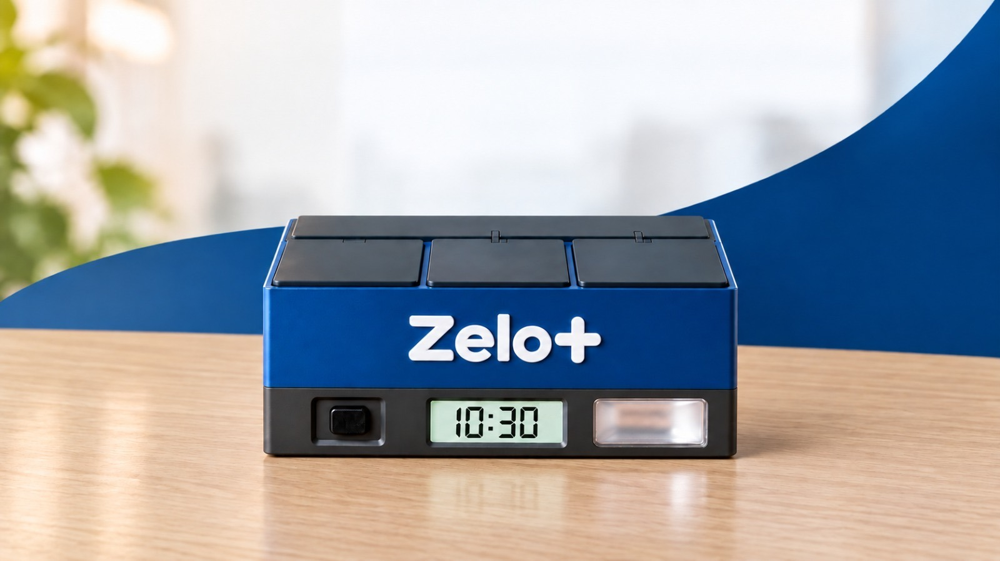

*Imagem de referência — conceito visual do produto final (ilustrativo).*
<!-- /so-github -->

---

## Sumário

- [Regras de redação desta versão](#regras-de-redação-desta-versão)
- [Missão, visão e valores](#missão-visão-e-valores)
- [Sumário executivo](#sumário-executivo)
- [Parte A — Entendendo o projeto](#parte-a--entendendo-o-projeto)
  - [A1. O que é o Zelo+](#a1-o-que-é-o-zelo)
  - [A2. Materiais e ligações](#a2-materiais-e-ligações)
  - [A3. Ambiente de desenvolvimento](#a3-ambiente-de-desenvolvimento)
  - [A4. Cinco conceitos antes de começar](#a4-cinco-conceitos-antes-de-começar)
  - [A5. A página do Zelo+ (tela completa)](#a5-a-página-do-zelo-tela-completa)
- [Parte B — Desenho técnico do gabinete](#parte-b--desenho-técnico-do-gabinete)
  - [B1. Desenho técnico dimensional](#b1-desenho-técnico-dimensional)
  - [B2. Imagens do produto](#b2-imagens-do-produto)
  - [B3. Critérios de projeto](#b3-critérios-de-projeto)
  - [B4. Onde fica cada componente](#b4-onde-fica-cada-componente)
  - [B5. Abertura de emergência sem energia](#b5-abertura-de-emergência-sem-energia)
  - [B6. Modelo 3D do gabinete e impressão](#b6-modelo-3d-do-gabinete-e-impressão)
  - [B7. Fechamento manual da tampa (em avaliação)](#b7-fechamento-manual-da-tampa-em-avaliação)
- [Parte C — O código, passo a passo](#parte-c--o-código-passo-a-passo)
  - [Passo 1 — Bibliotecas e pinos](#passo-1--bibliotecas-e-pinos)
  - [Passo 2 — Estruturas de dados](#passo-2--estruturas-de-dados)
  - [Passo 3 — `setup()`: ligando tudo](#passo-3--setup-ligando-tudo)
  - [Passo 4 — Wi-Fi sem senha no código (captive portal)](#passo-4--wi-fi-sem-senha-no-código-captive-portal)
  - [Passo 5 — Modo normal: relógio pela internet e rotas da página](#passo-5--modo-normal-relógio-pela-internet-e-rotas-da-página)
  - [Passo 6 — Memória permanente (Preferences)](#passo-6--memória-permanente-preferences)
  - [Passo 7 — A página de cadastro](#passo-7--a-página-de-cadastro)
  - [Passo 8 — Salvando o cadastro](#passo-8--salvando-o-cadastro)
  - [Passo 9 — Movendo as portas (servos)](#passo-9--movendo-as-portas-servos)
  - [Passo 10 — O coração: `loop()` e a máquina de estados](#passo-10--o-coração-loop-e-a-máquina-de-estados)
  - [Passo 11 — Conferindo os horários](#passo-11--conferindo-os-horários)
  - [Passo 12 — O alarme tocando](#passo-12--o-alarme-tocando)
  - [Passo 13 — O paciente aperta o botão](#passo-13--o-paciente-aperta-o-botão)
  - [Passo 14 — Abastecer, repor e esvaziar](#passo-14--abastecer-repor-e-esvaziar)
  - [Passo 15 — Avisos pelo Telegram](#passo-15--avisos-pelo-telegram)
  - [Passo 16 — Histórico de doses](#passo-16--histórico-de-doses)
  - [Passo 17 — Escrevendo no LCD](#passo-17--escrevendo-no-lcd)
  - [Passo 18 — Modo de teste](#passo-18--modo-de-teste)
  - [Passo 19 — Relógio DS3231 (próxima etapa)](#passo-19--relógio-ds3231-próxima-etapa)
  - [Passo 20 — Leitura da caixa do remédio por foto (IA)](#passo-20--leitura-da-caixa-do-remédio-por-foto-ia)
  - [Passo 21 — Modo do cuidador: abrir pelo botão, sem o celular](#passo-21--modo-do-cuidador-abrir-pelo-botão-sem-o-celular)
- [Parte D — Juntando tudo](#parte-d--juntando-tudo)
  - [D1. Linha do tempo de uma dose](#d1-linha-do-tempo-de-uma-dose)
  - [D2. Referência rápida](#d2-referência-rápida)
- [Parte E — Uso autônomo, sem o laptop](#parte-e--uso-autônomo-sem-o-laptop)
  - [E1. Pré-requisitos e validação](#e1-pré-requisitos-e-validação)
  - [E2. Por que o laptop não é necessário](#e2-por-que-o-laptop-não-é-necessário)
  - [E3. A solução: fonte 5 V/3 A + módulo UPS + bateria 18650](#e3-a-solução-fonte-5-v3-a--módulo-ups--bateria-18650)
  - [E4. Lista de compras](#e4-lista-de-compras)
  - [E5. Montagem passo a passo](#e5-montagem-passo-a-passo)
  - [E6. Teste de falta de energia](#e6-teste-de-falta-de-energia)
  - [E7. Autonomia da bateria](#e7-autonomia-da-bateria)
  - [E8. Falta de energia e de internet](#e8-falta-de-energia-e-de-internet)
  - [E9. Módulo de relógio DS3231](#e9-módulo-de-relógio-ds3231)
  - [E10. Atualizar o programa depois de montado](#e10-atualizar-o-programa-depois-de-montado)
  - [E11. Procedimento de emergência](#e11-procedimento-de-emergência)
- [Parte F — Lista completa de componentes, com preços](#parte-f--lista-completa-de-componentes-com-preços)
  - [F1. Eletrônica do dispenser](#f1-eletrônica-do-dispenser)
  - [F2. Energia autônoma](#f2-energia-autônoma)
  - [F3. Montagem e ligações](#f3-montagem-e-ligações)
  - [F4. Relógio sem internet (próxima etapa)](#f4-relógio-sem-internet-próxima-etapa)
  - [F5. Ferramentas necessárias (fora do custo)](#f5-ferramentas-necessárias-fora-do-custo)
  - [F6. Resumo do investimento](#f6-resumo-do-investimento)
- [Parte G — Custo de produção (estimativa para viabilidade)](#parte-g--custo-de-produção-estimativa-para-viabilidade)
  - [G1. Premissas e método](#g1-premissas-e-método)
  - [G2. Volume de plástico do gabinete](#g2-volume-de-plástico-do-gabinete)
  - [G3. Gabinete em impressão 3D](#g3-gabinete-em-impressão-3d)
  - [G4. Gabinete em plástico injetado](#g4-gabinete-em-plástico-injetado)
  - [G5. Componentes eletrônicos no atacado](#g5-componentes-eletrônicos-no-atacado)
  - [G6. Custo por unidade em três escalas](#g6-custo-por-unidade-em-três-escalas)
  - [G7. Investimentos iniciais (uma vez só)](#g7-investimentos-iniciais-uma-vez-só)
  - [G8. Preço de venda e viabilidade](#g8-preço-de-venda-e-viabilidade)
  - [G9. Limitações da estimativa](#g9-limitações-da-estimativa)
- [Parte H — Evolução do produto: funcionalidades com inteligência artificial](#parte-h--evolução-do-produto-funcionalidades-com-inteligência-artificial)
  - [H1. Princípios de projeto](#h1-princípios-de-projeto)
  - [H2. Arquitetura proposta](#h2-arquitetura-proposta)
  - [H3. Funcionalidades propostas](#h3-funcionalidades-propostas)
  - [H4. Quadro-resumo dos impactos](#h4-quadro-resumo-dos-impactos)
  - [H5. Impactos gerais da mudança](#h5-impactos-gerais-da-mudança)
  - [H6. Etapas de implantação](#h6-etapas-de-implantação)
  - [H7. Modelo próprio de IA (etapa futura)](#h7-modelo-próprio-de-ia-etapa-futura)
- [Referências](#referências)

---

# Regras de redação desta versão

Esta versão do guia aplica as regras de redação da especificação ASD-STE100
(*Simplified Technical English*). A ASD-STE100 é uma norma para textos técnicos em
inglês. Este guia usa as mesmas regras, adaptadas para o português. Por isso, esta versão
não tem certificação STE100. O objetivo é um texto claro, curto e sem ambiguidade.

## Regras aplicadas

| N.º | Regra | Aplicação neste guia |
|---|---|---|
| 1 | Um termo para cada conceito | Use somente os termos da tabela "Termos aprovados". Não use sinônimos. |
| 2 | Frases curtas | Procedimentos: no máximo 20 palavras por frase. Descrições: no máximo 25 palavras por frase. |
| 3 | Um assunto por frase | Cada frase dá uma informação ou uma instrução. |
| 4 | Parágrafos curtos | No máximo 6 frases por parágrafo. |
| 5 | Instruções no imperativo | Exemplo: "Conecte o cabo." Não use "o cabo deve ser conectado". |
| 6 | Uma ação por passo | Cada passo numerado tem uma ação. Exceção: duas ações feitas ao mesmo tempo. |
| 7 | Voz ativa | O texto diz quem faz a ação: "O ESP32 lê o botão." |
| 8 | Avisos antes do passo | ADVERTÊNCIA e CUIDADO ficam antes da instrução a que se aplicam. |
| 9 | Linguagem literal | Não use gírias, expressões figuradas nem comparações. |
| 10 | Valores com unidade | Escreva sempre a unidade: 5 V, 3 A, 7 s, 210 mm. |

## Avisos

| Tipo | Quando usar | Forma |
|---|---|---|
| **ADVERTÊNCIA** | Risco para pessoas, inclusive risco para a dose do paciente. | Instrução direta e, a seguir, a consequência. |
| **CUIDADO** | Risco para o equipamento ou para os dados. | Instrução direta e, a seguir, a consequência. |
| **NOTA** | Informação útil, sem risco. | Frase curta. |

## Termos aprovados

| Termo aprovado | Significado | Não use |
|---|---|---|
| dispenser | O equipamento Zelo+ completo. | caixa, aparelho, dispositivo |
| compartimento | Um dos três espaços para remédio (1, 2 ou 3). | gaveta, divisão |
| tampa do compartimento | A peça móvel que fecha o compartimento. | porta, portinha |
| tampa técnica | A tampa da área dos servos, na parte de trás. | tampa traseira |
| servo | O servo motor SG90 que move a tampa do compartimento. | motorzinho |
| placa | A placa ESP32 DevKit V1. | ESP, microcontrolador (em procedimentos) |
| visor | A tela TFT da frente do dispenser. | display, tela (em procedimentos) |
| botão | O botão da frente do dispenser. | tecla |
| luz de alerta | O LED da frente do dispenser. | lâmpada |
| buzzer | O componente que emite o som do alarme. | campainha, sirene |
| página do dispenser | A página web que o dispenser mostra no celular. | app, aplicativo, site |
| cuidador | A pessoa responsável pelo paciente e pelo cadastro. | responsável, usuário |
| paciente | A pessoa que toma o remédio. | idoso, usuário |
| dose | Os remédios de um mesmo horário. | tomada, medicação |
| fonte de 5 V | A fonte de alimentação de 5 V. | carregador |

---

# Missão, visão e valores

<figure markdown="1">

<figcaption><b>Missão, visão e valores do Zelo+.</b></figcaption>
</figure>

---

# Sumário executivo

> O Zelo+ é um dispenser automático de medicamentos para idosos.
> O dispenser envia um aviso ao celular do cuidador quando o paciente não retira a dose.
> Este sumário descreve estes itens:
>
> - o problema;
> - o valor do produto;
> - a entrega em ciclos curtos;
> - os indicadores de sucesso;
> - os riscos;
> - os próximos marcos.
>
> A equipe revisa o escopo a cada ciclo. A revisão usa o retorno de pacientes e de cuidadores.

## Problema e necessidade

| Quem tem o problema | Problema |
|---|---|
| **Paciente idoso** | O paciente toma vários remédios em horários diferentes. Ele pode esquecer uma dose, tomar a dose duas vezes ou trocar os remédios. |
| **Cuidador e família** | O cuidador não tem informação confiável sobre as doses tomadas. O acompanhamento depende da memória do paciente ou de visitas. |
| **Profissional de saúde** | O profissional não tem dados de adesão ao tratamento na consulta. |

**Oportunidade:** um equipamento de mesa, simples para o paciente. O equipamento
organiza as doses e dá o alarme no horário. Ele também informa a família. O custo é
adequado para uso em casa.

## Visão do produto e objetivos de valor

**Visão:** ser referência em tecnologia para o cuidado e o gerenciamento de medicamentos
na terceira idade.

| Objetivo de valor | Como o Zelo+ entrega o objetivo |
|---|---|
| **Dose certa, na hora certa** | O dispenser tem três compartimentos. Um servo move cada tampa do compartimento. No horário, o buzzer toca, a luz de alerta pisca e o visor mostra uma mensagem colorida. O botão abre somente o compartimento da dose. |
| **Família informada** | O dispenser envia um aviso pelo Telegram quando o paciente não retira a dose. O primeiro aviso ocorre aos 6 min. O alerta final ocorre aos 12 min. |
| **Configuração sem técnico** | O cuidador usa a página do dispenser no celular. Ele cadastra remédios, horários e familiares. A página guia o abastecimento. A página também lê a caixa do remédio por foto. |
| **Funciona sem internet** | Se o Wi-Fi da casa falhar, o dispenser cria uma rede própria. O dispenser tenta conectar de novo automaticamente. A bateria mantém o dispenser ligado na falta de energia. |
| **Informação para a consulta** | O dispenser grava o histórico de doses. A página mostra a taxa de adesão de cada remédio. O cuidador pode exportar o histórico em planilha. |

## Abordagem e incrementos

A equipe entrega o produto em **ciclos quinzenais**. Cada ciclo entrega um incremento
que funciona. A equipe valida cada incremento em bancada ou com usuários.

| Incremento | Valor entregue | Situação |
|---|---|---|
| **1. Núcleo do dispenser** | Alarmes, tampas dos compartimentos, botão, visor, página do dispenser, avisos pelo Telegram, histórico e adesão. | Concluído (protótipo funcional). |
| **2. Robustez** | Montagem autônoma com fonte e bateria. Relógio DS3231 para manter a hora sem internet. Tempos definitivos de uso. | Sprints 1 a 3 (peça piloto em 27/11/2026). |
| **3. IA — 1ª etapa** | Cadastro por foto ou por código de barras. Conferência na reposição. Relatório de adesão (H3.1, H3.2, H3.6). | Leitura por foto e consulta do código de barras à lista oficial integradas. Os outros itens estão planejados. |
| **4. IA — 2ª etapa** | Cadastro pela receita. Assistente do cuidador no Telegram (H3.4, H3.7). | Planejado. |
| **5. Acessibilidade** | Voz para o paciente (H3.11). | Planejado. Depende de um componente novo. |
| **6. Modelo próprio de IA** | Leitura de embalagens sem serviço de terceiros (H7). | Prazo aproximado de 12 meses. |

**Produto mínimo viável (MVP):** o MVP é o incremento 1. O MVP contém estes itens:

- três compartimentos com tampa motorizada;
- alarme com som e luz;
- abertura somente do compartimento da dose, pelo botão;
- página do dispenser para o cadastro;
- avisos pelo Telegram;
- histórico de adesão.

Estes itens não fazem parte do MVP: as etapas de IA, a voz para o paciente e o modelo
próprio de IA. A leitura da caixa por foto é a exceção: ela já está integrada.

## Equipe e papéis

| Papel | Integrantes | Responsabilidades |
|---|---|---|
| **Product Owner** | David Soares | Define a visão do produto. Prioriza o backlog. Aceita cada incremento. |
| **Scrum Master** | Matheus Barbosa | Conduz as cerimônias. Remove os impedimentos. Acompanha o ritmo das sprints. |
| **Desenvolvedores** | Cláudio Maciel, Daniel Wolf, João Eivazian, Julia Gardezani e Paulo Martimiano | Fazem o hardware, o firmware, a página do dispenser, o gabinete em impressão 3D, os testes e a documentação. |

**Partes interessadas:** pacientes idosos, cuidadores, familiares e profissionais de
saúde. A equipe consulta estas pessoas nas revisões de sprint e no lote piloto.

## Roadmap até a peça piloto

Cada sprint dura duas semanas. A **peça piloto está prevista para a última semana de
novembro de 2026** (23 a 27/11/2026).

| Sprint | Período | Meta da sprint |
|---|---|---|
| **Sprint 1** | 19/10 a 30/10/2026 | Robustez: montagem autônoma com fonte e bateria, relógio DS3231 e tempos definitivos de uso. |
| **Sprint 2** | 02/11 a 13/11/2026 | Gabinete impresso em 3D. Acionamento das tampas por alavanca e pino. Montagem integrada. |
| **Sprint 3** | 16/11 a 27/11/2026 | Ensaio completo, ajustes finais, documentação e **entrega da peça piloto**. |
| **Após a peça piloto** | A partir de dezembro de 2026 | Lote piloto de aproximadamente 100 unidades. Etapas de IA de acordo com o retorno dos usuários. |

**Situação atual:** o incremento 1 está concluído em protótipo funcional. O modelo 3D do
gabinete, o manual do usuário e o guia do produto estão prontos.

## Backlog, cerimônias e definição de pronto

**Priorização do backlog:** a equipe usa o método MoSCoW (deve ter, deveria ter, poderia
ter, não terá agora). A segurança da dose tem a prioridade mais alta. A seguir, a equipe
considera o valor para o cuidador e o esforço de implementação. O Product Owner faz a
priorização.

| Cerimônia | Quando | Objetivo |
|---|---|---|
| **Planejamento da sprint** | No início de cada sprint. | Escolher os itens do backlog. Definir a meta da sprint. |
| **Alinhamentos curtos** | Durante a sprint. | Acompanhar o andamento. Resolver os impedimentos. |
| **Revisão da sprint** | No fim de cada sprint. | Demonstrar o incremento. Coletar o retorno dos usuários e das partes interessadas. |
| **Retrospectiva** | Após a revisão. | Avaliar o processo da equipe. Definir melhorias para a sprint seguinte. |

**Definição de pronto:** um item está concluído quando ele atende a todas estas condições:

1. O item está testado em bancada.
2. O item não tem falha que impeça a dose.
3. O código e os arquivos do item estão no repositório.
4. O guia contém a documentação do item.
5. O Product Owner aceitou o item.

## Indicadores de sucesso

| Indicador | Como medir | Meta proposta |
|---|---|---|
| **Adesão ao tratamento** | Doses tomadas ÷ doses previstas (histórico do dispenser). | ≥ 90 % nos usuários do lote piloto. |
| **Doses no horário** | Doses retiradas antes do primeiro aviso ÷ doses tomadas. | Aumento a cada ciclo. |
| **Tempo de reação da família** | Tempo entre o alerta no Telegram e a retirada da dose. | Redução a cada ciclo. |
| **Facilidade de uso** | Tempo para cadastrar um remédio. Taxa de tarefas concluídas sem ajuda. | Cadastro em até 3 min. |
| **Satisfação** | NPS de cuidadores e de pacientes no fim de cada ciclo de teste. | NPS ≥ 50. |
| **Confiabilidade** | Falhas da tampa do compartimento, reinícios e horas sem hora certa, por mês. | Nenhuma falha que impeça a dose. |
| **Viabilidade** | Custo de fabricação por unidade (Parte G). | R$ 161–254 em série. |

## Principais riscos e premissas

| Risco ou premissa | Estratégia de adaptação |
|---|---|
| **Enquadramento como dispositivo médico (Anvisa)** | Fazer a consulta regulatória antes da venda. As funções de IA só informam. Elas não bloqueiam nem alteram a prescrição. |
| **Proteção de dados de saúde (LGPD)** | Pedir consentimento. Enviar somente os dados necessários. Guardar as chaves somente no serviço. Permitir a exclusão dos dados. |
| **Dependência de internet e de serviços de terceiros** | A rotina de doses funciona sem conexão. A IA é complementar. A IA terá uma alternativa própria (H7). |
| **Falta de energia ou de hora certa** | Bateria com módulo UPS e relógio DS3231. Aviso "Acerte a hora" e ajuste pelo celular. Power bank na entrada USB-C. Abertura manual das tampas sem energia (E11). |
| **Durabilidade mecânica** | Fazer ensaios de ciclo de abertura. Se necessário, trocar o servo SG90 pelo MG90S (engrenagem de metal). Fechamento manual da tampa com o servo sem sinal e sensor de tampa (B7). |
| **Custo e câmbio** | Revisar as faixas de custo a cada ciclo. Produzir o lote piloto em impressão 3D antes de investir em moldes. |
| **Premissa de uso** | O paciente consegue apertar um botão. O cuidador tem celular e Telegram. O lote piloto valida esta premissa. |

## Próximos passos

| Marco | Entregas |
|---|---|
| **Peça piloto (sprints 1 a 3, até 27/11/2026)** | Montagem autônoma com fonte e bateria, relógio DS3231, tempos definitivos, gabinete impresso em 3D e ensaio completo da validação de pré-requisitos (E1). |
| **Release de validação** | Lote piloto de aproximadamente 100 unidades em impressão 3D. Testes com famílias. Coleta dos indicadores desta seção. |
| **Decisão pendente (planejamento da Sprint 2)** | Decidir a implantação do fechamento manual da tampa, com sensor de tampa fechada e servo MG90S (B7). |
| **Ciclos seguintes** | Etapas de IA de acordo com o retorno dos usuários. Consulta regulatória. Homologação na Anatel antes da venda. |

**Investimento de referência:**

- Protótipo: aproximadamente R$ 303–403 (Parte F).
- Custo por unidade em série: R$ 162–257 (Parte G).
- Preço de venda estimado: R$ 400 a R$ 1.030 (Parte G).

---

# Parte A — Entendendo o projeto

## A1. O que é o Zelo+

O Zelo+ é um **dispenser automático de medicamentos**. Ele é para pacientes, em especial
para idosos. O dispenser tem **3 compartimentos**. Cada compartimento contém um remédio
diferente. Um servo move a tampa de cada compartimento.

<figure markdown="1">

<figcaption><b>Imagem de referência</b> — conceito visual do produto final (ilustrativo). O botão está à esquerda, o visor está no centro e a luz de alerta está à direita.</figcaption>
</figure>

<figure markdown="1">
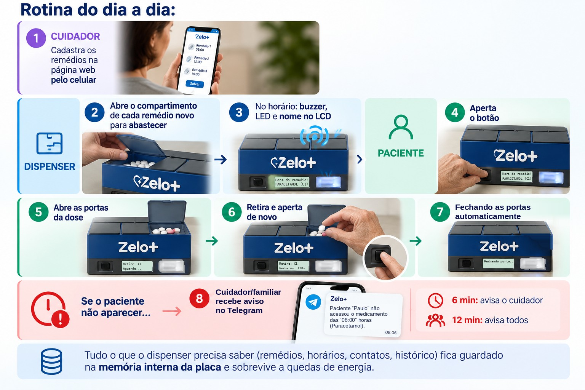
<figcaption><b>Rotina do dia a dia</b> — cuidador, dispenser e paciente, do cadastro dos remédios até os avisos pelo Telegram.</figcaption>
</figure>

## A2. Materiais e ligações

| Componente | Quantidade | Função |
|---|---|---|
| ESP32 DevKit (30 pinos) | 1 | Controla o dispenser. Tem Wi-Fi integrado. |
| Servo motor SG90 | 3 | Move a tampa do compartimento. Um servo para cada compartimento. |
| Visor TFT 2,25" colorido (ST7789P3, 76 × 284 pontos, ligação SPI) | 1 | Mostra o relógio, o nome do remédio e os avisos. A cor muda de acordo com a situação. |
| Buzzer **ativo** | 1 | Emite som quando recebe energia. |
| LED + resistor de 220–330 Ω | 1 | Luz de alerta. Pisca ao mesmo tempo que o buzzer. |
| Botão (push-button) | 1 | O paciente aperta o botão para abrir e fechar. |
| Fonte externa de 5 V (≥ 2 A) | 1 | Alimenta os servos. |
| Relógio DS3231 + bateria LIR2032 *(próxima etapa)* | 1 | Guarda a hora sem internet ([Passo 19](#passo-19--relógio-ds3231-próxima-etapa)). |
| Protoboard e jumpers | — | Fazem as ligações. |

<figure markdown="1">
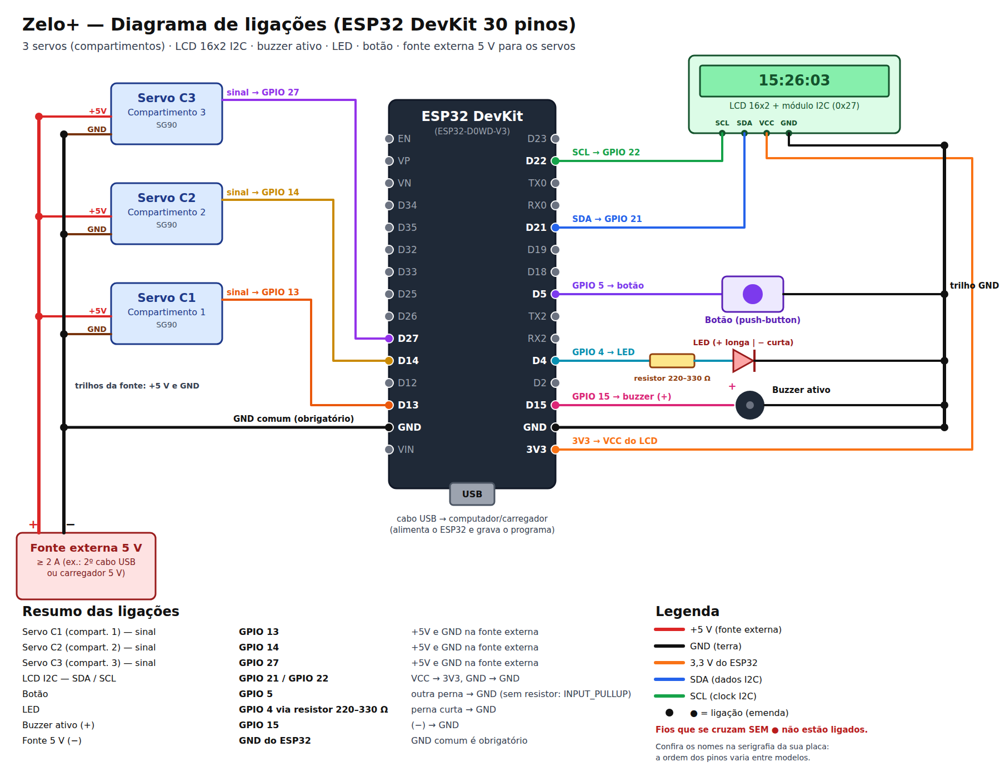
<figcaption><b>Diagrama de ligações da montagem de bancada.</b> A versão vetorial pode ser ampliada sem perda de qualidade: <code>docs/ligacoes.svg</code>.</figcaption>
</figure>

| Ligação | Pino da placa | Detalhe |
|---|---|---|
| Servo do compartimento 1 (sinal) | GPIO 13 | +5 V e GND na **fonte externa**. |
| Servo do compartimento 2 (sinal) | GPIO 14 | +5 V e GND na **fonte externa**. |
| Servo do compartimento 3 (sinal) | GPIO 27 | +5 V e GND na **fonte externa**. |
| Visor — SCL / SDA | GPIO 18 / GPIO 23 | Relógio e dados do SPI. |
| Visor — RST / DC | GPIO 17 (TX2) / GPIO 16 (RX2) | Reinício do visor / dado ou comando. |
| Visor — CS / BL | GPIO 26 / GPIO 25 | Seleção do visor / luz de fundo. |
| Visor — VCC / GND | 3V3 / GND | **Não ligue no 5 V.** |
| Relógio DS3231 — SDA / SCL *(próxima etapa)* | GPIO 21 / GPIO 22 | Único componente no I2C. VCC → 3V3, GND → GND (desenho na [E3](#e3-a-solução-fonte-5-v3-a--módulo-ups--bateria-18650)). |
| Botão | GPIO 5 | A outra perna vai ao GND. Não use resistor. |
| Luz de alerta (LED) | GPIO 4 | Ligue pelo resistor. A perna curta vai ao GND. |
| Buzzer (+) | GPIO 15 | O (−) vai ao GND. |
| Fonte externa (−) | GND da placa | **O GND comum é obrigatório.** |

**Por que os servos usam uma fonte separada?** O servo consome uma corrente alta quando
começa a girar. Se o servo estiver no 3V3 da placa, a tensão cai e a placa reinicia. Por
isso, os servos usam uma fonte de 5 V própria. Ligue o **GND da fonte ao GND da placa**.
Sem este GND comum, o servo não reconhece o sinal do pino.

**Ligação do visor.** O módulo do visor tem 8 pinos: GND, VCC, SCL, SDA, RST, DC, CS e BL.

- Os pinos **SCL e SDA do visor são do SPI**, não do I2C. Ligue estes pinos nos GPIO 18 e 23.
- Na placa, os GPIO 17 e 16 têm as marcas **TX2** e **RX2**.
- O pino BL acende a luz de fundo. A placa controla o brilho por este pino.
- O GPIO 19 é reservado para o SPI. Não ligue outro componente no GPIO 19.

> **CUIDADO:** Ligue o VCC do visor no **3V3**. O visor funciona com 3,3 V. A tensão de 5 V
> pode danificar o visor.

**Por que o GPIO 12 não está em uso?** O GPIO 12 é um pino de configuração da
inicialização. Se um componente estiver ligado neste pino, a placa pode não iniciar.

## A3. Ambiente de desenvolvimento

- **VSCode** com a extensão **PlatformIO**.
- Placa `esp32dev`, framework **Arduino** (linguagem C++).

O arquivo `platformio.ini` informa ao PlatformIO a placa e as bibliotecas:

```ini
[env:esp32dev]
platform = espressif32
board = esp32dev
framework = arduino
upload_port = COM3
monitor_speed = 115200
board_build.partitions = huge_app.csv
lib_deps = 
    marcoschwartz/LiquidCrystal_I2C^1.1.4
    madhephaestus/ESP32Servo^3.0.5
    bblanchon/ArduinoJson^7.0.4
    adafruit/RTClib^2.1.4
```

- `upload_port`: a porta USB da placa no Windows. O número muda de um computador para outro.
- `monitor_speed`: a velocidade do **Serial Monitor**. A placa escreve mensagens no Serial Monitor.
- `huge_app.csv`: aumenta o espaço para o programa. A parte de internet segura (HTTPS) aumenta o tamanho do firmware.
- `lib_deps`: as bibliotecas do visor, dos servos, de leitura de JSON (para o Telegram) e do relógio DS3231 (`RTClib`).

**Para gravar o programa na placa:**

1. Na barra azul do rodapé do VSCode, clique em ✓ (Build).
2. Clique em → (Upload).
3. Clique em 🔌 (Serial Monitor).

## A4. Cinco conceitos antes de começar

1. **`setup()` e `loop()`** — todo programa Arduino tem estas duas funções. O `setup()`
   executa **uma vez** quando a placa liga. O `loop()` executa **continuamente**, milhares
   de vezes por segundo.

2. **`millis()` em vez de `delay()`** — `delay(1000)` para a placa por 1 s. Durante este
   tempo, a placa não lê o botão e não responde à página. Por isso, o Zelo+ usa
   `millis()` na maioria dos casos. A função `millis()` dá o tempo, em milissegundos, desde
   que a placa ligou. O programa compara estes tempos:
   ```cpp
   if (millis() - ultimaAtualizacao < 1000) return;
   ```
   Se o tempo desde a última atualização for menor que 1 s, a função termina. A placa
   tenta de novo na volta seguinte do `loop()`. A placa não para.

3. **Máquina de estados** — o dispenser está sempre em **um** estado: aguardando,
   tocando, tampa aberta ou abastecendo. Cada estado tem ações diferentes. Quando um
   evento ocorre, o dispenser **muda de estado**. Assim, o comportamento é previsível.

4. **Máscara de bits** — para indicar "compartimentos 1 e 3", o código usa um número.
   Cada **bit** do número representa um compartimento:
   ```text
   compartimento:   3 2 1
   bits:            1 0 1   = 5  →  compartimentos 1 e 3
   ```
   Assim, uma única variável (`uint8_t`) guarda qualquer combinação de compartimentos.

5. **Memória permanente (Preferences/NVS)** — uma variável comum perde o valor quando a
   energia cai. A biblioteca `Preferences` grava os dados na **memória flash** da placa.
   A memória flash não perde os dados quando a placa desliga.

## A5. A página do Zelo+ (tela completa)

O cuidador abre a página do dispenser no celular. Para isso, ele digita no navegador o
IP que o visor mostra (exemplo: `192.168.15.152`). O próprio firmware gerou as imagens
abaixo, com a função `handleRoot()` do Passo 7 e um cadastro de exemplo completo.

| ① Falta configurar o Telegram | ② Tudo configurado | ③ Blocos abertos |
|:---:|:---:|:---:|
| 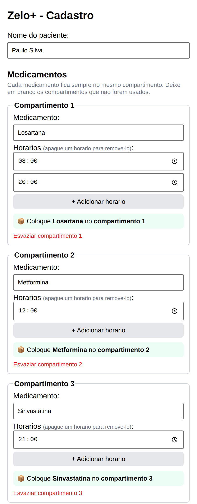 | 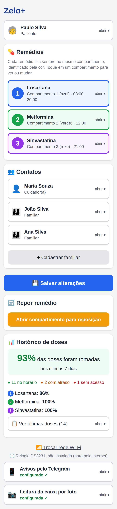 | 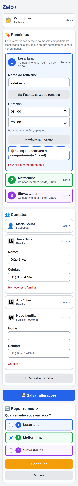 |

- **①** A familiar Ana não tem ID do Telegram. Por isso, um **aviso amarelo aparece no
  topo**. O bloco do Telegram, no fim da página, fica **aberto** e mostra quem falta.
- **②** Com tudo configurado, a página fica curta. O bloco do Telegram mostra somente
  "configurado ✓" no rodapé.
- **③** A imagem mostra os blocos abertos:
  - o compartimento 1 em edição: nome, botão da foto da caixa, horários e a dica "coloque no compartimento 1 (azul)";
  - o familiar João;
  - o formulário de um **familiar novo**;
  - a **reposição**, com a escolha do remédio pela cor.

<figure markdown="1">
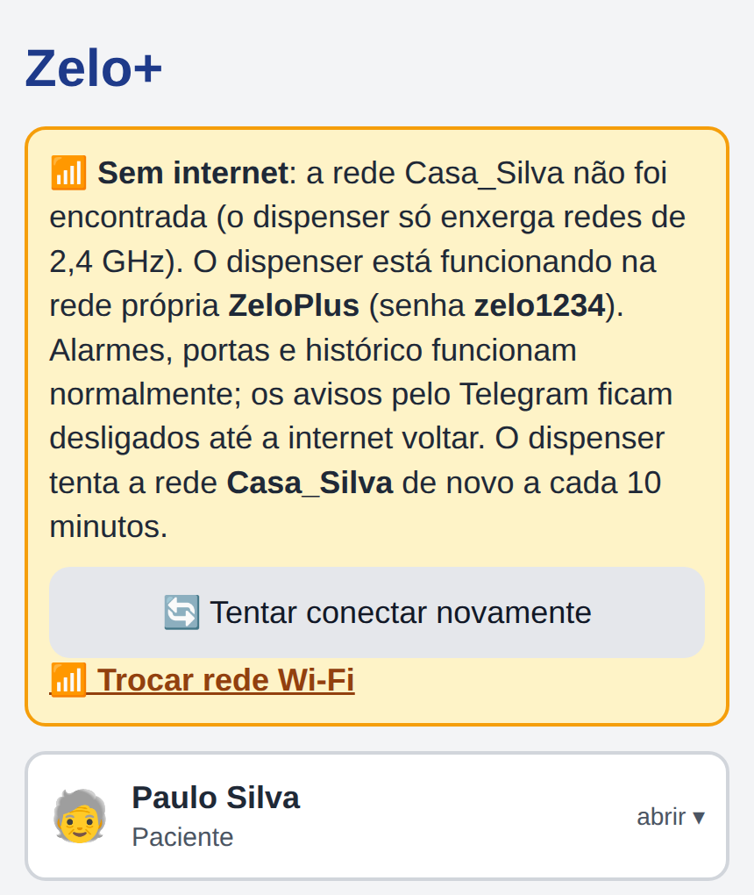
<figcaption><b>④ Sem internet</b> — página aberta pela rede própria ZeloPlus (parte superior).</figcaption>
</figure>

- **④** Se a rede salva não conectar quando o dispenser liga, o dispenser abre a rede
  própria `ZeloPlus` (Passo 4). O **aviso de sem internet** aparece no topo da página.
  O aviso contém estes itens:
  - o motivo (neste exemplo, a rede da casa não foi encontrada);
  - o nome e a senha da rede própria;
  - o botão **"Tentar conectar novamente"**;
  - o link **"Trocar rede Wi-Fi"**.

  O restante da página é igual à imagem ②. Os alarmes, as tampas dos compartimentos e o
  histórico funcionam normalmente. Somente os avisos pelo Telegram esperam a internet.

O visual da página segue três regras. As regras ajudam cuidadores e familiares com pouca
experiência em tecnologia:

- **Letras e botões grandes**, com bom contraste.
- **Uma cor para cada compartimento**: 1 **azul**, 2 **verde**, 3 **roxo**. A cor aparece
  no cartão do remédio, na dica de abastecimento, na reposição e no histórico.
- **Pouca informação na tela.** Remédios, paciente, cuidador e familiares aparecem
  **fechados**: a página mostra somente a faixa com o nome. Um toque abre os detalhes.

**Conteúdo de cada bloco:**

| Bloco | Fechado, mostra | Aberto, mostra | Passo |
|---|---|---|---|
| **Aviso de sem internet** (somente na rede própria) | Motivo, nome e senha da rede, "Tentar conectar novamente", "Trocar rede Wi-Fi". | — | 4 |
| **Aviso amarelo** (somente se faltar um item) | As pessoas que ainda não recebem avisos e "Configurar agora". | — | 7 |
| **Paciente** | Nome do paciente. | Campo para alterar o nome. | 7 |
| **Remédios 1, 2 e 3** | Número, cor, remédio e horários. | Nome, "Foto da caixa do remédio", horários (até 6), dica do compartimento, "Esvaziar". | 7, 14, 20 |
| **Cuidador(a)** | Nome. | Nome e celular. | 7, 8 |
| **Familiares** | Nome de cada familiar. | Nome, celular, "Remover". No fim: "+ Cadastrar familiar". | 7 |
| **Salvar alterações** | Botão azul grande. | — | 8 |
| **Repor remédio** | Botão laranja. | Escolha do remédio pela cor e confirmação. | 14 |
| **Histórico de doses** | % de adesão, contagem e adesão de cada remédio. | "Ver últimas doses": tabela, planilha, apagar. | 16 |
| **Trocar rede Wi-Fi** | Link. A página pede confirmação. | — | 4 |
| **Relógio DS3231** (rodapé) | "conectado" ou "não instalado". | — | 19 |
| **Avisos pelo Telegram** | "configurado ✓" ou "falta configurar". | Token, "Buscar IDs", ID de cada pessoa, teste. | 15 |
| **Leitura da caixa por foto** | "configurada ✓" ou "falta a chave da IA". | Chave da API do Gemini, nome do modelo e instruções para obter a chave. | 20 |

---

# Parte B — Desenho técnico do gabinete

O gabinete do Zelo+ mede **210 × 130 × 100 mm** (comprimento × profundidade × altura).
O gabinete tem estas três áreas:

- três compartimentos iguais, na frente;
- uma área técnica para os servos, na parte de trás;
- uma faixa de eletrônica na base, com o visor, o botão e a luz de alerta.

A Parte [C](#parte-c--o-código-passo-a-passo) explica o programa. A Parte
[E](#parte-e--uso-autônomo-sem-o-laptop) explica a energia autônoma e o relógio.

## B1. Desenho técnico dimensional

<figure markdown="1">
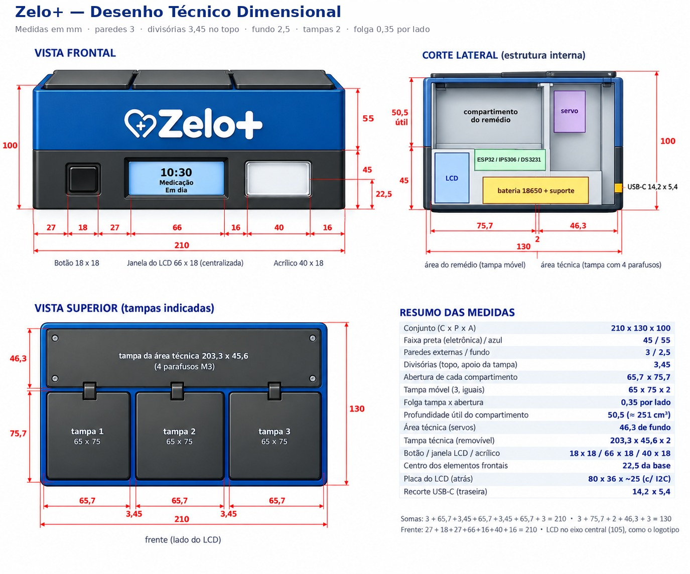
<figcaption><b>Desenho técnico dimensional do gabinete</b> — vista frontal, corte lateral, vista superior e resumo das medidas (em mm; vistas sem escala).</figcaption>
</figure>

O arquivo vetorial [`docs/gabinete.svg`](docs/gabinete.svg) ([PNG](docs/gabinete.png))
contém as vistas em escala.

**Dimensões principais: 210 (C) × 130 (P) × 100 (A) mm.**

| Direção | Composição (mm) | Soma |
|---|---|---|
| Largura (vista superior) | 3 + **65,7** + 3,45 + **65,7** + 3,45 + **65,7** + 3 | **210** ✓ |
| Profundidade | 3 + **75,7** (compartimento) + 2 + **46,3** (área técnica) + 3 | **130** ✓ |
| Altura | 2,5 (fundo) + 42,5 (eletrônica) + 2,5 (piso) + **50,5** (compartimento) + 2 (tampa) | **100** ✓ |
| Frente | 27 + **18** (botão) + 31,5 + **57** (janela do visor) + 20,5 + **40** (acrílico) + 16 | **210** ✓ |

| Elemento | Medida (mm) |
|---|---|
| Faixa preta (eletrônica) / faixa azul (compartimentos) | 45 / 55 |
| Abertura de cada compartimento | 65,7 × 75,7 |
| Tampa do compartimento (3, iguais) | 65 × 93,6 × 2 (folga de 0,35 em cada lado da largura) |
| Eixo das dobradiças das tampas | 94,5 da frente e 1 abaixo do topo (13,8 atrás da divisória) |
| Divisórias entre compartimentos | 2 no corpo, **3,45 no topo** (apoio das tampas) |
| Profundidade útil do compartimento | 50,5 (≈ 251 cm³ cada) |
| Tampa técnica (**abre sem ferramenta**: 4 ímãs e trava de moeda) | 203,3 × 29,2 × 2 |
| Botão / janela do visor / acrílico | 18 × 18 / 57 × 17 / 40 × 18. Centros a **22,5** da base. |
| Centros horizontais (botão / visor / acrílico) | 36 / **105** / 174 |
| Placa do visor (atrás do painel) | 73 × 21 × ~20 (com os conectores dos fios) |
| Área visível do visor | 55,2 × 14,8 (2,25" de diagonal, 284 × 76 pontos) |
| Recorte do USB-C (parede lateral direita) | 14,2 × 5,4. Centro a 55 da frente e a 15 da base. |
| Furos de som do buzzer (parede lateral esquerda) | 9 × Ø 2,4 (3 × 3, passo 4). Centro a 100 da frente e a 20 da base. |
| Fundo removível | 203,4 × 123,4 × 2,5. Fixação com 4 parafusos M3. |

## B2. Imagens do produto

<figure markdown="1">
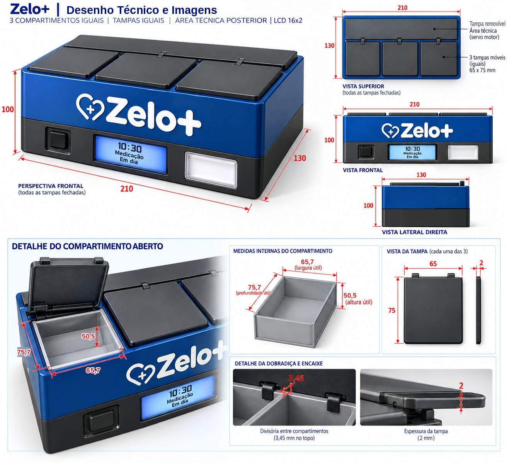
<figcaption><b>Imagens do produto</b> — perspectiva, vistas e detalhes do compartimento aberto, da dobradiça e do encaixe (medidas em mm; vistas sem escala).</figcaption>
</figure>

## B3. Critérios de projeto

- **Altura de 100 mm:**
  - A proporção é **210 : 130 : 100** (≈ 2,1 : 1,3 : 1). A altura é aproximadamente 48 % da largura. O gabinete fica estável na mesa.
  - A faixa preta de 45 mm contém a placa do visor (21 mm). A margem é de 12 mm acima e 12 mm abaixo.
  - Cada compartimento tem **50,5 mm de profundidade útil** (aproximadamente 251 cm³). Este volume é aproximadamente 8 vezes o volume de comprimidos de um mês (60 unidades ≈ 30 cm³). Os dedos alcançam o fundo do compartimento.
  - Opção: um fundo inclinado de 10–15° para a frente aproxima os comprimidos da mão.
- **Frente simétrica:**
  - A janela do visor está no **eixo central (105 mm)**, alinhada com o logotipo. A janela mede 57 × 17 mm. A área visível mede 55,2 × 14,8 mm. A folga de aproximadamente 1 mm em cada lado evita que o painel cubra a borda da imagem.
  - O centro do botão está em 36 mm. O centro do acrílico está em 174 mm. Os dois estão **à mesma distância do centro (69 mm)**. Assim, os três elementos ficam equilibrados.
- **Folga das tampas:** a tampa do compartimento tem 65 mm de largura. Para uma folga de 0,35 mm em cada lado, a abertura mede 65,7 mm. Por isso, as divisórias têm 3,45 mm no topo, onde as tampas se apoiam.
- **Dobradiça atrás da divisória:** o eixo da dobradiça está 13,8 mm atrás da divisória do compartimento. Assim, a alavanca do acionamento não toca a divisória quando a tampa abre a 90° (B5). Por isso, a tampa mede 93,6 mm: ela cobre o compartimento, a divisória e a faixa da dobradiça.
- **Manutenção:**
  - A tampa técnica abre **sem ferramenta** (ímãs e trava de moeda). Ela dá acesso aos servos e aos pinos das tampas.
  - O **fundo removível** (4 parafusos M3) dá acesso à protoboard, ao módulo UPS e à bateria.
  - O fundo removível também dá acesso ao USB da placa, para atualizar o programa (E10).
- **Energia e som:** o conector USB-C de painel está na **parede lateral direita**, perto do módulo UPS. Os furos de som do buzzer estão na **parede lateral esquerda**.
- **Emergência:** sem energia, cada tampa do compartimento se solta do servo pelo pino com argola. O acesso ao pino é pela tampa técnica (B5).

## B4. Onde fica cada componente

| Componente | Local no gabinete |
|---|---|
| Visor TFT 2,25" | Faixa preta, atrás da janela central (placa de 73 × 21, aproximadamente 20 de profundidade com os conectores). |
| Botão e LED (atrás do acrílico) | Faixa preta, nos lados do visor. |
| Placa na protoboard de 400 pontos | Berço da protoboard no fundo removível, sob os compartimentos (B6). |
| Relógio DS3231 | Berço próprio no fundo, sob a área técnica. |
| Módulo UPS LX-2BUPS com as baterias 18650 (90 × 42 × 33) | Berço próprio no fundo, perto da lateral direita. Furos de ventilação embaixo. |
| 3 servos SG90 | Área técnica. O eixo é paralelo ao eixo da dobradiça, a 98,5 mm da frente e a 73 mm da base (B5). |
| Conector USB-C de painel | Parede lateral direita, 15 mm acima da base, sobre uma prateleira interna. |
| Buzzer | Alojamento na parede lateral esquerda, atrás dos furos de som. |
| Capacitor de 1000 µF | Berço próprio no fundo, sob a área técnica. |
| Pinos com argola (3) | Na ligação entre o braço de cada servo e a alavanca da tampa do compartimento (B5). |
| Ímãs e trava de moeda | Cantos e borda da tampa técnica (B5). |

## B5. Abertura de emergência sem energia

**Objetivo:** abrir um compartimento **sem energia**: sem rede elétrica e com a bateria
descarregada. O procedimento não força o servo. Parado, o servo SG90 segura a tampa
pelas engrenagens de plástico.

> **CUIDADO:** Não abra a tampa do compartimento com força enquanto o pino com argola
> estiver no lugar. A força quebra as engrenagens do servo.

<figure markdown="1">
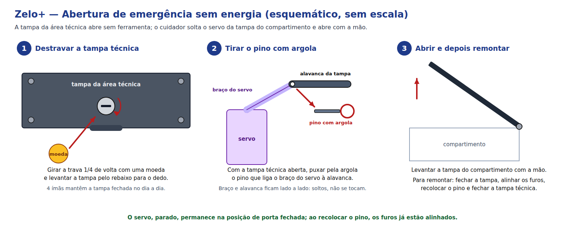
<figcaption><b>Abertura de emergência sem energia</b> — destrave a tampa técnica com uma moeda, remova o pino com argola que liga o servo à tampa do compartimento e abra a tampa com a mão (esquemático, sem escala).</figcaption>
</figure>

**Solução:** a tampa técnica abre **sem ferramenta**. Um **pino com argola** liga cada
servo à tampa do seu compartimento. O cuidador remove o pino com os dedos.

| Elemento | Descrição |
|---|---|
| **Ímãs de fixação** | 4 pares de ímãs de neodímio de 6 × 2 mm. Os ímãs estão colados em rebaixos nos cantos da tampa técnica e nos apoios do gabinete. Eles mantêm a tampa fechada sem parafusos. |
| **Trava de moeda** | Trava de 1/4 de volta com fenda. Gire a trava com uma moeda. A trava impede a abertura da tampa por acidente. |
| **Rebaixo para o dedo** | Rebaixo na borda da tampa técnica. Use o rebaixo para levantar a tampa depois de destravar. |
| **Pino com argola (3)** | Liga o braço de cada servo à alavanca da tampa do compartimento. O braço e a alavanca ficam **lado a lado**, em planos diferentes. Sem o pino, um não bloqueia o movimento do outro. |

**Peças do acionamento (impressão 3D):** um **pino desliza num rasgo** da alavanca da
tampa. Este pino liga o braço do servo à tampa do compartimento. As medidas são para o
gabinete impresso:

- o curso do servo é curto;
- com a tampa aberta, a alavanca passa a 1,5 mm da divisória;
- o braço não toca a tampa técnica.

<figure markdown="1">
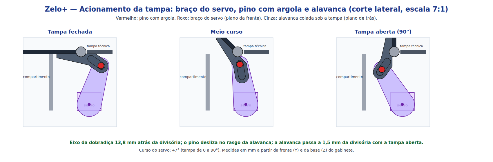
<figcaption><b>Acionamento da tampa</b> — braço do servo, pino com argola e alavanca nas posições fechada, meio curso e aberta (corte lateral, escala 7:1).</figcaption>
</figure>

<figure markdown="1">
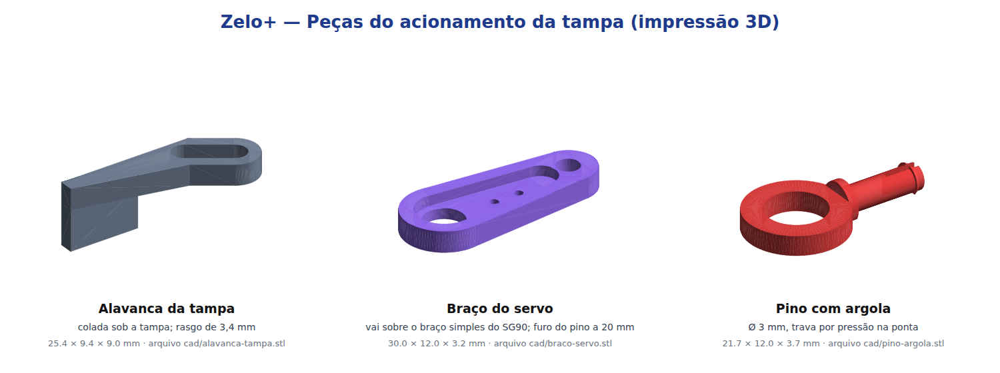
<figcaption><b>Peças do acionamento</b> — alavanca da tampa, braço do servo e pino com argola. Arquivos em <code>cad/</code>: STL para impressão e <code>zelo_acionamento.scad</code>, editável no OpenSCAD.</figcaption>
</figure>

| Posição | Medida (mm, a partir da frente e da base do gabinete) |
|---|---|
| Eixo da dobradiça da tampa | Y 94,5 · Z 99 (13,8 atrás da divisória) |
| Eixo do servo SG90 (paralelo ao eixo da dobradiça) | Y 98,5 · Z 73 |
| Furo do pino no braço do servo | A 20 do eixo do servo |
| Rasgo da alavanca | De 6,0 a 12,3 do eixo da dobradiça, a 35° abaixo da horizontal com a tampa fechada |
| Curso do servo | 47° para a tampa ir de 0° a 90° |

| Peça | Impressão | Montagem |
|---|---|---|
| **Alavanca da tampa** | PETG, 100 % de preenchimento, camada de 0,16 mm. Imprima com a face de colagem na mesa. | Cole a alavanca sob a tampa com cianoacrilato, de Y 82,5 a Y 92,7. A face de colagem termina 1,8 mm à frente do eixo da dobradiça. Coloque a alavanca perto de um lado da tampa, alinhada com o braço do servo. |
| **Braço do servo** | PETG, 100 % de preenchimento, camada de 0,16 mm. Imprima com o rebaixo para cima. | Encaixe o braço simples original do SG90 no rebaixo. Fixe com 2 parafusos M2 × 6 (ou cola) e com o parafuso central do servo. |
| **Pino com argola** | PETG, 100 % de preenchimento, camada de 0,12 mm. Imprima deitado, como no arquivo. | Coloque o pino pelo lado da alavanca. Passe o pino pelo rasgo e pelo furo do braço. A ponta trava por pressão. |

- **Ajuste do programa:** no gabinete impresso, o curso do servo é de 47°. Em
  `src/main.cpp`, altere `ANGULO_ABERTO` para `ANGULO_FECHADO` + 47. Se o servo estiver
  montado do outro lado, use `ANGULO_FECHADO` − 47. Encaixe o braço no eixo do servo com
  a tampa fechada e com o servo na posição `ANGULO_FECHADO`.
- **Folgas:** o rasgo e o furo do braço têm 3,4 mm para o pino de 3,0 mm. Se os furos
  ficarem apertados na impressão, aumente `FURO` no arquivo `.scad` em 0,1 mm.

**Procedimento:**

1. Gire a trava 1/4 de volta com uma moeda.
2. Levante a tampa técnica pelo rebaixo.
3. Puxe pela argola o pino do compartimento necessário.
4. Levante a tampa do compartimento com a mão.

**Para montar de novo:**

1. Feche a tampa do compartimento.
2. Alinhe o furo da alavanca com o furo do braço do servo. O servo parado fica na posição de tampa fechada.
3. Coloque o pino.
4. Feche a tampa técnica.
5. Gire a trava de volta com a moeda.

**Critérios de projeto:**

- A trava de moeda mantém o controle das doses. O paciente não abre a área técnica por
  acidente. O cuidador faz o procedimento.
- O sistema não usa energia e não depende do programa. Ele não tem peças de precisão.
- Se a energia voltar com um pino fora do lugar, o servo gira sem a tampa. Isto não causa
  dano. Coloque o pino de novo.
- A tampa técnica sem parafusos também facilita a manutenção e a troca da bateria.

## B6. Modelo 3D do gabinete e impressão

O modelo 3D do gabinete contém os suportes de todos os componentes do protótipo (com
protoboard). O programa [`cad/gabinete.py`](cad/gabinete.py) gera o modelo. O programa
também verifica se uma peça ou um componente toca outro. A verificação é feita com a
tampa fechada e durante a abertura de 0° a 90°
([`cad/conferir_movimento.py`](cad/conferir_movimento.py)). As duas verificações não
encontraram colisões.

<figure markdown="1">
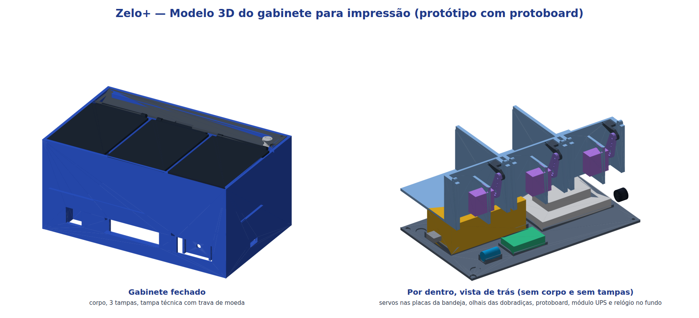
<figcaption><b>Modelo 3D do gabinete</b> — à esquerda, fechado. À direita, vista de trás sem o corpo e sem as tampas, com os servos, a bandeja, o fundo e os componentes.</figcaption>
</figure>

**Peças para imprimir** (arquivos em `cad/gabinete/` e `cad/`):

| Peça | Qtd | Tamanho (mm) | Impressão | Conteúdo |
|---|---|---|---|---|
| **Corpo** (`corpo.stl`) | 1 | 210 × 130 × 100 | PLA, 20 % de preenchimento, 3 paredes. Imprima em pé. Use suporte somente sob os ressaltos internos e as colunas do fundo. | Paredes. Janelas do visor, do botão e do acrílico. Berço do botão. Suporte do LED. Trilhos do visor. Alojamento e furos de som do buzzer (lateral esquerda). Recorte e prateleira do USB-C (lateral direita). Apoios da bandeja, das tampas e da tampa técnica. Rebaixos dos ímãs. Colunas dos parafusos do fundo. |
| **Bandeja** (`bandeja.stl`) | 1 | 203,4 × 104,7 × 56,5 | PLA, 20 %. Imprima com o piso na mesa, sem suporte. | Piso e divisórias dos compartimentos. Divisória da área técnica. 3 placas dos servos (janela para o corpo do SG90 e 2 furos para M2). Olhais das dobradiças. |
| **Fundo** (`fundo.stl`) | 1 | 203,4 × 123,4 × 8,5 | PLA, 20 %. Imprima deitado. | Berços da protoboard (83 × 55), do módulo UPS (90 × 42) e do relógio (38 × 22). Berço do capacitor. Ventilação sob o UPS. Rebaixos dos pés. Furos dos 4 parafusos. |
| **Tampa do compartimento** (`tampa-compartimento.stl`) | 3 | 65 × 93,7 × 5 | PLA, 100 %. Imprima com a face de cima na mesa. Use suporte somente nas articulações. | Placa da tampa, recortes dos olhais e 2 articulações. |
| **Tampa técnica** (`tampa-tecnica.stl`) | 1 | 203,3 × 29,2 × 2 | PLA, 100 %. Imprima deitada. | Rebaixos dos ímãs, furo da trava e rebaixo para o dedo. |
| **Trava de moeda** (`trava-botao.stl` e `trava-lingueta.stl`) | 1 + 1 | 10 × 10 × 8,2 e 6 × 14 × 1,8 | PETG, 100 %. | Botão com fenda para a moeda. Lingueta encaixada no eixo quadrado. |
| **Alavanca, braço do servo e pino com argola** | 3 de cada | Consulte a B5. | PETG, 100 %. | Acionamento das tampas (B5). |

**Ferragens e itens comprados:**

| Item | Qtd | Uso |
|---|---|---|
| Parafuso M3 × 8 autoatarraxante | 4 | Fundo. |
| Parafuso M2 × 6 autoatarraxante | 12 | Abas dos servos (6) e braço do servo (6). |
| Filamento de 1,75 mm (pedaços de 9 mm) | 6 | Pinos das dobradiças. Fixe com uma gota de cola. |
| Ímã de neodímio 6 × 2 mm | 8 | Tampa técnica (4) e apoios do corpo (4). |
| Pé de borracha adesivo de 10 mm | 4 | Fundo. |
| Protoboard de 400 pontos (83 × 55 mm) | 1 | Placa e ligações, no berço do fundo. |
| Placa de acrílico translúcido 42 × 20 × 2 mm | 1 | Janela do LED. Cole no rebaixo. |

**Ordem de montagem:**

1. **Corpo:**
   1. Cole o acrílico no rebaixo da janela.
   2. Coloque o visor nos trilhos, com os pinos do lado do botão.
   3. Com cola quente, cole o botão no berço, o LED no suporte, o buzzer no alojamento e o conector USB-C na prateleira.
2. **Fundo:**
   1. Cole a protoboard no berço com a fita dupla face da protoboard.
   2. Cole o módulo UPS e o relógio nos berços.
   3. Coloque o capacitor no berço.
   4. Faça as ligações (A2 e E3).
3. **Bandeja:**
   1. Coloque o corpo de cada servo na janela da sua placa.
   2. Fixe as abas com parafusos.
   3. Monte os braços e as alavancas (B5).
   4. Passe os fios dos servos para baixo.
   5. Coloque a bandeja pelo topo do corpo até o apoio a 45 mm da base.
4. **Tampas:**
   1. Cole as alavancas sob as tampas.
   2. Coloque as articulações entre os olhais.
   3. Coloque os pinos de filamento.
   4. Ligue o braço e a alavanca com o pino com argola.
5. **Fechamento:**
   1. Feche o fundo com os 4 parafusos.
   2. Cole os ímãs.
   3. Monte a trava de moeda na tampa técnica: o botão fica em cima e a lingueta fica embaixo.

O volume das peças do modelo é de aproximadamente 437 cm³. Este valor é próximo da
estimativa da G2 (443 cm³). A G2 usa a estimativa para calcular o custo do gabinete.

## B7. Fechamento manual da tampa (em avaliação)

**Objetivo:** a **abertura** continua **automática**. O paciente pode fechar a tampa de
três formas: **com a mão**, com o **botão** ou **automaticamente** depois de 3 minutos.
Com a tampa fechada, o servo continua a travar o compartimento.

**Princípio:** com sinal, o servo segura a tampa pelas engrenagens. Se o paciente empurra
a tampa contra o servo com sinal, as engrenagens de plástico do SG90 recebem uma força
muito alta. Sem sinal, o servo gira livremente. Um empurrão leve fecha a tampa.

| Forma de fechamento | Funcionamento proposto |
|---|---|
| **Com a mão** | Depois da abertura, o ESP32 desliga o sinal do servo (`detach`). O paciente fecha a tampa com a mão. O sensor da tampa detecta o fechamento. O ESP32 liga o servo de novo na posição fechada, sem movimento. O compartimento fica travado de novo. |
| **Com o botão** | Igual ao funcionamento atual: depois da trava de 7 s, um toque liga o servo e fecha a tampa devagar. |
| **Automático** | Igual ao funcionamento atual: a tampa fecha depois de 3 minutos. |

**Mudanças necessárias:**

| Item | Descrição | Custo estimado |
|---|---|---|
| **Sensor de tampa fechada (3)** | Reed switch com um ímã pequeno colado na tampa, ou microchave. Um sensor em cada compartimento, ligado a uma entrada livre do ESP32. O sensor informa ao programa a posição real da tampa. | R$ 1–3 cada |
| **Servo MG90S (3)** | Engrenagem de metal no lugar do SG90. Mais resistência ao fechamento com a mão. | + R$ 3–5 por servo |
| **Programa** | Desligar o sinal do servo depois da abertura. Ler os sensores. Ligar o servo de novo com a tampa fechada. Registrar no histórico o fechamento com a mão. | — |

**Outros benefícios do sensor:** confirmação do fechamento da tampa, aviso de tampa
aberta ou mal fechada e registro mais completo da dose.

**Versão de produção:** use um **acoplamento que patina** (embreagem de atrito ou
acoplamento magnético) entre o braço do servo e a alavanca da tampa. Este acoplamento
protege as engrenagens também quando uma pessoa força uma tampa fechada. Acima de um
limite de força, o acoplamento solta. No movimento seguinte do servo, o acoplamento
encaixa de novo. Esta opção exige um novo desenho do braço e da alavanca (B5 e arquivos
em `cad/`).

**Situação:** proposta registrada no backlog. O Product Owner decide a implantação (ver
[Próximos passos](#próximos-passos)).

---

# Parte C — O código, passo a passo

## Passo 1 — Bibliotecas e pinos

**Função:** este trecho carrega as bibliotecas e dá nomes aos pinos. Assim, o código usa
`BUTTON_PIN` em vez do número 5.

```cpp
#include <Arduino.h>
#include <WiFi.h>
#include <WiFiClientSecure.h>
#include <HTTPClient.h>
#include <ArduinoJson.h>
#include <WebServer.h>
#include <DNSServer.h>
#include <Preferences.h>
#include <time.h>
#include <Wire.h>
#include <LiquidCrystal_I2C.h>
#include <ESP32Servo.h>
#include <RTClib.h>
#include <esp_sntp.h>

#define BUZZER_PIN 15
#define LED_PIN 4
#define BUTTON_PIN 5
#define NUM_COMPARTIMENTOS 3
#define MAX_HORARIOS 6       // horarios por medicamento
#define MAX_FAMILIARES 5
#define MAX_HISTORICO 60
```

| Biblioteca | Função |
|---|---|
| `WiFi`, `WebServer`, `DNSServer` | Conectar à internet e enviar a página de cadastro. |
| `WiFiClientSecure`, `HTTPClient`, `ArduinoJson` | Comunicar com o Telegram (HTTPS + JSON). |
| `Preferences` | Memória permanente. |
| `time.h` | Relógio (hora certa pela internet). |
| `Wire`, `LiquidCrystal_I2C` | Visor pelo barramento I2C. |
| `ESP32Servo` | Controlar os servos. |
| `RTClib`, `esp_sntp.h` | Relógio DS3231 e aviso de "hora ajustada pela internet" ([Passo 19](#passo-19--relógio-ds3231-próxima-etapa)). |

Os pinos e os ângulos dos servos ficam em **vetores** (listas). Cada vetor tem um item
para cada compartimento:

```cpp
const int PINOS_SERVO[NUM_COMPARTIMENTOS] = {13, 14, 27};
// Angulos de cada porta (ajuste aqui se algum mecanismo precisar de outro valor).
const int ANGULO_FECHADO[NUM_COMPARTIMENTOS] = {0, 0, 0};
const int ANGULO_ABERTO[NUM_COMPARTIMENTOS] = {90, 90, 90};
```

> **NOTA:** `PINOS_SERVO[0]` é o compartimento **1**. Em programação, a contagem começa
> em zero. Esta regra vale para todo o código: o índice `c` é o compartimento `c + 1`.

Os **objetos** a seguir representam os componentes:

```cpp
LiquidCrystal_I2C lcd(0x27, 16, 2);
Servo servos[NUM_COMPARTIMENTOS];
WebServer server(80);
DNSServer dnsServer;
Preferences preferences;
Preferences prefsCadastro;
Preferences prefsHistorico;
```

- `lcd(0x27, 16, 2)`: visor no endereço I2C `0x27`, com 16 colunas e 2 linhas.
- `server(80)`: servidor web na porta 80. A porta 80 é a porta padrão dos navegadores.
- Três objetos `Preferences`: um para cada área da memória (Wi-Fi, cadastro e histórico).

## Passo 2 — Estruturas de dados

**Função:** este trecho define como o programa guarda um **contato** e um **medicamento**.

```cpp
struct Contato {
  String nome;
  String telefone;
  String chatId;
};

// Medicamento guardado num compartimento fixo (indice 0..2 = compartimento 1..3).
struct Medicamento {
  String nome;
  int totalHorarios = 0;
  int hora[MAX_HORARIOS];
  int minuto[MAX_HORARIOS];
  bool jaDisparado[MAX_HORARIOS];
};

String nomePaciente = "";
Medicamento medicamentos[NUM_COMPARTIMENTOS];
Contato cuidador;
Contato familiares[MAX_FAMILIARES];
```

- `struct` junta várias informações com um único nome, como uma ficha.
- `medicamentos[3]`: a **posição no vetor é o compartimento**. O remédio em
  `medicamentos[1]` está sempre no compartimento 2. Assim, cada remédio fica sempre no
  mesmo compartimento.
- `jaDisparado[]`: impede que o mesmo horário toque duas vezes no mesmo minuto.
- `chatId`: o número que identifica cada pessoa no Telegram (Passo 15).

Os **estados** da máquina de estados:

```cpp
enum Estado { AGUARDANDO, TOCANDO, PORTA_ABERTA_ESTADO, ABASTECENDO };
Estado estadoAtual = AGUARDANDO;
```

As variáveis da **dose atual** usam máscara de bits (conceito 4):

```cpp
uint8_t doseMascara = 0;
String horarioDose = "";
String nomesDose = "";
unsigned long alarmeIniciadoEm = 0;
int nivelAvisoEnviado = 0;   // 0 = nenhum, 1 = cuidador avisado, 2 = todos alertados
bool dosePendente = false;   // alarme terminou sem acesso; botao ainda abre os compartimentos
```

Duas funções pequenas trabalham com estas variáveis:

```cpp
bool temBit(uint8_t mascara, int i) {
  return (mascara >> i) & 1;
}

bool medicamentoAtivo(int c) {
  return medicamentos[c].nome != "" && medicamentos[c].totalHorarios > 0;
}
```

- `temBit(5, 0)` dá verdadeiro: o compartimento 1 está na máscara `101`.
- `medicamentoAtivo(c)`: um compartimento só está ativo se tiver nome **e** horário.

## Passo 3 — `setup()`: ligando tudo

**Função:** este trecho executa uma vez quando a placa liga. Ele faz estas ações:

1. configura os pinos;
2. fecha as tampas dos compartimentos;
3. liga o visor;
4. **lê a memória**;
5. tenta conectar no Wi-Fi.

```cpp
  pinMode(BUZZER_PIN, OUTPUT);
  pinMode(LED_PIN, OUTPUT);
  pinMode(BUTTON_PIN, INPUT_PULLUP);
  digitalWrite(BUZZER_PIN, LOW);
  digitalWrite(LED_PIN, LOW);

  for (int c = 0; c < NUM_COMPARTIMENTOS; c++) {
    servos[c].setTimerWidth(RESOLUCAO_SERVO);  // precisa vir antes do attach
    servos[c].attach(PINOS_SERVO[c], PULSO_0_GRAU, PULSO_180_GRAUS);
    servos[c].write(ANGULO_FECHADO[c]);
    delay(500);
  }
```

- `OUTPUT`: a placa **envia** energia pelo pino (buzzer e luz de alerta).
- `INPUT_PULLUP`: um resistor **interno** mantém o pino em 3,3 V. Quando o paciente aperta
  o botão, o botão liga o pino ao GND e a leitura fica `LOW`. Por isso, o botão não usa
  resistor externo. O botão apertado dá `digitalRead(BUTTON_PIN) == LOW`.
- O `for` liga cada servo no seu pino e fecha a tampa do compartimento. Ele faz isto **com
  um servo de cada vez**, com intervalo de 0,5 s. No primeiro sinal, o servo gira até a
  posição fechada e consome um pico de corrente. Três servos ao mesmo tempo, na mesma
  fonte de 5 V da placa, baixam a tensão e reiniciam a placa.

A seguir, o programa liga o visor e **procura o relógio DS3231**. Se o relógio não
estiver instalado, o programa registra esta informação e continua (consulte o
[Passo 19](#passo-19--relógio-ds3231-próxima-etapa)):

```cpp
  lcd.init();
  lcd.backlight();
  lcd.print("Iniciando...");

  iniciarRelogioRTC();
```

Depois, o programa lê a memória e escolhe o modo do Wi-Fi:

```cpp
  prefsCadastro.begin("cadastro", false);
  carregarCadastro();
  prefsHistorico.begin("historico", false);
  carregarHistorico();

  preferences.begin("wifi", false);
  String ssidSalvo = preferences.getString("ssid", "");
  String senhaSalva = preferences.getString("pass", "");
```

```cpp
  if (WiFi.status() == WL_CONNECTED) {
    iniciarModoNormal();
  } else if (ssidSalvo != "") {
    // Rede salva fora do ar, fora de alcance ou com senha recusada: o dispenser
    // abre a rede propria e continua funcionando (hora pelo DS3231 ou pelo celular).
    iniciarModoLocal(descreverFalhaWiFi(WiFi.status()));
  } else {
    iniciarModoConfig();
  }
```

| Situação | Resultado |
|---|---|
| Há uma rede salva e a conexão funciona. | **Modo normal** (Passo 5). |
| Há uma rede salva, mas a conexão falha. Causas: rede desligada, fora de alcance, somente em 5 GHz ou senha recusada. | **Rede própria automática.** O dispenser abre a rede `ZeloPlus` e funciona sem internet (Passo 4). |
| **Não há rede salva.** | **Modo de configuração** (Passo 4). |

## Passo 4 — Wi-Fi sem senha no código (captive portal)

**Função:** se a placa não tem uma rede Wi-Fi salva, ela **cria uma rede própria** com o
nome `ZeloPlus-Config`. Quando o celular conecta nesta rede, a página de configuração
abre automaticamente, como no Wi-Fi de um aeroporto.

```cpp
void iniciarModoConfig() {
  modoConfig = true;

  WiFi.disconnect();  // para de tentar a rede salva, senao a busca de redes falha
  WiFi.mode(WIFI_AP_STA);
  WiFi.softAPConfig(apIP, apIP, IPAddress(255, 255, 255, 0));
  WiFi.softAP("ZeloPlus-Config");

  dnsServer.start(DNS_PORT, "*", apIP);
```

- `WiFi.disconnect()`: para as tentativas de conexão à rede salva. Exemplo: a rede da casa
  quando o dispenser está em outro local. Sem esta linha, a busca de redes falha e a lista
  da página fica vazia.
- `softAP`: a placa funciona como um **ponto de acesso** (roteador).
- `dnsServer.start(..., "*", apIP)`: para **qualquer** endereço, a resposta é o IP da placa
  (`192.168.4.1`). Por isso, o celular abre a página automaticamente.

A página mostra as redes encontradas. A placa funciona somente em **2,4 GHz**. As redes de
5 GHz não aparecem. A página também tem um campo para digitar o nome da rede, para redes
ocultas. O cuidador escolhe a rede e digita a senha. A placa testa a conexão. Se a
conexão funcionar, a placa **grava** os dados e reinicia:

```cpp
  if (WiFi.status() == WL_CONNECTED) {
    preferences.putString("ssid", ssid);
    preferences.putString("pass", senha);
```

```cpp
    delay(3000);
    ESP.restart();
```


Quando a placa liga de novo, o `setup()` encontra a rede salva e entra no modo normal.

- O link "Trocar rede Wi-Fi" da página apaga a rede salva (`preferences.remove("ssid")`).
  A seguir, a placa reinicia no modo de configuração.
- Se o **botão estiver apertado quando a placa liga**, a placa entra no modo de
  configuração. Ela não tenta a rede salva.

**Uso sem internet (rede própria).** Alguns locais não têm internet. Exemplo: uma sala de
aula ou de apresentação. Para estes locais, a página de configuração tem o botão **"Usar
sem internet"**. Com este botão, o dispenser funciona na própria rede `ZeloPlus-Config`, no
endereço `http://192.168.4.1`. O dispenser ajusta o relógio com a hora do celular
conectado:

```cpp
void handleModoLocal() {
  uint32_t segundos = strtoul(server.arg("epoch").c_str(), nullptr, 10);
  if (segundos >= HORA_MINIMA_VALIDA) {
    struct timeval agora = { (time_t)segundos, 0 };
    settimeofday(&agora, nullptr);
    if (rtcPresente) rtc.adjust(DateTime(segundos));
  }
```

- `epoch`: a hora do celular, em segundos. O navegador escreve este valor (`Date.now()`)
  quando o cuidador toca no botão.
- `settimeofday`: ajusta o relógio interno da placa. Se o DS3231 estiver instalado, o
  programa ajusta o DS3231 também.

Neste modo, estas funções funcionam: a página, o cadastro, os alarmes, as tampas dos
compartimentos, o histórico e a reposição. O dispenser não envia avisos pelo
**Telegram**, porque o Telegram precisa de internet. Sem o DS3231, o dispenser perde a
hora quando desliga. Neste caso, use o mesmo botão para informar a hora de novo.

**Rede própria automática.** Se uma rede está salva, mas não conecta quando o dispenser
liga, o dispenser continua a funcionar. Ele abre a rede **`ZeloPlus`** com a senha
**`zelo1234`** e entra no modo normal. O programa registra o motivo da falha para o aviso
da página:

```cpp
String descreverFalhaWiFi(wl_status_t situacao) {
  if (situacao == WL_NO_SSID_AVAIL) {
    return "a rede " + redeSalva + " não foi encontrada (o dispenser só enxerga redes de 2,4 GHz)";
  }
  if (situacao == WL_CONNECT_FAILED) {
    return "a rede " + redeSalva + " recusou a conexão (confira a senha)";
  }
  return "não foi possível conectar à rede " + redeSalva;
}
```

```cpp
void iniciarModoLocal(const String& motivo) {
  modoLocal = true;
  nomeRedeLocal = NOME_REDE_LOCAL;
  motivoSemInternet = motivo;
  WiFi.setAutoReconnect(false); // novas tentativas so no horario certo (manterRedeLocal)
  WiFi.disconnect();
  WiFi.mode(WIFI_AP_STA);
  WiFi.softAPConfig(apIP, apIP, IPAddress(255, 255, 255, 0));
  WiFi.softAP(NOME_REDE_LOCAL, SENHA_REDE_LOCAL);
  dnsServer.start(DNS_PORT, "*", apIP);
  registrarPortalCativo();
  Serial.println("Sem internet: " + motivo);
  iniciarModoNormal();
}
```

- O visor mostra `Rede ZeloPlus` / `senha zelo1234`. A seguir, o visor mostra `Pagina:` /
  `192.168.4.1`. Quando o celular conecta na rede `ZeloPlus`, a página do dispenser abre
  automaticamente.
- Um **aviso** aparece no topo da página. O aviso mostra o motivo, o nome e a senha da
  rede, o botão **"Tentar conectar novamente"** e o link "Trocar rede Wi-Fi".
- Sem internet e sem DS3231, o dispenser não tem a hora. Neste caso, a página envia a hora
  do celular quando abre (rota `/acertar-hora`). A seguir, os alarmes funcionam.

**Novas tentativas.** Na rede própria, o dispenser tenta a rede salva **a cada 10
minutos**. O programa não para durante a tentativa:

```cpp
void manterRedeLocal() {
  static unsigned long ultimaTentativaLocal = millis();
  if (tentandoRede) {
    wl_status_t situacao = WiFi.status();
    if (situacao == WL_CONNECTED) {
      sairModoLocal();
      return;
    }
    if (millis() - tentativaIniciadaEm < DURACAO_TENTATIVA) return;
    tentandoRede = false;
    motivoSemInternet = descreverFalhaWiFi(situacao);
    WiFi.disconnect(); // so a conexao com a rede salva; a rede propria continua
    ultimaTentativaLocal = millis();
    Serial.println("Ainda sem internet: " + motivoSemInternet);
    return;
  }
  if (redeSalva == "") return;
  if (millis() - ultimaTentativaLocal < INTERVALO_NOVA_TENTATIVA) return;
  if (WiFi.softAPgetStationNum() > 0) return;
  iniciarTentativaRede();
}
```

- `softAPgetStationNum()`: o número de aparelhos conectados na rede `ZeloPlus`. A tentativa
  automática espera até que nenhum aparelho esteja conectado. A placa tem um único rádio.
  Durante a busca da rede salva, a conexão da página cai.
- O botão **"Tentar conectar novamente"** faz a mesma tentativa imediatamente. Antes, a
  página avisa que a conexão com a rede `ZeloPlus` pode cair.
- Quando a rede salva conecta (`sairModoLocal`), o dispenser desliga a rede `ZeloPlus`.
  O visor mostra o IP novo e o Telegram funciona de novo.

## Passo 5 — Modo normal: relógio pela internet e rotas da página

**Função:** este trecho ajusta o relógio pela internet, mostra o IP no visor e liga cada
endereço da página a uma função.

```cpp
const char* ntpServer = "pool.ntp.org";
const long gmtOffset_sec = -10800; // Brasília (GMT-3)
const int daylightOffset_sec = 0;
```

```cpp
  sntp_set_time_sync_notification_cb(aoSincronizarNTP);
  configTime(gmtOffset_sec, daylightOffset_sec, ntpServer);
```

- **NTP** é um serviço da internet que informa a hora exata. O valor `-10800` s é igual a
  3 h a menos que o horário mundial (UTC). Este é o horário de Brasília.
- A primeira linha pede ao NTP um **aviso** a cada ajuste da hora. O aviso chama a função
  `aoSincronizarNTP`. Com este aviso, o programa grava a hora no DS3231 (Passo 19).

A seguir, o visor mostra o **IP** da página. Na rede própria (Passo 4), o visor mostra o
nome e a senha da rede e o endereço `192.168.4.1`:

```cpp
  lcd.clear();
  if (modoLocal) {
    // Visor: nome e senha da rede propria, depois o endereco da pagina.
    escreverLinhaLCD(0, "Rede " + nomeRedeLocal);
    escreverLinhaLCD(1, nomeRedeLocal == NOME_REDE_LOCAL ? "senha " + String(SENHA_REDE_LOCAL) : "sem senha");
    delay(4000);
    escreverLinhaLCD(0, "Pagina:");
    escreverLinhaLCD(1, "192.168.4.1");
    Serial.println("Sem internet: rede " + nomeRedeLocal + ", acesse http://192.168.4.1");
  } else {
    lcd.print("IP do sistema:");
    lcd.setCursor(0, 1);
    lcd.print(WiFi.localIP());
    Serial.print("Acesse: http://");
    Serial.println(WiFi.localIP());
  }
```

As **rotas** ligam um endereço a uma função:

```cpp
  server.on("/", handleRoot);
  server.on("/salvar", HTTP_POST, handleSalvar);
  server.on("/abrir-manual", HTTP_POST, handleAbrirManual);
  server.on("/esvaziar", HTTP_POST, handleEsvaziar);
  server.on("/testar-mensagens", HTTP_POST, handleTestarMensagens);
  server.on("/telegram-ids", HTTP_POST, handleTelegramIds);
  server.on("/ler-caixa", HTTP_POST, handleLerCaixa, receberFoto);
  server.on("/historico.csv", handleHistoricoCSV);
  server.on("/limpar-historico", HTTP_POST, handleLimparHistorico);
  server.on("/trocar-wifi", handleTrocarWifi);
  server.on("/tentar-wifi", HTTP_POST, handleTentarWifi);
  server.on("/acertar-hora", HTTP_POST, handleAcertarHora);
  if (!servidorNoAr) {
    server.begin();
    servidorNoAr = true;
  }
```

| Endereço | Resultado |
|---|---|
| `/` | Mostra a página de cadastro (Passo 7). |
| `/salvar` | Recebe o formulário e grava os dados (Passo 8). |
| `/abrir-manual` | Abre um compartimento para a reposição (Passo 14). |
| `/esvaziar` | Esvazia um compartimento (Passo 14). |
| `/testar-mensagens`, `/telegram-ids` | Telegram (Passo 15). |
| `/ler-caixa` | Lê a caixa do remédio por foto (Passo 20). |
| `/tentar-wifi`, `/acertar-hora`, `/trocar-wifi` | Rede própria: nova tentativa, hora pelo celular e troca de rede (Passo 4). |
| `/historico.csv`, `/limpar-historico` | Histórico (Passo 16). |

## Passo 6 — Memória permanente (Preferences)

**Função:** este trecho grava o cadastro na memória flash e lê o cadastro da memória
flash. Assim, o cadastro não se perde quando a energia cai.

Cada compartimento tem chaves próprias: `m0_` (compartimento 1), `m1_` e `m2_`.

```cpp
void salvarMedicamento(int c) {
  const Medicamento& m = medicamentos[c];
  String p = prefixoMedicamento(c);
  uint8_t horas[MAX_HORARIOS];
  uint8_t minutos[MAX_HORARIOS];
  for (int i = 0; i < m.totalHorarios; i++) {
    horas[i] = (uint8_t)m.hora[i];
    minutos[i] = (uint8_t)m.minuto[i];
  }
  prefsCadastro.putString((p + "_nome").c_str(), m.nome);
  prefsCadastro.putUChar((p + "_tot").c_str(), (uint8_t)m.totalHorarios);
  if (m.totalHorarios > 0) {
    prefsCadastro.putBytes((p + "_hr").c_str(), horas, m.totalHorarios);
    prefsCadastro.putBytes((p + "_mn").c_str(), minutos, m.totalHorarios);
  }
}
```

- `putString` grava um texto.
- `putUChar` grava um número pequeno (0–255).
- `putBytes` grava uma lista de bytes (as horas e os minutos).
- Exemplo: "Losartana às 08:00 e 20:00" no compartimento 1 fica gravado assim:
  `m0_nome = "Losartana"`, `m0_tot = 2`, `m0_hr = [8, 20]`, `m0_mn = [0, 0]`.

Na leitura, o programa **verifica** os dados antes de usar:

```cpp
  int validos = 0;
  for (int i = 0; i < total; i++) {
    if (horas[i] > 23 || minutos[i] > 59) continue;
    horaDestino[validos] = horas[i];
    minutoDestino[validos] = minutos[i];
    disparadoDestino[validos] = false;
    validos++;
  }
  return validos;
```

**Cadastro em formato de um compartimento:** se a memória tem um cadastro gravado em
chaves de um compartimento único, o programa copia este remédio para o compartimento 1.
Depois, o programa apaga as chaves desse formato:

```cpp
void migrarCadastroAntigo() {
  if (prefsCadastro.isKey("m0_nome") || !prefsCadastro.isKey("remedio")) return;

  Medicamento& m = medicamentos[0];
  m.nome = prefsCadastro.getString("remedio", "");
  m.nome.trim();
  m.totalHorarios = lerHorarios("total", "horas", "minutos", m.hora, m.minuto, m.jaDisparado);
  salvarMedicamento(0);
```

- `trim()` remove os espaços do início e do fim do nome. Exemplo: "Losartana " (com
  espaço). Sem esta limpeza, o programa considera que o remédio mudou e abre o
  compartimento sem necessidade.

## Passo 7 — A página de cadastro

**Função:** quando o navegador abre o IP da placa, a função `handleRoot()` **gera o HTML**
(o texto da página) e envia o HTML. O visual é para pessoas com pouca experiência em
tecnologia:

- **letras e botões grandes**;
- **uma cor para cada compartimento**;
- **blocos fechados**: a página mostra somente o essencial. Um toque abre os detalhes.

**1) Uma cor para cada compartimento.** Três listas guardam a cor de cada compartimento.
Cole etiquetas das mesmas cores no dispenser.

```cpp
const char* COR_COMPARTIMENTO[NUM_COMPARTIMENTOS] = {"#2563eb", "#16a34a", "#9333ea"};
const char* FUNDO_COMPARTIMENTO[NUM_COMPARTIMENTOS] = {"#eff6ff", "#f0fdf4", "#faf5ff"};
const char* NOME_COR[NUM_COMPARTIMENTOS] = {"azul", "verde", "roxo"};
```

**2) Blocos fechados.** O elemento HTML `<details>` mostra somente o `<summary>` (a faixa).
O resto fica oculto até um toque. Cada compartimento é um `<details>` com a sua cor. A
faixa mostra o número, o remédio e os horários:

```cpp
  String html = "<details class='comp' style='--cor:" + String(COR_COMPARTIMENTO[c]) + ";--fundo:" +
                String(FUNDO_COMPARTIMENTO[c]) + "'" + (aberto ? " open" : "") + "><summary>";
  html += marcaCompartimento(c, 44);
  if (medicamentoAtivo(c)) {
    html += "<span><b>" + escaparHTML(m.nome) + "</b><small>Compartimento " + n + " (" + NOME_COR[c] + ") &middot; " +
            horariosTexto(m) + "</small></span>";
  } else {
    html += "<span><b>Compartimento " + n + "</b><small>" + NOME_COR[c] + " &middot; vazio &middot; toque para cadastrar</small></span>";
  }
```

- `--cor` e `--fundo` são **variáveis de CSS**. O estilo `.comp` usa estas variáveis para
  pintar a borda e o fundo de cada cartão com a cor do compartimento.
- `marcaCompartimento()` desenha o círculo colorido com o número. Este círculo também
  aparece na reposição e no histórico.
- O compartimento 1 fica aberto somente no primeiro uso, quando não há remédio cadastrado.

No cartão, a **dica do compartimento** repete o número e a cor:

```cpp
  html += "&#128230; Coloque <b>" + escaparHTML(m.nome) + "</b> no <b>compartimento " + n + " (" + NOME_COR[c] + ")</b></div>";
```

Resultado: 📦 Coloque **Losartana** no **compartimento 1 (azul)**. A dica muda **durante a
digitação do cuidador**. Um código JavaScript curto faz esta atualização no navegador:

```cpp
  html += "function atualizarDica(c) {";
  html += "  var nome = document.getElementById('m' + c + '_nome').value.trim();";
  html += "  var dica = document.getElementById('dica-' + c);";
  html += "  dica.style.display = nome ? 'block' : 'none';";
```

**3) Pessoas em blocos fechados.** O cuidador e os familiares aparecem **somente com o
nome**. Um toque mostra o nome e o celular. O formulário de um familiar novo fica no botão
"+ Cadastrar familiar":

```cpp
  html += "<summary><span style='font-size:28px'>" + String(icone) + "</span><span><b>";
  html += contato.nome != "" ? escaparHTML(contato.nome) : String(familiar ? "Novo familiar" : "Cuidador(a)");
```

Cada familiar ocupa uma posição (`fam0` a `fam4`). No cadastro, o navegador procura a
primeira posição livre. Na remoção, o navegador apaga o ID do Telegram desta posição.
Assim, um familiar novo não recebe o ID de um familiar removido:

```cpp
  html += "    if (usados.indexOf('fam' + i) >= 0) continue;";
  html += "    var modelo = document.getElementById('modelo-familiar').innerHTML.split('famX').join('fam' + i);";
```

**4) Bloco do Telegram somente quando necessário.** O bloco do Telegram fica no **fim da
página**, depois de "Trocar rede Wi-Fi". O bloco fica **aberto**, com um aviso no topo,
enquanto faltar o token ou o ID de uma pessoa. Exemplo: depois do cadastro de um familiar
novo. Quando a configuração está completa, o bloco mostra somente "configurado ✓":

```cpp
bool telegramPendente(String* faltando) {
  bool pendente = (tokenTelegram == "");
  if (cuidador.nome != "" && cuidador.chatId == "") {
    pendente = true;
```

Os campos deste bloco estão **fora** do formulário principal. O atributo `form='cadastro'`
faz o navegador enviar estes campos com o formulário:

```cpp
  html += "</label><input type='text' inputmode='numeric' form='cadastro' name='" + prefixo + "_chat' id='chat-" + prefixo +
```

**5) Troca de remédio num compartimento em uso.** Antes do envio, o navegador compara o
nome anterior (em `data-original`) com o nome novo. Se os nomes forem diferentes, o
navegador pede confirmação:

```cpp
  html += "    if (antigo && novo && antigo.toLowerCase() != novo.toLowerCase()) {";
  html += "      if (!confirm('O compartimento ' + (c + 1) + ' (' + CORES[c] + ') tinha ' + antigo + '. Retire todos os comprimidos antigos antes de colocar ' + novo + '. Confirmar troca?')) return false;";
```

> **NOTA (segurança):** a função `escaparHTML()` trata todo texto digitado antes de
> colocar o texto na página. Assim, um nome como `D'Ávila` ou `<b>` não danifica o HTML.
>
> ```cpp
> case '<': saida += "&lt;"; break;
> ```

## Passo 8 — Salvando o cadastro

**Função:** a função `handleSalvar()` recebe o formulário, **verifica** todos os dados e
somente depois grava.

**Envio do cadastro:** o botão **Salvar** não usa o envio padrão de formulário. A página
envia os dados com `fetch`, como nos outros comandos (repor, esvaziar, Telegram). A página
do dispenser usa `http://` na rede local. Com o envio padrão por `http://`, o navegador
mostra o aviso "as informações que você está prestes a enviar não estão protegidas". Com
`fetch`, o navegador não mostra este aviso:

```cpp
  html += "function enviarCadastro(e) {";
  html += "  e.preventDefault();";
  html += "  if (!confirmarTrocas()) return false;";
  html += "  var form = document.getElementById('cadastro');";
  html += "  fetch('/salvar', {method:'POST', body: new URLSearchParams(new FormData(form))})";
  html += "    .then(function(r){ if (r.ok) { location.href = '/'; return; } return r.text().then(function(t){ alert(t); }); })";
  html += "    .catch(function(){ alert('Não foi possível salvar. Verifique a conexão com o dispenser.'); });";
  html += "  return false;";
  html += "}";
```

- `e.preventDefault()` cancela o envio padrão.
- `FormData` junta os campos do formulário. Isto inclui os campos externos ligados por
  `form='cadastro'`.
- Se o dispenser aceitar os dados, a página abre de novo com os dados novos.
- Se o dispenser recusar os dados, a página mostra a mensagem num alerta. Exemplo: cuidador
  sem celular. O texto digitado não se perde.

A função `handleSalvar()` faz estas verificações e ações:

1. **O cuidador é obrigatório:**

```cpp
  if (novoCuidador.nome == "" || novoCuidador.telefone == "") {
    server.send(400, "text/plain; charset=utf-8", "O cuidador é obrigatório: preencha nome e celular.");
    return;
  }
```

2. **Cada remédio precisa de um horário. É necessário pelo menos um remédio:**

```cpp
    if (novos[c].nome != "" && novos[c].totalHorarios == 0) {
```

```cpp
  if (ativos == 0) {
    server.send(400, "text/plain; charset=utf-8", "Cadastre ao menos um medicamento. Volte e corrija.");
    return;
  }
```

3. **Identifica os compartimentos com remédio novo.** A função coloca estes compartimentos
   numa **fila de abastecimento** (máscara de bits):

```cpp
    if (novo != "" && novo != antigo) filaAbastecimento |= (uint8_t)(1 << c);
    if (novo == "") filaAbastecimento &= (uint8_t)~(1 << c);
    medicamentos[c] = novos[c];
```

- `|= (1 << c)` **liga** o bit do compartimento `c`: este compartimento precisa abrir.
- `&= ~(1 << c)` **desliga** o bit.
- Se somente os horários mudaram, `novo == antigo`. A fila não muda e a tampa do
  compartimento não abre.

4. **Grava todos os dados** e envia o navegador de volta para a página:

```cpp
  salvarCadastro();

  server.sendHeader("Location", "/");
  server.send(303);
```

Esta função **não** abre as tampas dos compartimentos. O `loop()` abre as tampas
(Passo 10), um compartimento de cada vez.

## Passo 9 — Movendo as portas (servos)

**Função:** este trecho abre e fecha as tampas dos compartimentos **devagar e sem
impacto**. Cada movimento dura 7 s. A tampa começa devagar, acelera no meio e diminui a
velocidade no fim.

```cpp
// Duracao de cada movimento de porta (abrir ou fechar), em milissegundos.
// Aumente para deixar as portas mais lentas.
const unsigned long TEMPO_MOVIMENTO_PORTA = 7000;

// Largura do pulso do servo em 0 e em 180 graus (padrao do SG90/MG90).
const int PULSO_0_GRAU = 544;
const int PULSO_180_GRAUS = 2400;

// Resolucao do sinal dos servos: 16 bits dao cerca de 0,3 us por unidade (o
// padrao, 10 bits, so tem cerca de 20 us, quase 2 graus).
const int RESOLUCAO_SERVO = 16;

int pulsoDoAngulo(float angulo) {
  return PULSO_0_GRAU + (int)round(angulo * (PULSO_180_GRAUS - PULSO_0_GRAU) / 180.0);
}

// Move a porta devagar e sem trancos: comeca lento, acelera no meio e freia no
// fim (curva de cosseno). Um passo a cada 20 ms, o intervalo do sinal do servo.
// Exige os servos em 5 V: com tensao baixa eles nao tem forca para os avancos
// pequenos, param zumbindo e depois saltam.
void moverPorta(int c, int de, int para) {
  const int passos = TEMPO_MOVIMENTO_PORTA / 20;
  for (int i = 1; i <= passos; i++) {
    float t = (float)i / passos;          // 0 -> 1 ao longo do movimento
    float suave = (1 - cos(t * PI)) / 2;  // 0 -> 1, lento no inicio e no fim
    servos[c].writeMicroseconds(pulsoDoAngulo(de + (para - de) * suave));
    delay(20);
  }
}
```

- **Passos:** 7000 ms ÷ 20 ms = **350 posições** por movimento. O servo recebe uma posição
  nova a cada pulso do sinal (a cada 20 ms).
- **Curva suave:** `(1 − cos(t·π)) / 2` vai de 0 a 1. O início e o fim são lentos. Na
  abertura, a tampa está a aproximadamente 4° depois de 1 s, a 45° na metade do tempo e a
  90° aos 7 s. A velocidade máxima, no meio do curso, é de aproximadamente 20° por
  segundo. Assim, a tampa não bate no fim do curso. O pico de corrente na partida do
  motor também diminui.
- **Resolução do sinal:** o servo identifica a posição pela largura do pulso. A largura vai
  de 544 µs (0°) a 2400 µs (180°), aproximadamente 10 µs por grau. Com 16 bits
  (`RESOLUCAO_SERVO`), a placa ajusta o pulso em frações de microssegundo. Assim, os
  avanços pequenos do início e do fim chegam ao servo sem arredondamento. Defina a
  resolução antes do `attach` (Passo 3).
- **Alimentação:** o movimento lento precisa dos servos em **5 V**, com corrente
  suficiente (A2). Com tensão baixa, o motor não tem força para os avanços pequenos. O
  motor para com ruído e depois gira de uma vez.
- **Ajuste:** para mudar a velocidade, altere `TEMPO_MOVIMENTO_PORTA`. Exemplos: 9000 para
  9 s (mais lento); 5000 para 5 s (mais rápido).

```cpp
void abrirCompartimento(int c) {
  moverPorta(c, ANGULO_FECHADO[c], ANGULO_ABERTO[c]);
}

void fecharCompartimento(int c) {
  moverPorta(c, ANGULO_ABERTO[c], ANGULO_FECHADO[c]);
}
```

Um único toque pode abrir **vários** compartimentos. Dois servos ao mesmo tempo
sobrecarregam a fonte. Por isso, os compartimentos abrem **um depois do outro**:

```cpp
// Abre os compartimentos marcados, um logo apos o outro.
void abrirCompartimentos(uint8_t mascara) {
  for (int c = 0; c < NUM_COMPARTIMENTOS; c++) {
    if (temBit(mascara, c)) abrirCompartimento(c);
  }
}
```

A função `abrirCompartimento()` termina somente quando a tampa chega a 90°. Por isso, o
servo seguinte começa somente quando o servo anterior para.

## Passo 10 — O coração: `loop()` e a máquina de estados

**Função:** em cada volta, o `loop()` responde à página web, verifica os horários e
executa as ações do **estado atual**.

```cpp
void loop() {
  if (modoConfig) {
    dnsServer.processNextRequest();
  }
  server.handleClient();

  if (modoConfig) {
    return;
  }

  manterWiFi();
  gravarHoraNoRTC();
  verificarHorarios();

  switch (estadoAtual) {
```

- `manterWiFi()` e `gravarHoraNoRTC()` controlam o relógio e a reconexão (Passo 19). Se
  não há ação necessária, as duas funções terminam imediatamente. Assim, elas não
  atrasam o alarme.

**Mapa dos estados:**

```text
                    horário chegou
   ┌────────────┐ ───────────────────► ┌──────────┐
   │ AGUARDANDO │                      │ TOCANDO  │
   │  (relógio) │ ◄─── 12 min sem ──── │ (alarme) │
   └────────────┘      acesso          └──────────┘
     │   ▲   ▲    (dose pendente)            │ botão
     │   │   │                               ▼
     │   │   │  fechou              ┌──────────────────────┐
     │   │   └───────────────────── │ PORTA_ABERTA_ESTADO  │
     │   │                          │ (paciente retirando) │
     │   │ fechou                   └──────────────────────┘
     ▼   │
   ┌─────────────┐
   │ ABASTECENDO │  remédio novo, reposição ou esvaziar
   └─────────────┘
```

No estado **AGUARDANDO**, a ordem de prioridade é:

```cpp
    case AGUARDANDO:
      if (dosePendente && digitalRead(BUTTON_PIN) == LOW) {
        abrirParaPaciente();
        break;
      }
      // Prioridade: alarme em espera; depois abastecimento de compartimento novo.
      if (mascaraEmEspera != 0) {
        uint8_t mascara = mascaraEmEspera;
        mascaraEmEspera = 0;
        iniciarAlarme(mascara, horarioEmEspera);
        break;
      }
      if (filaAbastecimento != 0) {
```

1. Se há uma dose pendente e o botão está apertado, o dispenser abre para o paciente.
2. Se há um horário em espera, o alarme começa.
3. Se há um compartimento novo na fila, o dispenser abre o compartimento para o
   abastecimento.
4. Se não há nenhuma destas condições, o visor mostra o relógio.

## Passo 11 — Conferindo os horários

**Função:** uma vez por segundo, este trecho compara a hora atual com os horários de cada
remédio. Ele funciona **em todos os estados**.

```cpp
  for (int c = 0; c < NUM_COMPARTIMENTOS; c++) {
    if (!medicamentoAtivo(c)) continue;
    Medicamento& m = medicamentos[c];
    for (int i = 0; i < m.totalHorarios; i++) {
      if (m.jaDisparado[i] || timeinfo.tm_hour != m.hora[i] || timeinfo.tm_min != m.minuto[i]) continue;
      m.jaDisparado[i] = true;
      if (mascaraEmEspera == 0) horarioEmEspera = formatarHorario(m.hora[i], m.minuto[i]);
      mascaraEmEspera |= (uint8_t)(1 << c);
    }
  }
```

- No horário, o compartimento entra na **máscara de espera**.
- **Dois remédios no mesmo horário** entram na mesma máscara. O resultado é **um único
  alarme**.
- Se o dispenser estiver ocupado, o horário **fica em espera**. Exemplo: o cuidador repõe
  outro compartimento. O alarme toca quando o dispenser volta a `AGUARDANDO`.
- `jaDisparado` impede um segundo alarme no mesmo minuto. O programa limpa este valor
  quando o minuto muda:

```cpp
        if (timeinfo.tm_min != medicamentos[c].minuto[i]) medicamentos[c].jaDisparado[i] = false;
```

## Passo 12 — O alarme tocando

**Função:** a função `iniciarAlarme()` prepara a dose e muda o estado para `TOCANDO`.

```cpp
void iniciarAlarme(uint8_t mascara, const String& horario) {
  estadoAtual = TOCANDO;
  doseMascara = mascara;
  horarioDose = horario;
  nomesDose = juntarNomes(mascara);
  alarmeIniciadoEm = millis();
  nivelAvisoEnviado = 0;
  dosePendente = false;
```

- `nomesDose` guarda o texto "Losartana e Metformina" para as mensagens.
- `alarmeIniciadoEm` registra o início do alarme. O programa conta todos os tempos a
  partir deste valor.

**Ciclo do som:** 1 min com som e 1 min em silêncio:

```cpp
      bool minutoDeSom = ((decorrido / CICLO_ALARME) % 2) == 0;
      if (!minutoDeSom) {
        if (ledBuzzerLigado) desligarLedBuzzer();
        break;
      }

      if (millis() - ultimoToggleAlarme >= 150) {
        ultimoToggleAlarme = millis();
        ledBuzzerLigado = !ledBuzzerLigado;
        digitalWrite(LED_PIN, ledBuzzerLigado ? HIGH : LOW);
        digitalWrite(BUZZER_PIN, ledBuzzerLigado ? HIGH : LOW);
      }
```

- `decorrido / CICLO_ALARME` é o número de minutos desde o início (0, 1, 2, …).
- `% 2 == 0`: nos minutos pares (0, 2, 4…), o buzzer toca. Nos minutos ímpares, o buzzer
  fica em silêncio.
- No minuto com som, a luz de alerta e o buzzer **mudam de estado a cada 150 ms**.

**Avisos:** aos 6 min, o dispenser avisa o cuidador. Aos 12 min, o dispenser avisa todos
os contatos:

```cpp
      if (decorrido >= TEMPO_PRIMEIRO_AVISO && nivelAvisoEnviado == 0) {
        desligarLedBuzzer();
        escreverLinhaLCD(1, "Avisando cuidad.");
        avisarPrimeiroAtraso();
        nivelAvisoEnviado = 1;
      }
```

```cpp
      if (decorrido >= TEMPO_ALERTA_FINAL) {
        desligarLedBuzzer();
        lcd.clear();
        escreverLinhaLCD(0, "Avisando familia");
        atualizarDose(DOSE_SEM_ACESSO, decorrido);
        alertarSemAcesso();
        nivelAvisoEnviado = 2;
```

```cpp
        dosePendente = true;
        lcd.clear();
        estadoAtual = AGUARDANDO;
```

- `nivelAvisoEnviado` impede o envio do mesmo aviso duas vezes.
- Depois de 12 min, o alarme **para**. A dose fica **pendente**. Se o paciente chegar
  depois, o botão ainda abre os compartimentos.

## Passo 13 — O paciente aperta o botão

**Função:** este trecho registra o acesso, desliga o alarme e **abre todos os
compartimentos da dose**, um depois do outro.

```cpp
void abrirParaPaciente() {
  unsigned long decorrido = millis() - alarmeIniciadoEm;
  atualizarDose(decorrido < TEMPO_PRIMEIRO_AVISO ? DOSE_NO_HORARIO : DOSE_ATRASADA, decorrido);
  esquecerRegistrosDose();

  desligarLedBuzzer();
  dosePendente = false;

  lcd.clear();
  escreverLinhaLCD(0, "Retire: " + listaCompartimentos(doseMascara));
  escreverLinhaLCD(1, "Abrindo...");
  abrirCompartimentos(doseMascara);

  mascaraAberta = doseMascara;
  estadoAtual = PORTA_ABERTA_ESTADO;
  portaAbertaEm = millis();

  avisarAcessoAposAviso();
}
```

- Antes do primeiro aviso, o registro é "tomada no horário". Depois do primeiro aviso, o
  registro é "tomada com atraso" (Passo 16).
- Se o dispenser já avisou alguém, a função `avisarAcessoAposAviso()` envia a mensagem
  "Paulo acessou o dispenser às 15:27". Assim, a família recebe a confirmação.

**Fechamento com trava de 7 s:** logo depois da abertura, o dedo do paciente pode estar no
botão. Para evitar um fechamento por acidente, o botão funciona somente depois de 7 s. Se
ninguém apertar o botão, a tampa fecha automaticamente depois de 3 min:

```cpp
      bool travaLiberada = (millis() - portaAbertaEm >= TRAVA_BOTAO);
      bool fechar = (travaLiberada && digitalRead(BUTTON_PIN) == LOW) ||
                    (millis() - portaAbertaEm >= TEMPO_PORTA_ABERTA);

      if (fechar) {
        lcd.clear();
        escreverLinhaLCD(0, "Fechando porta..");
        fecharCompartimentos(mascaraAberta);
        mascaraAberta = 0;
```

## Passo 14 — Abastecer, repor e esvaziar

Os três casos usam a **mesma função**. A função abre **um** compartimento para o cuidador.
Somente o texto do visor muda:

```cpp
void iniciarAbastecimento(int c, ModoAbastecimento modo) {
  compartimentoAbastecendo = c;
  modoAbastecimento = modo;

  String titulo;
  if (modo == ABAST_REPOR) titulo = "Repor compart." + String(c + 1);
  else if (modo == ABAST_ESVAZIAR) titulo = "Esvaziar comp." + String(c + 1);
  else titulo = "Abast. compart." + String(c + 1);
```

**a) Abastecimento guiado (remédio novo):** o `loop()` usa o **primeiro** compartimento da
fila. Ele remove este compartimento da fila e abre o compartimento. Quando a tampa fecha,
o estado volta para `AGUARDANDO`. A seguir, o compartimento seguinte da fila abre. Os
compartimentos abrem um de cada vez:

```cpp
        for (int c = 0; c < NUM_COMPARTIMENTOS; c++) {
          if (!temBit(filaAbastecimento, c)) continue;
          filaAbastecimento &= (uint8_t)~(1 << c);
          iniciarAbastecimento(c, ABAST_NOVO);
          break;
        }
```

**b) Reposição:** na página, o cuidador **escolhe o remédio**. As opções mostram somente os
remédios cadastrados. O cuidador confirma, e o navegador envia o número do compartimento:

```cpp
  html += "  var corpo = new URLSearchParams(); corpo.append('c', reporEscolhido);";
  html += "  fetch('/abrir-manual', {method:'POST', body: corpo}).then(function(r){";
```

A placa verifica se o pedido é válido e se o dispenser está livre. A seguir, a placa abre
**somente este** compartimento:

```cpp
void handleAbrirManual() {
  int c = server.arg("c").toInt();
  if (!server.hasArg("c") || c < 0 || c >= NUM_COMPARTIMENTOS || !medicamentoAtivo(c)) {
    server.send(400, "text/plain", "Compartimento invalido");
    return;
  }
  if (!dispenserLivre()) {
    server.send(409, "text/plain", "Sistema ocupado no momento");
    return;
  }

  server.send(200, "text/plain", "OK");
  iniciarAbastecimento(c, ABAST_REPOR);
}
```

**c) Esvaziar:** a placa apaga o remédio do compartimento. Se o cuidador pedir, a placa
abre o compartimento para a remoção dos comprimidos restantes:

```cpp
  medicamentos[c].nome = "";
  medicamentos[c].totalHorarios = 0;
  filaAbastecimento &= (uint8_t)~(1 << c);
  salvarMedicamento(c);
```

## Passo 15 — Avisos pelo Telegram

**Por que o Telegram?** O Telegram é gratuito e oficial. Ele recebe as mensagens por um
pedido simples pela internet. O WhatsApp gratuito pelo CallMeBot não tinha vagas. O
WhatsApp oficial é pago e precisa da aprovação da Meta.

**Configuração (uma vez):**

1. O cuidador cria um bot no **BotFather**.
2. O cuidador cola o **token** do bot na página do dispenser.
3. Cada pessoa abre o bot no Telegram e toca em **Iniciar**.
4. O cuidador toca em "Buscar IDs". A página mostra o `chatId` de cada pessoa.

**Para enviar uma mensagem**, a placa faz um pedido HTTPS para a API do Telegram:

```cpp
  String url = "https://api.telegram.org/bot" + token + "/" + metodo;
  if (!http.begin(cliente, url)) {
    Serial.println("Telegram: falha ao iniciar conexao");
    return -1;
  }
  http.addHeader("Content-Type", "application/x-www-form-urlencoded");
  int codigo = http.POST(corpo);
```

```cpp
  String corpo = "chat_id=" + codificarURL(contato.chatId) + "&text=" + codificarURL(texto);
  int codigo = chamarTelegram(tokenTelegram, "sendMessage", corpo);
```

- `codificarURL()` troca os espaços e os acentos por códigos (`%20`, `%C3%A3`…). O
  endereço e o corpo do pedido aceitam somente alguns caracteres.
- A resposta `200` significa que o Telegram recebeu a mensagem.

**As mensagens:**

```cpp
void avisarPrimeiroAtraso() {
  enviarParaCuidador("Zelo+: Paciente “" + nomePaciente + "” não acessou o medicamento das “" +
                     horarioDose + "” horas (" + nomesDose + ").");
}

void alertarSemAcesso() {
  enviarParaTodos("Zelo+: Paciente “" + nomePaciente + "” não foi até o dispenser no horário das “" +
                  horarioDose + "” (" + nomesDose + ").");
}
```

| Momento | Quem recebe | Exemplo |
|---|---|---|
| 6 min sem acesso | Cuidador | Zelo+: Paciente "Paulo" não acessou o medicamento das "15:26" horas (Losartana). |
| 12 min sem acesso | Cuidador e familiares | Zelo+: Paciente "Paulo" não foi até o dispenser no horário das "15:26" (Losartana e Metformina). |
| Acesso depois de um aviso | As pessoas avisadas | Zelo+: Paulo acessou o dispenser às 15:27 (dose de Losartana das 15:26). |

**Buscar IDs:** a função `handleTelegramIds()` pede ao Telegram as últimas mensagens do
bot (`getUpdates`). A biblioteca **ArduinoJson** lê somente os dados necessários: o id e o
nome de cada pessoa.

```cpp
  JsonDocument filtro;
  JsonObject chatFiltro = filtro["result"][0]["message"]["chat"].to<JsonObject>();
  chatFiltro["id"] = true;
  chatFiltro["first_name"] = true;
  chatFiltro["last_name"] = true;
  chatFiltro["username"] = true;
```

O **filtro** diminui o uso de memória. A resposta do Telegram tem muitos campos. A placa
guarda somente estes quatro campos.

## Passo 16 — Histórico de doses

**Função:** cada remédio de cada alarme gera um **registro** com a data, a situação e o
atraso. O programa usa os registros para calcular a **adesão ao tratamento**.

```cpp
struct RegistroDose {
  uint32_t inicio;         // horario do disparo (segundos desde 1970)
  uint16_t atrasoSeg;      // tempo ate o acesso
  uint8_t status;
  uint8_t compartimento;   // 0..2
  char remedio[20];        // nome do medicamento no momento da dose
};
```

```cpp
enum StatusDose : uint8_t {
  DOSE_PENDENTE = 0,    // alarme tocando (ou placa reiniciou antes de concluir)
  DOSE_NO_HORARIO = 1,  // acesso antes do primeiro aviso ao cuidador
  DOSE_ATRASADA = 2,    // acesso depois do primeiro aviso (inclusive apos o alerta final)
  DOSE_SEM_ACESSO = 3   // alerta final enviado e ninguem acessou
};
```

**Buffer circular:** a placa guarda as **60 doses mais recentes**. Quando o buffer está
cheio, a dose nova substitui a dose mais antiga:

```cpp
int registrarInicioDose(int compartimento) {
  int idx = proximoHistorico;
```

```cpp
  proximoHistorico = (proximoHistorico + 1) % MAX_HISTORICO;
  if (totalHistorico < MAX_HISTORICO) totalHistorico++;
  return idx;
}
```

- `% MAX_HISTORICO` (resto da divisão) faz a posição voltar a 0 depois da posição 59.

Para ler da dose mais recente para a mais antiga:

```cpp
int indiceHistorico(int k) {
  return (proximoHistorico - 1 - k + 2 * MAX_HISTORICO) % MAX_HISTORICO;
}
```

**Adesão** = doses tomadas (no horário e com atraso) ÷ doses concluídas, nos últimos
7 dias. Para arredondar, a função soma a metade do divisor:

```cpp
int percentual(int parte, int total) {
  return (parte * 100 + total / 2) / total;
}
```

A página mostra estes itens:

- a adesão geral e a adesão de cada remédio;
- a tabela das 20 doses mais recentes;
- o link **Baixar histórico (CSV)**. O arquivo abre no Excel e no Google Planilhas.

```cpp
  String csv = "data;horario;medicamento;compartimento;situacao;atraso_minutos\r\n";
```

## Passo 17 — Escrevendo no LCD

**Problema:** o LCD 16x2 não tem letras com acento. A palavra "Medicação" aparece com
símbolos errados. **Solução:** duas técnicas juntas.

**1. Caracteres especiais desenhados no LCD.** O LCD aceita até 8 caracteres próprios. Cada
caractere é um desenho numa grade de 5 × 8 pontos. Cada linha da grade é um número binário
(`1` = ponto aceso). O Zelo+ cria o **ç** e o **ã** para a tela de espera:

```cpp
const uint8_t LCD_CEDILHA = 1;
const uint8_t LCD_A_TIL = 2;
uint8_t DESENHO_CEDILHA[8] = {0b00000, 0b01110, 0b10000, 0b10000, 0b10001, 0b01110, 0b00100, 0b01100};
uint8_t DESENHO_A_TIL[8] = {0b01101, 0b10010, 0b01110, 0b00001, 0b01111, 0b10001, 0b01111, 0b00000};
```

```text
  ç (código 1)      ã (código 2)
  · · · · ·         · █ █ · █
  · █ █ █ ·         █ · · █ ·
  █ · · · ·         · █ █ █ ·
  █ · · · ·         · · · · █
  █ · · · █         · █ █ █ █
  · █ █ █ ·         █ · · · █
  · · █ · ·         · █ █ █ █
  · █ █ · ·         · · · · ·
```

O programa grava os desenhos no LCD uma vez, quando a placa liga (no `setup()`):

```cpp
  lcd.createChar(LCD_CEDILHA, DESENHO_CEDILHA);
  lcd.createChar(LCD_A_TIL, DESENHO_A_TIL);
```

**2. As outras letras com acento ficam sem acento.** No formato UTF-8, uma letra com acento
usa **2 bytes**. O primeiro byte é sempre `0xC3`. O segundo byte identifica a letra. O "ç"
(`0xA7`) e o "ã" (`0xA3`) usam os caracteres especiais. As outras letras ficam sem acento:

```cpp
    if (c == 0xC3 && i + 1 < texto.length()) {
      uint8_t original = (uint8_t)texto[++i];
      if (!maiusculas && original == 0xA7) { saida += (char)LCD_CEDILHA; continue; }
      if (!maiusculas && original == 0xA3) { saida += (char)LCD_A_TIL; continue; }
      uint8_t d = original | 0x20; // 0x80-0x9F (maiusculas) -> minusculas
      char base = '?';
      if (d >= 0xA0 && d <= 0xA5) base = 'A';
      else if (d == 0xA7) base = 'C';
      else if (d >= 0xA8 && d <= 0xAB) base = 'E';
```

Os **nomes dos remédios** aparecem em **maiúsculas** (parâmetro `maiusculas`). As
maiúsculas facilitam a leitura. Exemplo: `"Losartana Potássica"` → `"LOSARTANA POTASS"`
(limite de 16 colunas).

Esta função **sempre preenche a linha inteira**. Assim, ela apaga o texto anterior:

```cpp
void escreverLinhaLCD(int linha, const String& texto) {
  String t = textoLCD(texto);
  while (t.length() < 16) t += ' ';
  lcd.setCursor(0, linha);
  lcd.print(t);
}
```

Na **tela de espera**, a linha 1 mostra a hora no centro. A linha 2 mostra a situação das
doses:

```cpp
  // Linha 1: hora e minuto, centralizados.
  char horaBuffer[6];
  strftime(horaBuffer, sizeof(horaBuffer), "%H:%M", &timeinfo);
  escreverLinhaLCD(0, String("     ") + horaBuffer);

  int ativos = totalMedicamentosAtivos();
  if (dosePendente) {
    escreverLinhaLCD(1, "Dose pendente!");
  } else if (ativos > 0) {
    escreverLinhaLCD(1, "Medicação em dia");
  } else {
    escreverLinhaLCD(1, "Sem remédio");
  }
```

| Situação | Linha 1 | Linha 2 |
|---|---|---|
| Aguardando | `10:30` (no centro) | `Medicação em dia` |
| Alarme | `Hora do remedio!` | `LOSARTANA (C1)` (muda a cada 2 s) |
| Retirada | `Retire: C1 C2` | `Fecha em: 170s` |
| Abastecer / Repor | `Abast. compart.2` / `Repor compart.2` | `METFORMINA` |
| Dose pendente | `15:40` (no centro) | `Dose pendente!` |
| Nenhum remédio cadastrado | hora (no centro) | `Sem remedio` |
| Hora desconhecida (sem internet e sem DS3231) | `Acerte a hora` | `pelo celular` (luz de alerta pisca) |
| Rede própria quando o dispenser liga (Passo 4) | `Rede ZeloPlus` / `Pagina:` | `senha zelo1234` / `192.168.4.1` |

Sem a hora, os alarmes não tocam. Por isso, a tela de espera pede o ajuste da hora e a luz
de alerta pisca:

> **ADVERTÊNCIA:** Se o visor mostrar "Acerte a hora", abra a página do dispenser no
> celular. Sem a hora, o dispenser não dá o alarme das doses.

```cpp
  if (!getLocalTime(&timeinfo, 10)) {
    avisoHoraAtivo = true;
    escreverLinhaLCD(0, "Acerte a hora");
    escreverLinhaLCD(1, "pelo celular");
    digitalWrite(LED_PIN, digitalRead(LED_PIN) == HIGH ? LOW : HIGH);
    return;
  }
```

## Passo 18 — Modo de teste

Um teste com 12 min de espera é lento. Uma única linha muda todos os tempos:

```cpp
#define MODO_TESTE 1

#if MODO_TESTE
const unsigned long CICLO_ALARME = 5UL * 1000UL;
const unsigned long TEMPO_PRIMEIRO_AVISO = 30UL * 1000UL;
const unsigned long TEMPO_ALERTA_FINAL = 60UL * 1000UL;
#else
const unsigned long CICLO_ALARME = 60UL * 1000UL;
const unsigned long TEMPO_PRIMEIRO_AVISO = 6UL * 60UL * 1000UL;
const unsigned long TEMPO_ALERTA_FINAL = 12UL * 60UL * 1000UL;
#endif
```

- O compilador resolve o `#if`. Somente um dos blocos vai para a placa.
- Com `MODO_TESTE 1`: aviso aos 30 s, alerta aos 60 s, 5 s com som e 5 s em silêncio.


> **ADVERTÊNCIA:** Antes do uso real, altere para `#define MODO_TESTE 0` e grave o programa
> de novo. Com `MODO_TESTE 1`, os avisos ocorrem em segundos e não em minutos.

- O `UL` ("unsigned long") impede que o resultado ultrapasse o limite do tipo. O valor
  `12 * 60 * 1000` ultrapassa o limite de um `int` em algumas placas.

## Passo 19 — Relógio DS3231 (próxima etapa)

**Função:** se o **módulo de relógio DS3231** estiver ligado, o dispenser tem a hora
**mesmo sem internet**. Sem o módulo, a hora vem da internet (Passo 5). O **mesmo
programa** funciona nos dois casos. Por isso, é possível ligar o módulo depois, sem gravar
o programa de novo.

**Motivo:** o relógio interno da placa **perde a hora quando a placa desliga**. Quando a
placa liga de novo, ela só recebe a hora pela internet. Se a energia voltar com o roteador
desligado, os alarmes não tocam. O DS3231 tem **bateria própria** (LIR2032). Ele conta o
tempo com o dispenser desligado.

**Ligação:** no barramento I2C da placa:

- SDA → GPIO 21;
- SCL → GPIO 22;
- VCC → 3V3;
- GND → GND.

O diagrama está na [E3](#e3-a-solução-fonte-5-v3-a--módulo-ups--bateria-18650). Os detalhes
do módulo estão na [E9](#e9-módulo-de-relógio-ds3231). O relógio usa o endereço `0x68`. Ele
é o único componente nestes fios. O visor usa o SPI, em outros pinos.

**1. As variáveis do relógio**

```cpp
// ---------- RELOGIO DS3231 (opcional) ----------
// Modulo de relogio ligado no I2C, junto com o LCD (endereco 0x68). Guarda a hora
// certa mesmo sem internet e sem energia. Sem o modulo, tudo funciona como antes,
// com a hora vinda da internet (NTP).
RTC_DS3231 rtc;
bool rtcPresente = false;             // o modulo respondeu no I2C ao ligar
bool horaDoRtc = false;               // a hora atual veio do DS3231 ao ligar
volatile bool ntpSincronizou = false; // avisado pelo NTP a cada acerto de hora
const uint32_t HORA_MINIMA_VALIDA = 1704067200UL; // 01/01/2024: antes disso, hora invalida
```

- `rtc` é o objeto que comunica com o módulo (biblioteca `RTClib`, da Adafruit).
- `HORA_MINIMA_VALIDA` é 1º de janeiro de 2024, em **segundos desde 1970**. Os computadores
  guardam as datas neste formato. Uma hora anterior a esta data está errada. Exemplo: um
  módulo novo sem ajuste.
- `volatile` informa ao compilador que outra parte do programa pode mudar a variável. O
  NTP muda esta variável fora do `loop()`.

**2. Quando a placa liga: procurar o módulo e usar a hora do módulo**

```cpp
void iniciarRelogioRTC() {
  rtcPresente = rtc.begin();
  if (!rtcPresente) {
    Serial.println("DS3231 nao encontrado - usando so a internet");
    return;
  }
  if (rtc.lostPower()) {
    Serial.println("DS3231 sem hora valida - aguardando a internet");
    return;
  }
  uint32_t segundos = rtc.now().unixtime();
  if (segundos < HORA_MINIMA_VALIDA) {
    Serial.println("DS3231 com data antiga - aguardando a internet");
    return;
  }
  struct timeval agora = { (time_t)segundos, 0 };
  settimeofday(&agora, nullptr);
  horaDoRtc = true;
  Serial.println("DS3231: hora carregada do relogio");
}
```

- `rtc.begin()` chama o endereço `0x68`. **Sem o módulo, não há resposta.** A função dá
  `false` em menos de 1 s. O programa registra o resultado e continua.
- `rtc.lostPower()` informa se o módulo **perdeu a hora**. Causas: o módulo nunca teve
  ajuste ou ficou sem bateria. Neste caso, o programa espera a internet.
- `settimeofday()` ajusta o **relógio interno da placa** com a hora do módulo. A seguir,
  `getLocalTime()` funciona normalmente, com ou sem internet. O relógio do visor e a
  verificação dos horários usam `getLocalTime()`.

**3. Com internet: manter o módulo com a hora certa**

```cpp
// Chamada pelo NTP (fora do loop) sempre que a hora e acertada pela internet.
void aoSincronizarNTP(struct timeval* tv) {
  ntpSincronizou = true;
}
```

```cpp
void gravarHoraNoRTC() {
  if (!ntpSincronizou) return;
  ntpSincronizou = false;
  if (!rtcPresente) return;
  time_t agora = time(nullptr);
  if ((uint32_t)agora < HORA_MINIMA_VALIDA) return;
  rtc.adjust(DateTime((uint32_t)agora));
  Serial.println("DS3231: hora gravada (vinda da internet)");
}
```

- O NTP ajusta a hora na conexão e depois aproximadamente **a cada hora**. Em cada ajuste,
  `aoSincronizarNTP` somente muda uma variável de sinal.
- A função `gravarHoraNoRTC()` grava a hora no módulo. O `loop()` chama esta função
  (Passo 10). Assim, a gravação não ocorre durante uma escrita no visor.
- `rtc.adjust()` grava a hora e **apaga o aviso de hora perdida**. Quando a placa liga de
  novo, `lostPower()` informa que a hora é confiável.
- O módulo guarda a hora **mundial (UTC)**. A função `configTime()` aplica o fuso de
  Brasília quando o programa mostra a hora. Por isso, a hora não muda 3 h quando a placa
  liga de novo.

**4. Sem internet: continuar a tentar o Wi-Fi**

```cpp
void manterWiFi() {
  static unsigned long ultimaTentativa = 0;
  static bool estavaConectado = true;
  if (modoLocal) {
    manterRedeLocal();
    return;
  }
  bool conectado = (WiFi.status() == WL_CONNECTED);
  if (conectado && !estavaConectado) {
    Serial.print("Wi-Fi reconectado. Acesse: http://");
    Serial.println(WiFi.localIP());
  }
  estavaConectado = conectado;
  if (conectado || millis() - ultimaTentativa < 30000) return;
  ultimaTentativa = millis();
  WiFi.reconnect();
}
```

- Se a conexão **cair com o dispenser em funcionamento**, a placa tenta a rede salva **a
  cada 30 s**. O programa não para. O alarme continua a funcionar.
- Se o dispenser **ligou sem a rede salva**, ele está na rede própria. A função
  `manterRedeLocal()` faz as tentativas a cada 10 min (Passo 4).
- Na conexão, a página abre de novo **no mesmo IP** e o Telegram funciona de novo. O NTP
  ajusta a hora e o programa grava a hora no DS3231 de novo.

**5. Na página: o relógio está instalado?**

No rodapé, abaixo de "Trocar rede Wi-Fi", a página mostra o estado do módulo:

```cpp
  html += "<p class='rodape' style='font-size:15px;color:#6b7280;margin-top:0'>&#128339; Relógio DS3231: ";
  html += rtcPresente ? "conectado" : "não instalado (hora pela internet)";
  html += "</p>";
```

**Resumo: ações do programa quando a placa liga**

| Situação | Ação do programa |
|---|---|
| **Sem o módulo** | Usa a hora da internet. A página mostra "não instalado". |
| **Módulo novo** (sem ajuste) | Espera a internet. No primeiro ajuste, **grava a hora no módulo**. |
| **Módulo com hora e com internet** | Usa a hora do módulo imediatamente. O NTP verifica e grava a hora de novo em cada ajuste. |
| **Módulo com hora e sem internet** | Abre a rede própria `ZeloPlus` (Passo 4) com a hora do módulo. **Os alarmes funcionam.** A placa tenta a rede salva a cada 10 min. |
| **Nenhuma rede cadastrada** | Modo de configuração (Passo 4). |

A [E9](#e9-módulo-de-relógio-ds3231) mostra as mensagens do Serial Monitor de cada situação.

> **NOTA (instalar o módulo depois):**
>
> 1. Desligue o dispenser da energia.
> 2. Ligue os 4 fios.
> 3. Ligue o dispenser.
>
> Não é necessário gravar o programa de novo. O programa procura o módulo somente
> **quando a placa liga**. Por isso, desligue e ligue o dispenser.

> **NOTA:** a biblioteca `RTClib` está no `platformio.ini` (`adafruit/RTClib^2.1.4`). O
> PlatformIO instala a biblioteca automaticamente no **Build** seguinte.

---

## Passo 20 — Leitura da caixa do remédio por foto (IA)

**Função:** no cadastro, o botão **"Foto da caixa do remédio"** abre a câmera do celular. A
página procura na foto o **código de barras** da embalagem (EAN-13). O dispenser consulta
o código na **lista oficial de medicamentos da CMED/Anvisa**. A lista envia o nome, a
apresentação, o princípio ativo, o laboratório, a tarja e a quantidade de unidades da
caixa. Se a página não ler o código, a foto vai para um modelo de inteligência
artificial com visão (Gemini, do Google). O modelo lê na embalagem o **nome** e a
**concentração**. O botão **"Digitar o código de barras"** permite digitar os 13 números.
O cuidador verifica o resultado. Somente depois da confirmação, a página preenche o
nome. Esta é a primeira funcionalidade da
[Parte H](#parte-h--evolução-do-produto-funcionalidades-com-inteligência-artificial) (H3.1).

**Motivo:** a digitação do nome do remédio é a etapa do cadastro com mais erros. A
concentração é o caso mais comum (50 mg × 100 mg). A leitura da embalagem diminui este
risco e simplifica o uso.

> **ADVERTÊNCIA:** Compare sempre o nome e a concentração lidos com a receita antes de
> confirmar. A leitura por IA pode ter erros.

**Sequência completa:**

| Etapa | Local | Ação |
|---|---|---|
| 1. Foto | Celular | A câmera abre pelo campo de arquivo da página. Este campo funciona na página local (sem HTTPS). |
| 2. Código de barras | Celular | O leitor de códigos do navegador (`BarcodeDetector`) procura o EAN-13 na foto. A foto não sai do celular. |
| 3. Lista oficial | Celular → placa → base CMED | A placa recebe o código. A placa baixa a parte da lista da CMED que contém o código e envia os dados da apresentação à página. |
| 4. Redução | Celular | Esta etapa ocorre somente sem código lido ou com código fora da lista. A página reduz a foto para no máximo 900 px e aproximadamente 100 KB (JPEG). A memória da placa é limitada. |
| 5. Envio | Celular → placa | A foto chega em partes (`receberFoto`). A placa guarda a foto numa única área de memória. |
| 6. Consulta à IA | Placa → IA | A placa prepara o pedido. Ela converte a foto para base64 durante o envio. |
| 7. Resposta | IA → placa → celular | O modelo envia um JSON com o nome, a concentração e o código. Se o código estiver na lista oficial, a placa usa os dados da lista. |
| 8. Confirmação | Celular | A página mostra o resultado e a origem dos dados. A página preenche o nome somente se o cuidador confirmar. |

**1. O botão na página (redução da foto no celular)**

```cpp
  html += "<button type='button' class='secundario' onclick='tirarFoto(" + String(c) + ")'>&#128247; Foto da caixa do remédio</button>";
  html += "<button type='button' class='secundario' onclick='digitarCodigo(" + String(c) + ")'>&#128290; Digitar o código de barras</button>";
  html += "<input type='file' accept='image/*' capture='environment' id='foto-" + String(c) + "' style='display:none' onchange='enviarFoto(" + String(c) + ", this)'>";
```

```cpp
  html += "function comprimirFoto(img, lado, qualidade, pronto) {";
  html += "  var escala = Math.min(1, lado / Math.max(img.width, img.height));";
  ...
  html += "  tela.toBlob(function(foto) {";
  html += "    if (foto.size > 100000 && lado > 500) { comprimirFoto(img, Math.round(lado * 0.8), 0.6, pronto); return; }";
  html += "    pronto(foto);";
  html += "  }, 'image/jpeg', qualidade);";
```

- `capture='environment'`: abre a câmera traseira do celular.
- `comprimirFoto`: desenha a foto com um tamanho menor num `canvas`. Se a foto ainda tiver
  mais de 100 KB, a função tenta de novo com 80 % do tamanho.

**2. A placa recebe a foto em partes**

```cpp
void receberFoto() {
  HTTPUpload& envio = server.upload();
  if (envio.status == UPLOAD_FILE_START) {
    descartarFoto();
    fotoRecusada = false;
  } else if (envio.status == UPLOAD_FILE_WRITE) {
    ...
    uint8_t* maior = (uint8_t*)realloc(fotoRecebida, fotoTamanho + envio.currentSize);
    ...
    memcpy(fotoRecebida + fotoTamanho, envio.buf, envio.currentSize);
    fotoTamanho += envio.currentSize;
  }
}
```

- A placa não faz uma segunda cópia da foto. A placa tem aproximadamente 300 KB de memória
  de trabalho. O Wi-Fi e a conexão segura já usam uma parte desta memória.

**3. O pedido à IA**

O pedido usa a API do Gemini, método `generateContent` (GOOGLE, 2026a). A classe
`CorpoPedidoIA` envia estas três partes, nesta sequência:

1. o início do JSON;
2. a foto, convertida para base64 durante o envio;
3. o fim do JSON, com as instruções e o formato da resposta.

```cpp
const char* PEDIDO_IA_INICIO =
    "{\"contents\":[{\"parts\":[{\"inline_data\":{\"mime_type\":\"image/jpeg\",\"data\":\"";
```

```cpp
  String endereco = "https://generativelanguage.googleapis.com/v1beta/models/" + modeloIA + ":generateContent";
  if (http.begin(cliente, endereco)) {
    http.addHeader("Content-Type", "application/json");
    http.addHeader("x-goog-api-key", chaveIA);
```

| Parâmetro | Função |
|---|---|
| `modeloIA` | Modelo do Gemini com visão. O padrão é `gemini-3.5-flash`. O cuidador pode trocar o nome na página, sem gravar o programa de novo. |
| `inline_data` | A foto da embalagem, em JPEG codificado em base64. |
| `responseMimeType` e `responseSchema` | Obrigam uma resposta em JSON com os campos `nome`, `concentracao`, `codigo_barras` e `legivel`. |
| `x-goog-api-key` | Chave de acesso do Google AI Studio. |

As instruções enviadas com a foto contêm duas regras para o modelo:

- **copiar exatamente o texto impresso**;
- **não deduzir o nome pelo código de barras**.

Se o nome não estiver legível, o campo do nome volta vazio e `legivel` volta falso.

**4. Verificação da resposta**

```cpp
  if (!(leitura["legivel"] | false) || nome == "") {
    if (codigoBarras != "") {
      responderLeitura("Código de barras lido (" + codigoBarras + "), mas o nome do remédio não aparece na foto. "
                       "Fotografe a frente da caixa, onde o nome está escrito.");
    } else {
      responderLeitura("Não foi possível ler o nome do remédio. Tente uma foto mais próxima, com boa luz.");
    }
    return;
  }
```

Antes desta verificação, a placa consulta na lista oficial o código lido pela IA (item 5).
Se a placa encontrar o código, a resposta usa os dados da lista. A mensagem acima aparece
somente quando o código não está na lista e o nome não está visível na foto.

**5. Consulta do código de barras na lista oficial (CMED/Anvisa)**

O código de barras EAN-13 da caixa é somente uma **chave de identificação**. Os 13 números
não descrevem o medicamento. A **lista de preços de medicamentos da CMED** dá o
significado do código. A Anvisa publica esta lista todo mês, em dados abertos. Para cada
apresentação registrada, a lista contém os códigos EAN, o registro, o produto, a
apresentação, a substância, o laboratório, o tipo de produto e a tarja (ANVISA, 2026b).

*Preparação da base.* O programa `tools/cmed_para_json.py` converte a planilha da CMED na
base do dispenser. A base fica na pasta `dados/cmed/` do repositório do projeto:

```bash
python3 tools/cmed_para_json.py lista_cmed.xlsx
```

| Arquivo | Conteúdo |
|---|---|
| `000.json` a `999.json` | Partes da base, agrupadas pelos dígitos 10 a 12 do código. Cada parte tem poucos KB. A placa baixa somente a parte do código lido. |
| `info.json` | Arquivo de origem, data da conversão e totais de apresentações e de códigos. |

Cada código aponta para uma lista com nove campos:

```json
{"7896004713649":["Losartana Potássica 50 mg","LOSARTANA POTÁSSICA",
  "50 MG COM REV CT BL AL PLAS PVDC OPC X 30","LOSARTANA POTÁSSICA","EMS S/A",
  "Tarja Vermelha","1023501230011","Genérico",30]}
```

| Posição | Campo | Origem |
|---|---|---|
| 0 | Nome sugerido para o cadastro | Produto e concentração, com no máximo 40 caracteres (limite do campo da página). |
| 1 a 7 | Produto, apresentação, substância, laboratório, tarja, registro e tipo de produto | Colunas da lista da CMED. |
| 8 | Unidades na caixa | Número depois do "X" da apresentação, para comprimidos, cápsulas e drágeas. O valor é 0 nos outros casos. |

O conversor aceita somente códigos com o **dígito verificador** correto.

1. Todo mês, baixe a planilha nova da CMED.
2. Execute o conversor.
3. Publique a pasta `dados/cmed/`.

*Consulta na placa.*

```cpp
int consultarBaseMedicamentos(const String& ean, InfoMedicamento& info) {
  if (WiFi.status() != WL_CONNECTED) return -1;
  ...
  String endereco = String(BASE_MEDICAMENTOS_URL) + ean.substring(9, 12) + ".json";
  if (!http.begin(cliente, endereco)) return -1;
  int codigo = http.GET();
  ...
  if (codigo == 404) return 0; // parte inexistente: nenhum codigo deste grupo na lista
  if (codigo != 200) return -1;

  JsonDocument filtro;
  filtro[ean] = true;
  JsonDocument doc;
  if (deserializeJson(doc, resposta, DeserializationOption::Filter(filtro))) return -1;
```

- `eanValido`: verifica os 13 dígitos e o dígito verificador antes da consulta.
- `DeserializationOption::Filter`: a placa guarda na memória somente o código procurado.
  A placa não guarda a parte inteira.
- Retorno: `1` = código encontrado. `0` = código fora da lista. `-1` = sem internet ou
  falha na consulta.

A rota `/consultar-codigo` recebe o código da página (lido na foto ou digitado). A rota
envia os dados da lista. A rota `/ler-caixa` faz a mesma consulta quando a IA lê um
código na foto.

*Na página.* A função `enviarFoto` usa primeiro o leitor de códigos do navegador:

```cpp
  html += "      new BarcodeDetector({formats: ['ean_13']}).detect(img).then(function(lidos) {";
  html += "        if (!lidos.length) { semCodigo(); return; }";
  html += "        status.textContent = 'Código ' + lidos[0].rawValue + ' lido. Consultando a lista oficial...';";
  html += "        consultarCodigo(c, lidos[0].rawValue, status, TEM_CHAVE_IA ? semCodigo : null);";
```

- `BarcodeDetector`: leitor de códigos do navegador. O Chrome para Android tem este
  leitor. Nos outros navegadores, a foto vai para a IA. O botão "Digitar o código de
  barras" funciona em todos os navegadores.
- `semCodigo`: com a chave cadastrada, envia a foto à IA. Sem a chave, pede uma foto nova
  ou a digitação do código.
- A confirmação mostra o produto, a apresentação, o princípio ativo, o laboratório, a
  tarja, as unidades na caixa, o código e o nome sugerido.

A lista oficial **não contém a posologia** (doses e intervalos). A receita médica define
os horários. O cuidador cadastra os horários. A Parte H usa a posologia normal da bula
somente como informação de apoio (H3.3 e H3.10).

> **ADVERTÊNCIA:** Compare sempre os dados da lista com a caixa e com a receita antes de
> confirmar.

**6. A chave da IA**

1. Crie a chave de acesso do Gemini no **Google AI Studio** (aistudio.google.com, opção
   "Get API key"). A chave é gratuita.
2. Cadastre a chave no quadro **"Leitura da caixa por foto"**, no fim da página.

O dispenser guarda a chave na memória, como o token do Telegram (Passo 15). A página não
mostra a chave. O mesmo quadro contém o nome do modelo.

| Mensagem na página | Significado |
|---|---|
| "Código inválido. Confira os 13 números..." | O código digitado não tem 13 números, ou o dígito verificador está incorreto. |
| "O código ... não está na lista oficial de medicamentos" | O código é válido, mas não está na lista da CMED. Exemplo: suplemento ou produto sem preço regulado. |
| "Não foi possível consultar a lista oficial agora..." | A consulta teve uma falha temporária. Tente de novo. |
| "Não foi possível ler o código de barras na foto..." | A página não encontrou o código na foto e a chave da IA não está salva. Tire uma foto nova, mais perto do código, ou digite os números. |
| "Cadastre antes a chave da IA..." | A chave não está salva. |
| "Sem internet: a leitura por foto precisa de conexão..." | O dispenser está sem internet. Exemplo: na rede própria. |
| "Chave da IA recusada..." | A chave é inválida ou foi cancelada. |
| "Modelo de IA não encontrado..." | O nome do modelo não existe. Verifique o nome no Google AI Studio e corrija no quadro. |
| "Limite de uso da IA atingido por agora..." | O limite da camada gratuita foi atingido. Tente mais tarde. |
| "O serviço de IA está ocupado..." | O serviço tem uma falha temporária. Tente de novo. |
| "Código de barras lido (...), mas o nome do remédio não aparece na foto." | Fotografe a frente da caixa. |

**Custo de uso:** a consulta à lista oficial não tem custo. A base fica no repositório
público do projeto. Cada consulta baixa poucos KB. A leitura por IA usa a **camada gratuita** da API do Gemini. A camada gratuita não
pede cartão de crédito. Ela tem limites de pedidos por minuto e por dia (GOOGLE, 2026b). A
leitura ocorre somente no cadastro e na troca de remédio, algumas vezes por mês. O uso
fica muito abaixo dos limites. O custo é zero.

**Privacidade:** quando o celular lê o código de barras, a foto fica no celular. A placa
consulta somente os 13 números. Na leitura por IA, o dispenser envia somente a foto da embalagem. O nome do paciente e os
horários ficam no dispenser (princípio de [H1](#h1-princípios-de-projeto)). Nos termos da
camada gratuita, o Google pode usar o conteúdo enviado para melhorar os produtos (GOOGLE,
2026b). Uma versão comercial pode usar a camada paga ou um modelo próprio (H7). A camada
paga não usa o conteúdo desta forma.

> **CUIDADO:** Fotografe somente a embalagem. Não coloque na foto receitas, nomes ou
> documentos. Na camada gratuita, o Google pode usar o conteúdo enviado.

**Ensaios da leitura por foto:**

| Ensaio | Resultado esperado |
|---|---|
| Foto da frente da caixa, com boa luz | Nome e concentração corretos. O campo é preenchido somente depois da confirmação. |
| Toque em "Cancelar" na confirmação | O campo não muda ("Leitura descartada"). |
| Foto do código de barras de um medicamento da lista | Dados da lista oficial (produto, apresentação, princípio ativo, laboratório, tarja, unidades) e nome sugerido, para confirmação. |
| Código digitado corretamente | O mesmo resultado da foto do código. |
| Código digitado com um número errado | Mensagem de código inválido. A placa não faz a consulta. |
| Código de produto fora da lista | Mensagem de código ausente da lista oficial. |
| Foto sem foco ou escura | Mensagem que pede uma foto nova. Nenhum nome é preenchido. |
| Chave da IA não cadastrada | A leitura do código de barras funciona. Sem código legível, a página pede uma foto nova ou a digitação. |
| Dispenser sem internet | Mensagem de falta de internet. |

## Passo 21 — Modo do cuidador: abrir pelo botão, sem o celular

**Função:** com este modo, o cuidador abre **qualquer compartimento** somente com o botão do
dispenser, sem a página no celular. Use este modo nestes casos:

- para retirar um remédio fora do horário;
- para repor um compartimento;
- numa emergência sem celular.

**Procedimento:**

1. Fora do horário de dose, **segure o botão por 10 s**.
   Depois de 2 s, o visor mostra `Modo do cuidador` / `Segure mais N s`. Se você soltar o
   botão antes de 10 s, o dispenser cancela a entrada no modo.
2. O visor mostra `Abrir C1?` e o nome do remédio. Faça um **toque curto** para ir à opção
   seguinte. A sequência é C1, C2, C3 e `Sair`.
3. Para abrir o compartimento da opção, faça um **toque longo** (1,5 s). Solte o botão
   quando o visor mostrar `Solte para confirmar`.
4. Para fechar, aperte o botão depois de 7 s. Se você não apertar o botão, a tampa fecha
   automaticamente depois de 3 min.

> **NOTA:** Se ninguém tocar no botão por 30 s, o dispenser sai do modo e volta à tela de
> espera.

**Constantes e variáveis:**

```cpp
// Modo do cuidador: abre qualquer compartimento pelo botao, sem o celular.
// Entra segurando o botao por TEMPO_ENTRAR_CUIDADOR fora do horario de dose;
// toque curto passa para a proxima opcao, toque longo confirma.
const unsigned long TEMPO_ENTRAR_CUIDADOR = 10000;
const unsigned long TEMPO_CONFIRMAR_OPCAO = 1500;
const unsigned long TEMPO_SAIR_CUIDADOR = 30000; // sem uso, volta sozinho
unsigned long botaoApertadoEm = 0;   // 0 = botao solto
bool aguardandoSoltarBotao = false;  // ignora o toque que acabou de entrar no modo
bool avisoSegurarMostrado = false;   // visor ja mostra "Segure mais N s"
```

**Escolha e confirmação:**

```cpp
// Dentro do modo: toque curto = proxima opcao; toque longo = confirma.
void atenderModoCuidador() {
  bool apertado = (digitalRead(BUTTON_PIN) == LOW);
  if (aguardandoSoltarBotao) {
    if (!apertado) aguardandoSoltarBotao = false;
    ultimaAcaoCuidador = millis();
    return;
  }
  if (apertado) {
    if (botaoApertadoEm == 0) botaoApertadoEm = millis();
    ultimaAcaoCuidador = millis();
    if (millis() - botaoApertadoEm >= TEMPO_CONFIRMAR_OPCAO) {
      escreverLinha(0, "Solte para confirmar");
    }
    return;
  }
  if (botaoApertadoEm != 0) {
    unsigned long duracao = millis() - botaoApertadoEm;
    botaoApertadoEm = 0;
    ultimaAcaoCuidador = millis();
    if (duracao < 50) return; // ruido do contato
    if (duracao < TEMPO_CONFIRMAR_OPCAO) {
      opcaoCuidador = (opcaoCuidador + 1) % (NUM_COMPARTIMENTOS + 1);
      mostrarOpcaoCuidador();
    } else if (opcaoCuidador >= NUM_COMPARTIMENTOS) {
      sairModoCuidador();
    } else {
      abrirPeloCuidador(opcaoCuidador);
    }
    return;
  }
  if (millis() - ultimaAcaoCuidador >= TEMPO_SAIR_CUIDADOR) sairModoCuidador();
}
```

**Abertura:**

```cpp
// Abre o compartimento escolhido, registra no historico e avisa o cuidador.
void abrirPeloCuidador(int c) {
  int idx = registrarInicioDose(c);
  historico[idx].status = DOSE_ABERTURA_MANUAL;
  salvarHistorico();

  temaVisor(COR_VISOR_COMPARTIMENTO[c]);
  limparVisor();
  escreverLinha(0, "Abertura manual C" + String(c + 1));
  escreverLinha(1, "Abrindo...");
  abrirCompartimento(c);

  mascaraAberta = (uint8_t)(1 << c);
  estadoAtual = PORTA_ABERTA_ESTADO;
  portaAbertaEm = millis();

  String nome = medicamentos[c].nome;
  enviarParaCuidador("Zelo+: compartimento " + String(c + 1) + (nome != "" ? " (" + nome + ")" : String("")) +
                     " aberto pelo botão do dispenser (modo do cuidador)" +
                     (horarioAgora() != "" ? " às " + horarioAgora() : String("")) + ".");
}
```

- **Segurança:** o botão apertado por 10 s e a sequência de toques impedem a entrada por
  acidente. Durante o alarme ou com uma dose pendente, o botão abre somente os
  compartimentos da dose.
- **Registro:** cada abertura entra no histórico como `Abertura manual (botao)`, em cinza.
  Ela **não entra no cálculo da adesão**, porque não é uma dose prevista.
- **Aviso:** com internet, o cuidador recebe uma mensagem no Telegram. A mensagem contém o
  compartimento, o remédio e o horário da abertura.

**Ensaios:**

| Ensaio | Resultado esperado |
|---|---|
| Segure o botão por 5 s e solte. | O visor mostra a contagem e volta à tela de espera. |
| Segure o botão por 10 s. | Visor azul: `Modo do cuidador` / `Abrir C1?`. |
| Faça toques curtos. | As opções mudam nesta sequência: C1, C2, C3, `Sair`. |
| Faça um toque longo em C2. | A tampa do compartimento 2 abre. O histórico mostra `Abertura manual (botao)`. O Telegram recebe o aviso. |
| Faça um toque longo em `Sair`. | O visor volta à tela de espera. |
| Não toque no botão por 30 s. | O visor volta automaticamente à tela de espera. |
| Segure o botão durante o alarme. | Somente a dose abre. O modo do cuidador não começa. |

# Parte D — Juntando tudo

## D1. Linha do tempo de uma dose

Exemplo: **Losartana (compartimento 1)** e **Metformina (compartimento 2)** às **15:26**,
com os tempos reais.

| Hora | Evento | Local no código |
|---|---|---|
| 15:26:00 | `verificarHorarios()` coloca C1 e C2 na máscara de espera. | Passo 11 |
| 15:26:00 | O `loop()`, em `AGUARDANDO`, chama `iniciarAlarme(0b011, "15:26")`. O programa cria 2 registros "tocando". | Passos 10, 12, 16 |
| 15:26–15:27 | O buzzer e a luz de alerta funcionam. O visor mostra `LOSARTANA (C1)` e `METFORMINA (C2)`, um de cada vez. | Passos 12, 17 |
| 15:27–15:28 | Silêncio. O botão continua a funcionar. | Passo 12 |
| 15:32 | Sem acesso. O Telegram envia o aviso ao cuidador. | Passos 12, 15 |
| 15:33 | O paciente aperta o botão. Os registros ficam "com atraso (7 min)". C1 abre e, a seguir, C2 abre. | Passo 13 |
| 15:33 | O Telegram envia "Paulo acessou o dispenser às 15:33" ao cuidador. | Passo 15 |
| 15:33:07 | A trava do botão termina. O visor mostra `Fecha em: 173s`. | Passo 13 |
| 15:34 | O paciente aperta o botão. C1 fecha e, a seguir, C2 fecha. O estado volta para `AGUARDANDO`. | Passo 13 |

Se o paciente **não** chegar até 15:38 (12 min), o dispenser faz estas ações:

- envia o alerta para todos os contatos;
- registra as doses como "sem acesso";
- mostra `Dose pendente!` no visor.

Depois disso, o botão ainda abre os dois compartimentos.

## D2. Referência rápida

**Tempos**

| Constante | Tempos reais | Modo de teste |
|---|---|---|
| `CICLO_ALARME` | 1 min | 5 s |
| `TEMPO_PRIMEIRO_AVISO` | 6 min | 30 s |
| `TEMPO_ALERTA_FINAL` | 12 min | 60 s |
| `TRAVA_BOTAO` | 7 s | 7 s |
| `TEMPO_PORTA_ABERTA` / `TEMPO_ABASTECIMENTO` | 3 min | 3 min |
| Nova tentativa de Wi-Fi (sem internet) | 30 s | 30 s |
| `TEMPO_ENTRAR_CUIDADOR` (botão apertado) | 10 s | 10 s |
| `TEMPO_CONFIRMAR_OPCAO` (toque longo) | 1,5 s | 1,5 s |
| `TEMPO_SAIR_CUIDADOR` (sem uso) | 30 s | 30 s |

**Barramentos de comunicação**

| Componente | Barramento | Pinos da placa |
|---|---|---|
| Visor TFT 2,25" (ST7789P3) | SPI | GPIO 18 (SCL), 23 (SDA), 17 (RST), 16 (DC), 26 (CS), 25 (BL) |
| Relógio DS3231 *(próxima etapa)* | I2C, endereço `0x68` | GPIO 21 (SDA), 22 (SCL) |

**Memória (Preferences)**

| Área (namespace) | Chaves |
|---|---|
| `wifi` | `ssid`, `pass` |
| `cadastro` | `nome` (paciente), `m0_*`/`m1_*`/`m2_*` (remédios), `cuid_*`, `fam0_*`…`fam4_*`, `tg_token` |
| `historico` | `regs2` (registros), `total`, `prox` |

**Limites**

| Item | Máximo |
|---|---|
| Compartimentos / remédios | 3 |
| Horários por remédio | 6 |
| Familiares | 5 |
| Doses no histórico | 60 |

---

# Parte E — Uso autônomo, sem o laptop

> Esta parte descreve a montagem do dispenser para funcionar sem o computador. O dispenser
> recebe energia da tomada. A bateria mantém o dispenser ligado na falta de energia. Faça
> esta montagem depois da validação do protótipo em bancada (E1). Durante o
> desenvolvimento e os ensaios, use a **montagem de bancada** da seção
> [A2](#a2-materiais-e-ligações). Na montagem de bancada, a placa recebe energia pela USB
> do computador e os servos usam a fonte de 5 V separada.

## E1. Pré-requisitos e validação

Faça as etapas desta tabela na sequência:

| Etapa | Procedimento | Critério de aprovação |
|---|---|---|
| 1. Ensaios funcionais em bancada | Teste estes itens: histórico (dose no horário, com atraso, sem acesso e exportação CSV); aviso de 60 s pelo Telegram ao cuidador e aos familiares; abastecimento guiado; reposição por remédio; dois remédios no mesmo horário; leitura de cadastro em formato de um compartimento; página no celular. | Em todos os casos, o comportamento é igual ao das Partes C e D. |
| 2. Tempos definitivos | Escreva `#define MODO_TESTE 0` no `src/main.cpp` (Passo 18). Compile e grave o programa. | A mensagem `ATENCAO: MODO_TESTE ativo` não aparece no Serial Monitor. |
| 3. Operação assistida | Deixe o dispenser em funcionamento por 24 h com os horários reais. A energia ainda vem do computador. | Nenhuma falha de alarme, de abertura da tampa ou de aviso. |
| 4. Endereço fixo na rede | No roteador, faça uma reserva de DHCP para o endereço do dispenser. | O endereço da página não muda depois de reiniciar o roteador. |
| 5. Identificação dos compartimentos | Cole etiquetas com as cores da página: 1 azul, 2 verde, 3 roxo. | As cores são iguais às do cadastro. |

## E2. Por que o laptop não é necessário

O programa fica **gravado na memória flash** da placa. A placa executa o programa sempre
que recebe energia. Durante os testes, o laptop tem somente duas funções:

1. **Fornecer energia** pela porta USB.
2. **Mostrar as mensagens** da placa no Serial Monitor. As mensagens são úteis nos testes.
   No uso normal, elas não são necessárias.

Para usar o dispenser sem o laptop, troque somente a **fonte de energia**. O código não
muda.

## E3. A solução: fonte 5 V/3 A + módulo UPS + bateria 18650

Esta é a **única montagem recomendada** para o uso autônomo do Zelo+:

```text
 Tomada ─► Fonte 5 V/3 A ─► USB-C fêmea ─(2 fios)─► módulo UPS LX-2BUPS ◄─► 18650 (1 ou 2)
                                                           │
                                                   saída: 5 V estáveis
                                                           │
                ┌──────────────────────────────────────────┼──────────────┐
           VIN do ESP32                                3 servos       capacitor 1000 µF
                └─────────────────── GND comum em tudo ───────────────────┘
```

<figure markdown="1">
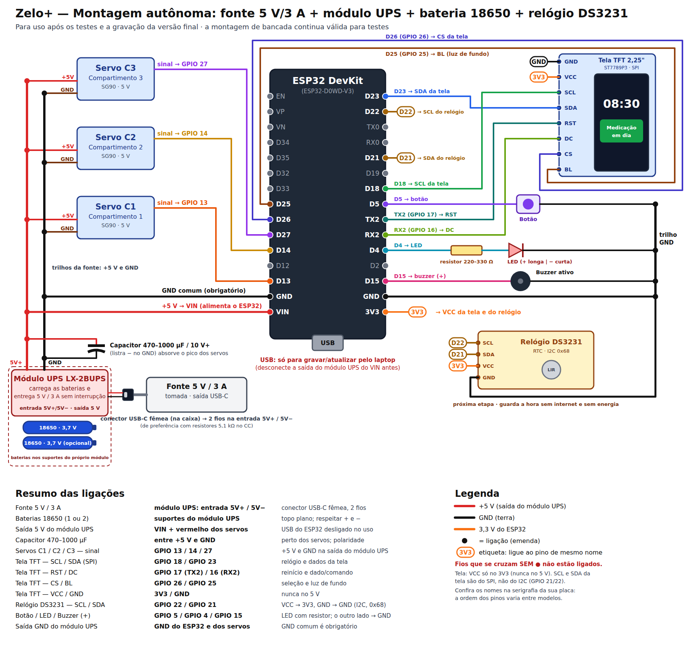
<figcaption><b>Diagrama de ligações da montagem autônoma</b> (fonte 5 V/3 A, módulo UPS LX-2BUPS, bateria 18650, visor TFT e relógio DS3231). Versão vetorial: <code>docs/ligacoes-autonomo.svg</code>.</figcaption>
</figure>

**Funcionamento:** o **LX-2BUPS** é um módulo **UPS** (fonte de alimentação ininterrupta)
para baterias 18650. O módulo tem três funções numa única placa:

- carrega a bateria;
- aumenta a tensão para 5 V;
- troca de fonte sem desligar o dispenser.

| Situação | Ação do módulo UPS |
|---|---|
| **Com energia da rede elétrica** | Alimenta o dispenser com os 5 V da fonte. Ao mesmo tempo, **carrega a bateria**. |
| **Falta de energia** | Passa para a bateria **sem interrupção** e **aumenta a tensão de 3,7 V para 5 V**. O dispenser continua ligado. |
| **Energia volta** | Usa a fonte de novo e carrega a bateria. |

| Característica | Valor |
|---|---|
| Entrada | 5 V, pela porta USB-C ou pelos terminais **5V+ / 5V−** |
| Saída | **5 V / 3 A** (pico de 4 A, 20 W), eficiência de até 96 % |
| Baterias | **1 ou 2 × 18650 de topo plano**, em suportes na placa (ligação em paralelo) |
| Corrente de carga | 1 A |
| Proteções | Sobrecarga, sobrecorrente, descarga profunda e temperatura |
| Dimensões | 90 × 42 × 33 mm |

- A tensão da bateria 18650 fica entre 3,0 V (vazia) e 4,2 V (cheia). **O módulo fornece
  os 5 V** à placa e aos servos. Por isso, a tensão de saída não muda com a carga da
  bateria.
- Os dois suportes da placa ligam as baterias **em paralelo**. A tensão é a de uma
  célula. A capacidade é a soma das duas. Com **duas baterias**, a autonomia é **duas
  vezes maior**.
- A saída de **3 A** tem margem. O dispenser consome no máximo aproximadamente 0,6 A, com
  um servo em movimento de cada vez. A fonte de 3 A fornece a carga da bateria (1 A) e o
  consumo do dispenser ao mesmo tempo.

**Entrada de energia: conector USB-C fêmea de painel.** A fonte encaixa num **conector
USB-C fêmea** fixado na parede do gabinete. Deste conector saem **2 fios** (vermelho e
preto). Os fios vão aos **terminais de entrada 5V+ / 5V− do módulo UPS**. A placa não usa
este conector. A placa recebe os 5 V pela **saída do módulo UPS → pino VIN**.

**Resistores de 5,1 kΩ:** uma fonte USB-C fornece os 5 V somente quando o equipamento se
identifica. O equipamento se identifica com um **resistor de 5,1 kΩ no pino CC**. Por isso:

- Use um conector com a indicação **"com resistor 5,1 kΩ / 5K1"** ou **"compatível com
  carregador tipo C (C–C)"**.
- **Teste o conector quando receber:** ligue a fonte no conector. Meça os 2 fios com o
  multímetro. O valor correto é **aproximadamente 5 V**. Se o valor for **0 V**, o conector
  não tem os resistores. Neste caso, a fonte não fornece energia e o dispenser não liga.
- **Alternativa:** use um **módulo USB-C fêmea de 6 pinos** (VBUS, GND, CC1, CC2, D+, D−).
  Solde **um resistor de 5,1 kΩ do CC1 ao GND** e **outro do CC2 ao GND**. Não ligue os
  pinos D+ e D−.

## E4. Lista de compras

> **NOTA:** esta lista contém **somente a parte de energia**. A
> [Parte F](#parte-f--lista-completa-de-componentes-com-preços) contém a **lista completa do
> dispenser**, com ilustrações e preços estimados.

| # | Item | Qtd | Especificação |
|---|---|---|---|
| 1 | **Fonte de tomada 5 V / 3 A** | 1 | Saída **USB-C**, 5 V, 3 A (15 W). Use uma marca conhecida, com certificação Inmetro. |
| 2 | **Módulo UPS LX-2BUPS** | 1 | "Fonte UPS carregador de bateria 18650 com 2 slots, USB-C 5V 3A". Tem os **suportes das baterias** na placa, a entrada 5V+/5V− e a saída de 5 V. |
| 3 | **Bateria 18650 de topo plano** | 1 ou 2 | Li-ion 3,7 V, **2500–3000 mAh reais** (Samsung, LG, Sony/Murata, Panasonic). **Topo plano (flat-top)**, para os suportes do módulo. Não compre baterias com indicação de "9800 mAh". Duas baterias dão autonomia duas vezes maior. |
| 4 | **Conector USB-C fêmea de painel com 2 fios** | 1 | Fixado no gabinete. A fonte encaixa neste conector. Os **2 fios** (vermelho/preto) vão aos terminais de entrada **5V+ / 5V−** do módulo UPS. Use um conector **com resistores de 5,1 kΩ no CC** (consulte a E3). |
| 5 | **Capacitor eletrolítico 1000 µF / 16 V** | 1 | Entre +5 V e GND, perto dos servos. O capacitor tem polaridade: a faixa "−" vai ao GND. |
| 6 | **Fio 22 AWG** vermelho e preto | ~1 m de cada | Da saída do módulo UPS ao VIN da placa e aos servos. |
| 7 | **Placa perfurada** ou barramento de bornes | 1 | Para os trilhos de +5 V e GND com solda. A solda é mais firme que a protoboard para uso contínuo. |
| 8 | **Termo-retrátil** sortido | 1 kit | Para isolar as emendas com solda. |
| 9 | **Multímetro** | 1 | Para verificar a polaridade e os 5 V da saída **antes** de ligar a placa. |
| 10 | Ferro de solda + estanho | — | Para os terminais do módulo UPS, a placa perfurada e as emendas. |
| 11 | *Módulo relógio DS3231 + bateria LIR2032* (próxima etapa) | 1 | Consulte a [E9](#e9-módulo-de-relógio-ds3231). Mantém a hora certa sem internet. |

> **NOTA:** se o módulo tiver também uma **saída USB**, esta saída fornece os mesmos 5 V.
> Para o dispenser, use os **terminais de saída** com fios. A ligação com fios fica firme e
> não depende de um conector que pode se soltar.

## E5. Montagem passo a passo

> **CUIDADO:** Faça a montagem **sem a bateria e sem a fonte ligadas**. Ligue a energia
> somente nas etapas indicadas.

1. **Conector de entrada:**
   1. Faça o teste dos 5 V no conector (consulte a E3).
   2. Fixe o conector USB-C fêmea no gabinete.
   3. Ligue o fio **vermelho** no terminal de entrada **5V+** do módulo UPS.
   4. Ligue o fio **preto** no terminal de entrada **5V−**.
   5. Isole as ligações com termo-retrátil.
2. **Saída:**
   1. Ligue um fio vermelho na **saída 5 V (+)** do módulo.
   2. Ligue um fio preto na **saída GND (−)** do módulo.
   3. Leve os dois fios até a placa perfurada. Os fios formam os **trilhos de +5 V e GND**.
3. **Baterias:** coloque 1 ou 2 baterias 18650 de topo plano nos suportes do módulo.
   Respeite as marcas **+** e **−** da placa.
4. **Teste sem a placa ESP32:**
   1. Ligue a fonte na tomada.
   2. Meça os trilhos com o multímetro. O valor correto é **entre 4,9 V e 5,2 V**.
   3. Desligue tudo.
5. **Capacitor:** solde o capacitor de 1000 µF entre os trilhos, **perto dos servos**. A
   faixa "−" vai ao GND.
6. **Servos:**
   1. Ligue o fio **vermelho** de cada servo no trilho de +5 V.
   2. Ligue o fio **marrom** de cada servo no GND.
   3. Mantenha os fios de sinal nos GPIO 13, 14 e 27.
7. **Placa ESP32:**
   1. Ligue o trilho de +5 V no pino **VIN**.
   2. Ligue o trilho de GND no pino **GND** da placa.


   > **CUIDADO:** Não ligue o cabo USB da placa. A energia entra somente pelo VIN. Duas
   > fontes ao mesmo tempo podem danificar a placa ou o computador.

8. **Outros componentes** (visor, botão, luz de alerta, buzzer): faça as ligações da
   montagem de bancada.

   > **CUIDADO:** Ligue o visor no **3V3** da placa. Não ligue o visor no trilho de 5 V.

9. **Ligar:**
   1. Ligue a fonte na tomada.
   2. Verifique o visor. O visor mostra "Iniciando...", a seguir o endereço da página e,
      depois, o relógio.

## E6. Teste de falta de energia

Faça este teste com o dispenser em funcionamento (relógio no visor):

1. **Remova a fonte da tomada.** O dispenser **continua ligado** pela bateria.
2. Verifique o visor:
   - Se o relógio **continua normal**, a troca de fonte está correta.
   - Se o visor mostrar **"Iniciando..."**, a placa reiniciou na troca de fonte. O
     cadastro, os horários e o histórico ficam salvos. A placa volta a funcionar
     automaticamente em poucos segundos. Para evitar este reinício, verifique se o
     capacitor está perto dos servos e bem fixado.
3. **Coloque a fonte de novo.** O dispenser continua ligado e a bateria carrega. Os LEDs do
   módulo mostram a carga.
4. Faça um **alarme de teste** com o dispenser na bateria (servo abre e fecha). Este teste
   confirma que a bateria suporta o pico de corrente dos servos.

**Outras precauções com o módulo UPS:**

- Se a bateria **descarregar** numa falta longa, o módulo desliga a saída quando a
  bateria chega a **2,6 V**. O módulo liga a saída automaticamente quando a energia da rede
  volta e a bateria passa de **3 V**.
- A corrente de carga é de **1 A**. Uma bateria vazia carrega em aproximadamente 3 h. Duas
  baterias carregam em aproximadamente 6 h. O dispenser funciona normalmente durante a
  carga.
- Durante a carga com o dispenser ligado, o módulo **aquece um pouco**. Instale o módulo
  num local com ventilação no gabinete.

## E7. Autonomia da bateria

Cálculo para **uma bateria 18650 real de 2500–3000 mAh**:

| Etapa | Valor |
|---|---|
| Energia da bateria | 2500 mAh × 3,7 V ≈ **9,3 Wh** |
| Perda no aumento para 5 V (~85 %) | Restam ≈ **7,9 Wh** |
| Consumo médio do dispenser (placa com Wi-Fi, visor, servos parados) | ≈ **0,75 a 1 W** |
| **Autonomia sem energia da rede elétrica (1 bateria)** | **≈ 8 a 10 h** |
| **Autonomia com 2 baterias** | **≈ 16 a 20 h** |

Os servos se movem somente alguns segundos por dia. O consumo dos servos é muito pequeno
neste cálculo. Para medir a autonomia real da sua bateria:

1. Carregue a bateria completamente.
2. Remova a fonte da tomada.
3. Registre o tempo até o dispenser desligar.

## E8. Falta de energia e de internet

| Situação | Resultado |
|---|---|
| **Falta de energia (até ~8–10 h com 1 bateria; ~16–20 h com 2)** | O dispenser **funciona pela bateria**. Os alarmes tocam. O Telegram funciona somente se a internet (roteador) também estiver ligada. |
| **Falta de energia por mais tempo** (bateria descarregada) | O dispenser desliga. O cadastro, os horários e o histórico **ficam salvos**. Os horários durante o desligamento **não tocam** depois. |
| **A energia volta, com internet** | O dispenser liga automaticamente, conecta no Wi-Fi e ajusta a hora. A bateria carrega. |
| **A energia volta, sem internet e sem o DS3231** | O dispenser abre a rede própria `ZeloPlus` (senha `zelo1234`). **Sem a hora certa, os alarmes não tocam.** O visor mostra `Acerte a hora` / `pelo celular` e a luz de alerta pisca. Conecte o celular na rede `ZeloPlus` e abra a página. A página envia a hora do celular e os alarmes funcionam de novo. O dispenser tenta a rede salva a cada 10 min. |
| **A energia volta, sem internet e com o DS3231** | O dispenser abre a rede própria `ZeloPlus` com a hora do relógio. **Os alarmes tocam normalmente.** O dispenser tenta a rede salva a cada 10 min. O Telegram funciona quando a internet volta. |
| **A internet cai, com energia** | O relógio interno continua a contar. **Os alarmes tocam normalmente.** Somente as mensagens do Telegram não são enviadas. |

> **ADVERTÊNCIA:** Se o visor mostrar `Acerte a hora`, conecte o celular na rede `ZeloPlus`
> e abra a página. Sem a hora, os alarmes das doses não tocam.

## E9. Módulo de relógio DS3231

> **NOTA:** o programa já funciona com o módulo
> ([Passo 19](#passo-19--relógio-ds3231-próxima-etapa)). A instalação do módulo é a
> **próxima etapa da montagem**. O módulo é **necessário para o produto**. Com o módulo, o
> dispenser **tem a hora mesmo sem internet**, também depois de a bateria descarregar e a
> energia voltar. Sem o módulo, o programa usa a hora da internet ou do celular.

**Por que o relógio interno da placa não é suficiente:** a placa tem um relógio interno
preciso (aproximadamente 1 a 2 s por dia) **enquanto recebe energia**. O módulo UPS mantém a
placa ligada nas faltas de energia comuns. Mas o relógio interno não tem bateria própria. Se
a alimentação parar completamente, a hora se perde. Exemplos: baterias descarregadas,
dispenser desligado ou gravação do programa. A gravação da hora na memória interna não
resolve o problema. A placa não sabe por quanto tempo ficou desligada. O DS3231 resolve
este caso.

| Situação | Sem o DS3231 | Com o DS3231 |
|---|---|---|
| Falta de energia com a bateria 18650 carregada | Hora mantida | Hora mantida |
| Sem internet, dispenser sempre ligado | Hora mantida | Hora mantida |
| Desligamento total e religamento **com** internet | A internet ajusta a hora em segundos | Hora mantida |
| Desligamento total e religamento **sem** internet | Hora desconhecida. O visor mostra `Acerte a hora` e a luz de alerta pisca até o ajuste pelo celular. | Hora mantida. Os alarmes funcionam. |

O dispenser é um equipamento de medicação. Na última situação, sem o DS3231, o paciente
perde doses. Por isso, o módulo faz parte do produto final.

**Descrição:** uma placa pequena com um relógio de alta precisão e uma **bateria tipo
moeda**. O relógio conta o tempo por anos, mesmo com o dispenser desligado.

| Característica | Valor |
|---|---|
| Precisão | ±2 ppm (aproximadamente 1 min por ano) |
| Comunicação | I2C, endereço `0x68` (único componente no I2C; o visor usa o SPI) |
| Alimentação | 3,3 V (pino 3V3 da placa) |
| Bateria | LIR2032 (recarregável). Consulte o aviso abaixo. |
| Preço aproximado | R$ 26 a R$ 31 (consulte a [F4](#f4-relógio-sem-internet-próxima-etapa)) |

**Ligação:** nos pinos I2C da placa (GPIO 21 e 22). Estes pinos são somente para o relógio.
O VCC usa o mesmo 3V3 do visor (marca **3V3** no diagrama da seção E3).

| DS3231 | Placa ESP32 |
|---|---|
| VCC | 3V3 |
| GND | GND |
| SDA | GPIO 21 |
| SCL | GPIO 22 |

> **CUIDADO:** Use uma bateria **LIR2032** (recarregável). Muitos módulos DS3231 têm um
> circuito que carrega a bateria. Este circuito danifica uma **CR2032 comum (não
> recarregável)**. Se usar uma CR2032, remova antes o resistor e o diodo de carga do módulo.

**Uso do módulo pelo programa** (código completo no [Passo 19](#passo-19--relógio-ds3231-próxima-etapa)):

1. **Quando a placa liga:** o programa procura o DS3231. Se o DS3231 tiver uma hora válida,
   o programa ajusta o relógio da placa imediatamente, sem esperar a internet. Os alarmes
   funcionam imediatamente.
2. **Com internet:** em cada ajuste da hora pelo NTP (na conexão e depois a cada ~1 h), o
   programa **grava a hora certa no DS3231**. Assim, o DS3231 fica sempre com a hora certa.
3. **Sem internet:** o programa usa o DS3231. Os alarmes funcionam normalmente. O programa
   tenta o Wi-Fi a cada 10 min (rede própria, Passo 4). Somente o Telegram espera a
   internet.
4. **Sem o módulo:** o programa identifica a falta do módulo quando a placa liga e usa a
   hora da internet.

**Instalação do módulo:**

1. **Desligue o dispenser da energia:** a fonte e as baterias do módulo UPS.
2. Coloque a bateria **LIR2032** no módulo.
3. Ligue os 4 fios: VCC → 3V3, GND → GND, SDA → GPIO 21, SCL → GPIO 22.
4. Ligue o dispenser **com internet**.
5. Verifique o Serial Monitor. Estas mensagens aparecem, nesta sequência:
   `DS3231 sem hora valida - aguardando a internet` e
   `DS3231: hora gravada (vinda da internet)`.
6. Verifique a página. O rodapé mostra **"Relógio DS3231: conectado"**.

**Mensagens no Serial Monitor**

| Mensagem | Significado |
|---|---|
| `DS3231 nao encontrado - usando so a internet` | O módulo não está instalado ou a ligação está errada. Verifique SDA e SCL. |
| `DS3231 sem hora valida - aguardando a internet` | Módulo novo ou bateria LIR2032 descarregada. |
| `DS3231: hora carregada do relogio` | A hora está certa quando a placa liga. |
| `DS3231: hora gravada (vinda da internet)` | O NTP ajustou a hora e o programa atualizou o módulo. |
| `Sem internet: rede ZeloPlus, acesse http://192.168.4.1` | A placa ligou sem a rede salva. O dispenser funciona na rede própria, com a hora do relógio. |

**Ensaios do relógio:**

| Ensaio | Resultado esperado |
|---|---|
| Página aberta com o módulo instalado | O rodapé mostra "Relógio DS3231: conectado". |
| Religamento sem internet (roteador desligado) | O visor mostra `Rede ZeloPlus` / `senha zelo1234`, a seguir `192.168.4.1` e depois a hora correta. |
| Horário de dose com o roteador desligado | O alarme toca no horário. |
| Retorno da internet | Em até 10 min (ou imediatamente, com o botão "Tentar conectar novamente"), o dispenser conecta, desliga a rede `ZeloPlus` e mostra o IP no visor. A página e o Telegram funcionam de novo. |
| Religamento sem o módulo | O rodapé mostra "não instalado". A hora vem da internet. |

## E10. Atualizar o programa depois de montado

É possível atualizar o programa com a montagem autônoma:

> **CUIDADO:** Não ligue o USB e o VIN ao mesmo tempo. Duas fontes ao mesmo tempo podem
> danificar a placa ou o computador.

1. Vire o dispenser.
2. **Remova os 4 parafusos do fundo.** A protoboard e a placa ficam visíveis (B6).
3. **Desligue a saída do módulo UPS do VIN** da placa. Remova o fio do VIN ou abra o borne.
4. Ligue o **USB da placa no laptop**.
5. Grave o programa novo (Build → Upload), como na bancada.
6. Remova o cabo USB.
7. **Ligue de novo o fio do VIN.**
8. Coloque o fundo e os 4 parafusos. O dispenser funciona de novo pela fonte e pela bateria.

## E11. Procedimento de emergência

Esta tabela mostra três procedimentos para abrir os compartimentos sem o método normal. A
ordem vai do mais simples ao mais complexo:

| Situação | Procedimento | Local |
|---|---|---|
| **Sem o celular ou sem a página**, com o dispenser ligado | 1. Fora do horário de dose, segure o botão por 10 s. 2. Escolha o compartimento com toques curtos. 3. Confirme com um toque longo. | [Passo 21](#passo-21--modo-do-cuidador-abrir-pelo-botão-sem-o-celular) |
| **Sem energia da rede elétrica e com a bateria descarregada** | Ligue um **power bank** de celular (5 V, 2 A ou mais) na entrada USB-C do dispenser. O dispenser liga imediatamente. As tampas dos compartimentos funcionam normalmente. | Entrada USB-C na parede lateral direita |
| **Sem nenhuma energia** | 1. Abra a tampa técnica com uma moeda (trava de 1/4 de volta). 2. Remova o pino com argola do compartimento. 3. Abra a tampa do compartimento com a mão. 4. Feche a tampa, coloque o pino e trave a tampa técnica. | [B5](#b5-abertura-de-emergência-sem-energia) |

> **NOTA:** sem energia, use o power bank como primeira opção. Com o power bank, o
> dispenser registra as doses, dá o alarme e envia os avisos. A abertura pela tampa técnica
> não fica registrada, porque o dispenser está desligado.

---

# Parte F — Lista completa de componentes, com preços

Esta parte contém os componentes para montar o Zelo+ na **versão autônoma** (tomada e
bateria, Parte E). As ilustrações são desenhos simples para identificar cada componente.

> **NOTA (preços):** os valores são de lojas brasileiras de eletrônica, em **setembro de
> 2026** (consulte as [Referências](#referências)). Os itens com **\*** não tinham preço em
> loja nacional na pesquisa. Para estes itens, o valor é uma **estimativa** com preços
> internacionais convertidos. Os preços mudam com frequência e **não incluem frete**. As
> ferramentas **não** entram no cálculo (consulte a [F5](#f5-ferramentas-necessárias-fora-do-custo)).

## F1. Eletrônica do dispenser

| Componente e códigos | Ilustração | Função | Preço de referência |
|---|:---:|---|---|
| **Placa ESP32 DevKit V1 — 30 pinos** · 1 un.<br>ESP32-WROOM-32 · chip ESP32-D0WD-V3 · USB CP2102 | 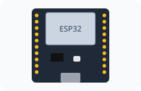 | Controla o dispenser. Executa o programa, gera a página web, conecta no Wi-Fi e envia os avisos. | R$ 54,90 |
| **Micro servo SG90 9 g** · 3 un.<br>TowerPro SG90 · 180° · 1,6 kgf·cm · 4,8–6 V |  | Abre e fecha a tampa de cada compartimento. Um servo para cada compartimento. | R$ 13,33–16,90 cada<br>**R$ 40–51** (3 un.) |
| **Visor TFT 2,25" colorido (IPS)** · 1 un.<br>ST7789P3 · 76 × 284 pontos · SPI · 8 pinos · 3,3 V | 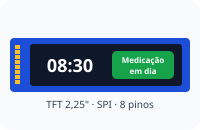 | Mostra o relógio, o nome do remédio e os avisos (abertura, fechamento, dose pendente). A cor muda de acordo com a situação. | R$ 21,93–23,84 **\*** |
| **Buzzer ativo 5 V** · 1 un.<br>12 mm · "auto-oscilante" · 3,5–5 V | 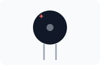 | Emite o som no horário do remédio (alarme sonoro). | R$ 2,50 |
| **LED difuso 5 mm vermelho** · 1 un. | 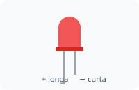 | Luz de alerta. Pisca ao mesmo tempo que o buzzer (alarme visual). | R$ 0,15 |
| **Resistor 220 Ω, ¼ W** · pacote com 10<br>faixas: vermelho-vermelho-marrom-dourado | 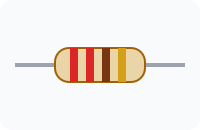 | Limita a corrente do LED. Sem o resistor, o LED queima. O dispenser usa 1 resistor. | R$ 0,90 (10 un.) |
| **Chave táctil (push button) 12×12 mm com capa** · kit com 10 |  | O botão que o paciente aperta para abrir e fechar os compartimentos. O dispenser usa 1 botão. | R$ 10,20 (10 un.) |

## F2. Energia autônoma

| Componente e códigos | Ilustração | Função | Preço de referência |
|---|:---:|---|---|
| **Fonte de tomada 5 V / 3 A, saída USB-C** · 1 un.<br>bivolt · 15 W · com certificação Inmetro | 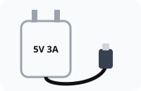 | Fornece a energia da rede elétrica para o dispenser e para a carga da bateria. | R$ 35,98–50 |
| **Módulo UPS LX-2BUPS** · 1 un.<br>5 V / 3 A · entrada USB-C e 5V+/5V− · 2 suportes 18650 na placa | 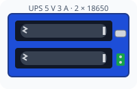 | Carrega a bateria. Mantém 5 V estáveis, com ou sem energia da rede elétrica. A troca de fonte não desliga o dispenser. | R$ 60,00 |
| **Bateria Li-ion 18650** · 1 un. (2 para autonomia duas vezes maior)<br>Onistek ON-18650 · 3,7 V · rótulo 3800 mAh (valor real provável 1500–2500 mAh) | 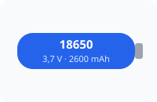 | Mantém o dispenser ligado na falta de energia (~4–10 h, de acordo com a capacidade real). | R$ 17,15 |
| **Conector USB-C fêmea de painel, com 2 fios** · 1 un.<br>"jack USB tipo C fêmea com rabicho 2 fios" · 5 V · ≥ 2,5 A · com resistores de 5,1 kΩ (preferência) | 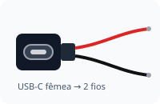 | Entrada de energia no gabinete. A fonte encaixa no conector. Os 2 fios vão à entrada **5V+ / 5V−** do módulo UPS. | R$ 12–30 |
| **Resistor 5,1 kΩ, ¼ W** · pacote com 10 *(alternativa: somente com o módulo USB-C de 6 pinos)*<br>faixas: verde-marrom-vermelho-dourado | 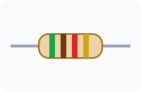 | Um resistor em cada pino CC (CC1 e CC2) até o GND. Com os resistores, a fonte USB-C fornece os 5 V. | R$ 0,60 (10 un.) |
| **Capacitor eletrolítico 1000 µF / 16 V** · 1 un.<br>105 °C · tem polaridade (faixa "−") | 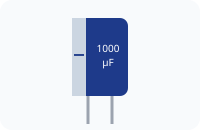 | Absorve o pico de corrente dos servos. Impede o reinício da placa. | R$ 0,73–3 |

## F3. Montagem e ligações

| Componente e códigos | Ilustração | Função | Preço de referência |
|---|:---:|---|---|
| **Placa perfurada ilhada 7×9 cm** · 1 un.<br>fenolite ou fibra de vidro | 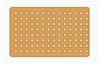 | Base firme, com solda, para os trilhos de +5 V e GND. Dura mais que a protoboard. | R$ 3,90–12,50 |
| **Jumpers macho/fêmea 20 cm** · 1 kit (40 un.) |  | Ligações entre a placa ESP32, o visor, os servos e a placa perfurada. | R$ 8,90 |
| **Fio flexível 22 AWG** · vermelho e preto, ~2 m de cada |  | Ligações de energia: da saída do módulo UPS ao VIN e aos servos. | R$ 1,20–3 por metro<br>**R$ 5–12** (4 m) |
| **Tubo termo-retrátil** · 1 kit sortido |  | Isola as emendas com solda. Impede curto-circuito. | R$ 16,88–43 |
| **Cabo USB-A → micro-USB (dados)** · 1 un. | 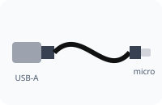 | Para gravar e atualizar o programa pelo laptop. | A partir de R$ 11,69 |

## F4. Relógio sem internet (próxima etapa)

Estes componentes são da próxima etapa da montagem. Eles são **necessários para o produto
final** (consulte a [E9](#e9-módulo-de-relógio-ds3231)). O custo fica separado do total do
protótipo.

| Componente e códigos | Ilustração | Função | Preço de referência |
|---|:---:|---|---|
| **Módulo RTC DS3231** · 1 un.<br>DS3231 + EEPROM AT24C32 · I2C 0x68 · 3,3–5 V | 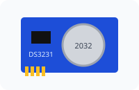 | Guarda a hora certa sem internet e sem energia (consulte a E9). | R$ 26–30,91 |
| **Bateria LIR2032 (recarregável)** · 1 un.<br>3,6 V · tipo moeda | 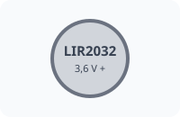 | Alimenta o relógio do DS3231 quando o dispenser está desligado. | R$ 11,90–28,50 |

## F5. Ferramentas necessárias (fora do custo)

As ferramentas **não entram no total** do projeto. Elas são de uso geral. Normalmente, é
possível emprestar as ferramentas ou usar as ferramentas de casa ou do laboratório da
escola. As ferramentas são **necessárias** para a montagem autônoma, que tem soldas em
peças pequenas.

| Ferramenta | Ilustração | Uso | Modelo recomendado e ajustes |
|---|:---:|---|---|
| **Ferro de solda com ajuste de temperatura** |  | Soldar os fios do conector USB-C, as ligações do módulo UPS e a placa perfurada. | **Estação ou ferro com controle de temperatura**, 50–60 W, faixa ~200–480 °C (exemplos: **Hikari HK-936B** ou **Yaxun 936**).<br>• **Temperatura:** **320–350 °C** para os pontos pequenos (pinos, resistores, terminais). Até **370 °C** para os fios 22 AWG e os trilhos da placa.<br>• **Ponta:** cônica fina (0,5–1 mm) ou chanfrada pequena (~1,6 mm).<br>• Não use ferros simples **sem ajuste** (exemplo: modelos "60 W" comuns, que passam de 500 °C). O calor em excesso pode **soltar as ilhas** da placa perfurada. Ele também pode danificar a bateria em caso de contato. |
| **Estanho (solda) 60/40 com fluxo, 0,5 mm** |  | Material da solda. | Fio de **0,5 mm** (fino, para peças pequenas), liga **60/40** com **fluxo resinoso** (exemplo: **Cobix 0,5 mm RA T2**, carretel pequeno de 250 g ou tubo pequeno). |
| **Multímetro digital** | 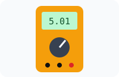 | Verificar os 5 V da saída e a polaridade **antes** de ligar a placa. | Modelo básico com **tensão DC** e **teste de continuidade** (som) (exemplos: **Hikari HM-1001** ou **Minipa ET-1002**). |
| **Acessórios de bancada** | — | Preparar os fios e corrigir erros. | Suporte com esponja para o ferro (normalmente incluído na estação) · **alicate de corte rente** pequeno · **decapador** para fio 22 AWG · **malha dessoldadora** ou sugador · pinça · suporte "terceira mão" com lupa (opção) · isqueiro ou soprador para o termo-retrátil. |
| **Segurança** | — | — | Consulte a advertência abaixo. |

> **ADVERTÊNCIA:** Use **óculos de proteção** durante a solda. Trabalhe num local
> **ventilado**: a fumaça do fluxo é prejudicial. **Lave as mãos** depois de usar estanho
> com chumbo. Não solde com a bateria no suporte: o calor pode causar incêndio na bateria.

## F6. Resumo do investimento

| Grupo | Faixa de preço |
|---|---|
| F1. Eletrônica do dispenser | R$ 131 – 146 |
| F2. Energia autônoma *(com a bateria)* | R$ 126 – 161 |
| F3. Montagem e ligações | R$ 46 – 96 |
| **Total para montar o dispenser** | **≈ R$ 303 – 403** |
| F4. Relógio sem internet (próxima etapa, separado) | + R$ 38 – 60 |

**Itens fora do total:**

- as ferramentas (F5);
- o frete;
- a estrutura física do dispenser: gabinete, tampas e divisórias dos compartimentos. O
  custo depende do material (MDF, acrílico ou impressão 3D).

A Parte [B](#parte-b--desenho-técnico-do-gabinete) contém o desenho técnico. A Parte
[G](#parte-g--custo-de-produção-estimativa-para-viabilidade) contém o custo do gabinete em
impressão 3D e em plástico injetado e o custo por unidade em produção.

**Observações sobre os componentes:**

- A **placa ESP32, a bateria e a fonte** têm muitas imitações no mercado. Compre estes
  componentes de fornecedores especializados em eletrônica.
- Uma bateria 18650 original tem no máximo aproximadamente 3500 mAh. Valores como
  "9800 mAh" ou "12000 mAh" no rótulo indicam um produto falso.
- Os resistores, os botões e o termo-retrátil são vendidos em pacotes. O preço da tabela é
  o preço do pacote.

---

# Parte G — Custo de produção (estimativa para viabilidade)

> **Objetivo desta parte:** estimar a **viabilidade** da produção do Zelo+ em série.
> **Data-base: setembro de 2026.** Esta parte não é um orçamento. Os valores são faixas
> (mínimo–máximo). Cada faixa vem de uma premissa declarada. Para refazer um valor, troque
> a premissa correspondente. As medidas do gabinete são as do desenho técnico (Parte B). A
> seção [Referências](#referências) contém as fontes dos valores.

<figure markdown="1">

<figcaption><b>Imagem de referência</b> — conceito visual do produto final (ilustrativo). A imagem não é o protótipo atual.</figcaption>
</figure>

## G1. Premissas e método

**Custo por unidade** = componentes + gabinete + ferragens + montagem + embalagem +
**investimentos amortizados** (investimento ÷ quantidade produzida).

| Premissa | Valor | Origem |
|---|---|---|
| Data-base | Setembro de 2026 | — |
| Câmbio | **US$ 1 = R$ 5,16** | Cotação de 24/09/2026 (faixa de 52 semanas: R$ 4,88–5,61). |
| Fator de nacionalização (componentes importados) | **1,8 ×** o preço de fábrica em dólar | Frete e seguro (~8–10 %) + imposto de importação (0–16 %) + IPI + PIS/COFINS + ICMS. Simplificação de ordem de grandeza. |
| Custo de US$ 1 de componente no Brasil | 5,16 × 1,8 = **R$ 9,29** | Cálculo |
| Energia elétrica | **R$ 0,849/kWh** | Tarifa residencial média prevista pela Aneel para 2026 |
| Mão de obra de montagem | **R$ 20/h** | Salário de montador + encargos (~70 %) ÷ 176 h/mês |
| Quantidades analisadas | **100**, **1000** e **10 000** unidades | Lote piloto, pequena série, série |
| Arredondamento | Valores finais arredondados ao real | — |

## G2. Volume de plástico do gabinete

O cálculo usa as medidas do desenho técnico (Parte B). O volume de plástico é a soma de
área × espessura de cada parte:

| Parte | Cálculo (mm) | Volume |
|---|---|---|
| Paredes externas | Perímetro 680 × altura 100 × 3,0 | 204,0 cm³ |
| Fundo | 210 × 130 × 2,5 | 68,2 cm³ |
| Piso dos compartimentos | 204 × 75,7 × 2,5 | 38,6 cm³ |
| Divisórias entre compartimentos | 2 × 75,7 × 50,5 × 2,0 + apoio das tampas (2 × 75,7 × 5 × 1,45) | 16,4 cm³ |
| Divisória da área técnica | 204 × 50,5 × 2,0 | 20,6 cm³ |
| 3 tampas dos compartimentos | 3 × 65 × 93,6 × 2,0 | 36,5 cm³ |
| Tampa técnica | 203,3 × 29,2 × 2,0 | 11,9 cm³ |
| Detalhes (dobradiças, acionamento das tampas, fixações, moldura do visor, logotipo) | + 12 % | 46,8 cm³ |
| **Total** | | **≈ 443 cm³** |

| Material | Densidade | Massa da peça pronta |
|---|---|---|
| PLA (impressão 3D) | 1,24 g/cm³ | 443 × 1,24 = **≈ 549 g** (+ 8 % de perdas = **593 g** de filamento) |
| ABS (injeção) | 1,05 g/cm³ | 443 × 1,05 = **≈ 465 g** |

## G3. Gabinete em impressão 3D

**Equipamento de referência:** impressora de mesa de **300 × 300 mm** (exemplo: Creality
K1 Max, ~R$ 6776). O gabinete de 210 × 130 mm cabe inteiro na mesa.

| Item | Cálculo (cenário médio) | Valor |
|---|---|---|
| Tempo de impressão | 549 g ÷ 30 g/h | 18,3 h |
| Filamento PLA | 0,593 kg × R$ 110/kg | R$ 65,28 |
| Energia | 18,3 h × 0,20 kW × R$ 0,849 | R$ 3,11 |
| Depreciação da impressora | 18,3 h × (R$ 6776 ÷ 5000 h de vida útil) | R$ 24,82 |
| Manutenção (bicos, mesa, correias) | 18,3 h × R$ 0,30 | R$ 5,49 |
| Reserva para falhas de impressão | 10 % dos itens acima | R$ 9,87 |
| Acabamento (remover suportes, lixar) | 0,5 h × R$ 20 | R$ 10,00 |
| **Total por gabinete** | | **R$ 118,57** |

**Faixa:** de **R$ 100** (filamento a R$ 90/kg, 35 g/h, 15,7 h) até **R$ 157** (R$ 140/kg,
20 g/h, 27,5 h).

- **Verificação:** sem o acabamento, o custo é de **R$ 0,20 por grama**. Este valor está na
  faixa de custo real de produção do mercado para 2026 (R$ 0,18–0,30/g).
- **Capacidade:** com ~18,3 h por gabinete, uma impressora produz **~380 gabinetes por
  ano** (80 % do tempo em uso). Para 1000 unidades por ano, são necessárias ~3 impressoras.
- **Uso recomendado:** lote piloto e pequena série. Não há investimento em molde. O
  desenho pode mudar a qualquer momento.

## G4. Gabinete em plástico injetado

**Moldes necessários** (aço P20, adequado para a produção em série; valores de mercado no
Brasil em 2026):

| Molde | Peça | Investimento estimado |
|---|---|---|
| 1 | Corpo azul (compartimentos, divisórias, área técnica) | R$ 75–130 mil |
| 2 | Base preta (recortes do visor, do botão, do acrílico e do USB-C) | R$ 50–90 mil |
| 3 | Molde "família": 3 tampas dos compartimentos + tampa técnica | R$ 40–75 mil |
| — | Projeto do molde (DFM) e ajustes de teste | R$ 15–30 mil |
| | **Total em aço** | **R$ 180–325 mil** |
| | Alternativa em **alumínio** (~5000–10 000 injeções; ~50 % do custo do aço, mais o DFM) | **R$ 98–178 mil** |

*A referência de mercado é de R$ 25–70 mil para o molde de uma peça pequena e simples, com
uma cavidade. O corpo e a base do Zelo+ são peças médias, com divisórias, recortes e
nervuras. Por isso, as faixas da tabela são maiores.*

**Custo para injetar um gabinete** (sem o molde):

| Item | Cálculo | Mínimo | Máximo |
|---|---|---|---|
| Resina ABS | 0,465 kg × 1,05 (canal de injeção) × R$ 13–18/kg | R$ 6,35 | R$ 8,79 |
| Pigmento (masterbatch azul e preto, 2 %) | 9,8 g × R$ 35/kg | R$ 0,34 | R$ 0,34 |
| Hora-máquina (injetora + operador + energia) | Ciclos de 50 + 45 + 35 s = 130 s × R$ 150–250/h × 1,05 (refugo) | R$ 5,69 | R$ 9,48 |
| Logotipo "Zelo+" (tampografia) | Por peça | R$ 1,00 | R$ 2,00 |
| Inspeção | Por conjunto | R$ 0,50 | R$ 0,50 |
| **Total por gabinete** | | **R$ 13,88** | **R$ 21,11** |

**Com o molde amortizado** (investimento ÷ quantidade + custo de injeção):

| Quantidade | Molde de alumínio | Molde de aço |
|---|---|---|
| 500 | R$ 209–376 | R$ 374–671 |
| 1000 | R$ 111–199 | R$ 194–346 |
| 2000 | R$ 63–110 | R$ 104–184 |
| 5000 | R$ 33–57 | R$ 50–86 |
| 10 000 | R$ 24–39 | R$ 32–54 |

**Ponto de equilíbrio (impressão 3D × injeção):**

```text
 quantidade = investimento no molde ÷ (custo 3D − custo injetado)

 diferença por unidade: de R$ 100 − 21 = R$ 79  até  R$ 157 − 14 = R$ 143

 molde de alumínio: R$  98–178 mil ÷ R$ 79–143  ≈   680 a 2.240 unidades
 molde de aço:      R$ 180–325 mil ÷ R$ 79–143  ≈ 1.260 a 4.100 unidades
```

**Conclusão:** **com menos de ~1000 unidades, a impressão 3D custa menos. Com mais de
~4000 unidades, o molde de aço custa menos.**

## G5. Componentes eletrônicos no atacado

Os valores são preços de fábrica em dólar para lotes de ~500–1000 unidades, multiplicados
por R$ 9,29 (G1). A fonte é comprada no Brasil, porque precisa da certificação do Inmetro.

**Cenário 1 — os mesmos módulos do protótipo**

| Componente | US$ (fábrica) | R$ no Brasil |
|---|---|---|
| ESP32 DevKit V1 | 2,50–3,50 | 23,22–32,51 |
| 3 servos SG90 | 2,10–3,00 | 19,50–27,86 |
| Visor TFT 2,25" (ST7789P3) | 1,36–1,50 | 12,63–13,94 |
| Buzzer, LED, resistor e botão | 0,20–0,35 | 1,86–3,25 |
| Módulo UPS LX-2BUPS | 3,00–5,00 | 27,87–46,45 |
| Bateria 18650 | 1,50–2,50 | 13,93–23,22 |
| Conector USB-C de painel | 0,25–0,50 | 2,32–4,64 |
| Capacitor 1000 µF | 0,05 | 0,46 |
| Placa, fios e termo-retrátil | 0,80–1,50 | 7,43–13,93 |
| Relógio DS3231 + LIR2032 | 0,90–1,50 | 8,36–13,93 |
| Fonte 5 V/3 A USB-C (Inmetro, compra nacional) | — | 15,00–22,00 |
| **Total** | | **R$ 132,59–202,20** |

**Cenário 2 — placa de circuito própria.** A placa contém o ESP32, o carregador, o USB-C,
o relógio, o buzzer, o botão e o LED. A fábrica monta a placa.

| Componente | R$ no Brasil |
|---|---|
| Módulo ESP32-WROOM-32E | 18,58–24,15 |
| Placa + montagem automática (circuito de carga e UPS, USB-C, relógio, buzzer, botão, LED) | 27,86–51,08 |
| Visor TFT 2,25" (ST7789P3) | 12,63–13,94 |
| 3 servos SG90 | 19,50–27,86 |
| Bateria 18650 + suporte | 14,86–25,08 |
| Cabos internos | 2,79–5,57 |
| Fonte 5 V/3 A USB-C (Inmetro) | 15,00–22,00 |
| **Total** | **R$ 111,23–169,68** |

O custo das peças é quase igual nos dois cenários. A placa própria tem estas vantagens:

- **montagem** mais rápida (de ~55 min para ~20 min por unidade);
- mais **confiabilidade** (sem fios soltos);
- **tamanho** menor.

Protótipo (Parte F, varejo) × produção (atacado): **R$ 303–403 → R$ 133–202** (cenário 1)
ou **R$ 111–170** (cenário 2). A redução é de aproximadamente **50 a 60 %**.

## G6. Custo por unidade em três escalas

| Item | Lote piloto — 100 un. | Pequena série — 1000 un. | Série — 10 000 un. |
|---|---|---|---|
| Configuração | Módulos + impressão 3D | Placa própria + impressão 3D | Placa própria + injeção (aço) |
| Componentes | R$ 159–243 ¹ | R$ 111–170 | R$ 111–170 |
| Gabinete | R$ 100–157 | R$ 100–157 | R$ 14–21 |
| Ferragens (parafusos, pinos das tampas, ímãs e pinos com argola, pés, janela do visor) | R$ 5–9 | R$ 5–9 | R$ 5–9 |
| Montagem e teste | 55 min → R$ 18 | 20 min → R$ 7 | 20 min → R$ 7 |
| Embalagem e manual | R$ 8–14 | R$ 6–12 | R$ 6–12 |
| Projeto da placa (R$ 5–20 mil) amortizado | — | R$ 5–20 | R$ 0,50–2 |
| Moldes de aço (R$ 180–325 mil) amortizados | — | — | R$ 18–33 |
| **Custo de fabricação** | **R$ 290–441** | **R$ 234–375** | **R$ 161–254** |
| Homologação Anatel (R$ 10–30 mil) amortizada | R$ 100–300 | R$ 10–30 | R$ 1–3 |
| **Custo total por unidade** | **R$ 390–741** | **R$ 244–405** | **R$ 162–257** |

¹ Componentes do cenário 1 com aumento de 20 % para a compra de lotes pequenos.

**Interpretação dos resultados:**

- Na série, o custo do **gabinete** diminui de R$ 100–157 (impressão 3D) para R$ 14–21
  (injeção). A eletrônica passa a ser o custo principal.
- No lote piloto, a **homologação** custa mais que qualquer peça. Por isso, faça a
  homologação somente com um plano de produção em quantidade.
- Entre 1000 e ~4000 unidades, a escolha entre impressão 3D, molde de alumínio e molde de
  aço depende da quantidade prevista (ponto de equilíbrio na G4).

## G7. Investimentos iniciais (uma vez só)

| Investimento | Valor estimado | Necessário a partir de |
|---|---|---|
| Projeto e protótipos da placa de circuito | R$ 5–20 mil | Pequena série |
| Homologação Anatel (produto com Wi-Fi) | R$ 10–30 mil | Qualquer venda |
| Impressoras 3D para ~1000 un./ano (~3 × R$ 6776) | ≈ R$ 20 mil | Pequena série (produção própria) |
| Moldes de injeção (aço) | R$ 180–325 mil | Série |
| Consulta de enquadramento na Anvisa | Variável | Antes da venda |

## G8. Preço de venda e viabilidade

Os produtos de hardware normalmente chegam ao consumidor por **2,5 a 4 vezes o custo de
fabricação**. Esta margem inclui os impostos sobre a venda, a distribuição, a garantia, a
assistência técnica e o lucro.

| Escala | Custo total por unidade | Preço de venda estimado (× 2,5 a × 4) |
|---|---|---|
| Lote piloto (100) | R$ 390–741 | R$ 980–2.960 |
| Pequena série (1000) | R$ 244–405 | R$ 610–1.620 |
| Série (10 000) | R$ 162–257 | **R$ 400–1.030** |

**Síntese:**

- Em série, o preço do Zelo+ para o consumidor fica entre **R$ 400 e R$ 1.030**.
- O **custo de entrada** (moldes, placa própria e homologação) fica entre **R$ 195 mil e
  R$ 375 mil**. Este custo só tem retorno com alguns milhares de unidades.
- Antes disso, a opção viável é o **lote piloto em impressão 3D**, com pouco investimento.

## G9. Limitações da estimativa

- **Dimensões:** as medidas são as do desenho técnico (Parte B). Uma mudança no desenho
  (espessuras, nervuras, fundo inclinado) altera o volume de plástico e os custos do
  gabinete.
- **Preços:** os valores são faixas de mercado, não cotações. Os moldes precisam de
  orçamento com o desenho 3D final.
- **Câmbio:** o câmbio variou de R$ 4,88 a R$ 5,61 em 52 semanas (±9 %). Esta variação
  altera diretamente o custo dos componentes.
- **Impostos:** o fator de 1,8 é uma simplificação. O valor real depende do regime
  tributário da empresa e da classificação fiscal de cada peça.
- **Durabilidade:** para uso diário por anos, troque o SG90 pelo **MG90S** (engrenagem de
  metal). O custo aumenta **R$ 3–5 por servo**.
- **Itens fora do cálculo:** frete até o cliente, marketing, impostos sobre a venda e
  custos administrativos. A bateria de lítio tem regras próprias de transporte.
- **Anvisa:** é necessário confirmar se um dispenser com alarme de medicação é um
  dispositivo médico. Se for, os custos e os prazos aumentam.

---

# Parte H — Evolução do produto: funcionalidades com inteligência artificial

Esta parte contém propostas de funcionalidades novas com **inteligência artificial (IA)**.
As propostas vêm do funcionamento do protótipo e dos ensaios práticos. Elas dão prioridade
a funções **sem módulos ou sensores novos**. Estas funções usam os recursos que já existem:

- o celular do cuidador;
- a página do Zelo+;
- o histórico de doses;
- o bot do Telegram.

Há uma exceção: a voz para o paciente (H3.11). Esta função precisa de um módulo de áudio. A
proposta continua na lista porque melhora muito a acessibilidade.

## H1. Princípios de projeto

Todas as propostas seguem quatro princípios:

| Princípio | Aplicação no Zelo+ |
|---|---|
| **O cuidador decide** | A IA sugere, verifica e alerta. A IA não altera o cadastro, a dose ou o horário sem a confirmação do cuidador. O histórico registra cada confirmação. |
| **Fonte oficial antes da IA** | Se houver uma base oficial, o sistema consulta a base primeiro. Exemplos: o código de barras (EAN) na lista de preços da CMED e a posologia no Bulário Eletrônico da Anvisa. A IA lê, organiza e compara. A IA não substitui estas fontes. |
| **Funções essenciais independentes** | O alarme, as tampas dos compartimentos, o botão, o fechamento automático e o histórico funcionam sem internet e sem IA. As funções de IA adicionam recursos. Uma falha da IA não para o dispenser. |
| **Privacidade dos dados de saúde** | Os dados de saúde são dados pessoais sensíveis (BRASIL, 2018, art. 11). O sistema envia à IA somente os dados necessários. Exemplo: a foto da caixa, sem o nome do paciente. O envio precisa de consentimento. O usuário pode pedir a exclusão dos dados. |

## H2. Arquitetura proposta

A placa ESP32 não tem memória nem capacidade de processamento para executar modelos de
visão ou de linguagem. Por isso, as funções de IA usam um **serviço intermediário na
nuvem**. O serviço faz as chamadas aos modelos e às bases oficiais:

```text
 Celular do cuidador          Serviço Zelo+ na nuvem          Provedores
 (página / Telegram)   ───►   (regras, chaves)        ───►    modelo de IA
  foto, código de barras,            │                 └──►   CMED e Bulário Anvisa
  áudio, perguntas                   ▼
                              ESP32 do dispenser
                              (cadastro, alarmes, portas, histórico)
```

- **Página do Zelo+:** recebe o botão "Tirar foto". O botão abre a câmera do celular e
  envia a imagem. Este recurso funciona na página local, sem conexão segura (HTTPS).
- **Serviço na nuvem:** guarda as chaves de acesso aos modelos de IA. As chaves não ficam
  na placa nem na página. O serviço aplica as regras de verificação.
- **Placa ESP32:** continua responsável pela rotina do dispenser. A placa recebe do serviço
  somente cadastros já confirmados pelo cuidador. A placa envia o histórico para os
  relatórios.

No protótipo, a leitura da caixa por foto (H3.1,
[Passo 20](#passo-20--leitura-da-caixa-do-remédio-por-foto-ia)) já funciona sem o serviço
intermediário. A placa consulta o modelo de IA diretamente. A chave fica na memória do
dispenser, como o token do Telegram. A consulta do código de barras à lista da CMED
também funciona. A base convertida fica no repositório do projeto. A placa baixa somente
a parte do código lido. Na versão comercial, o serviço na nuvem faz estas duas chamadas.

## H3. Funcionalidades propostas

### H3.1 Cadastro do medicamento por código de barras ou foto

| Item | Descrição |
|---|---|
| **Proposta** | No cadastro, o cuidador fotografa o código de barras da caixa ou digita os 13 números. O sistema consulta a base oficial. A base envia o nome, a apresentação, o princípio ativo, o laboratório, a tarja, o registro e a quantidade de unidades. O cuidador verifica e confirma. |
| **Função da IA** | Se o sistema não ler o código de barras, um modelo de visão lê o texto da caixa. Exemplos: embalagem danificada, medicamento manipulado, produto fora da lista. O modelo extrai o nome e a concentração. Numa etapa futura, o modelo extrai também o **lote e a validade**. |
| **Fontes de dados** | **Código EAN-13**: chave de identificação da apresentação. O código não descreve o medicamento. A lista de preços da CMED liga cada código à apresentação registrada (ANVISA, 2026b). **Código DataMatrix (IUM)**: contém o GTIN, o registro, o número de série, o lote e a validade (ANVISA, 2017). Muitas embalagens ainda não têm este código. **QR code da bula digital**: abre a bula do medicamento (ANVISA, 2024). |
| **Posologia** | Estas fontes não contêm a posologia do paciente. A receita médica define a posologia. A posologia normal da bula é somente uma informação de apoio (H3.3 e H3.10). |
| **Benefício para o usuário** | Elimina os erros de digitação e de concentração no cadastro. Simplifica o uso para cuidadores com pouca experiência em tecnologia. |
| **Mudanças no projeto** | Sem hardware novo. Página: leitura do código na foto, digitação do código e tela de confirmação. Dados: conversão mensal da lista da CMED (`tools/cmed_para_json.py`). Serviço na nuvem: hospedagem da base e chamada ao modelo de visão. |
| **Situação** | Implementado no protótipo ([Passo 20](#passo-20--leitura-da-caixa-do-remédio-por-foto-ia)): leitura do código na foto ou por digitação, consulta à lista oficial e leitura por IA sem código encontrado. Etapa seguinte: leitura do DataMatrix (lote e validade) e acesso à bula digital pelo QR code. |

### H3.2 Conferência na reposição

| Item | Descrição |
|---|---|
| **Proposta** | No abastecimento e na reposição, o cuidador lê a caixa nova. Se o produto ou a concentração forem diferentes do cadastro, o sistema mostra um alerta **antes de abrir a tampa do compartimento**. Exemplo: Losartana 50 mg no cadastro e Losartana 100 mg na caixa nova. |
| **Função da IA** | O cadastro guarda o código EAN da embalagem. Na reposição, um código igual confirma a mesma apresentação, sem IA. Um código diferente inicia a comparação do produto e da concentração pela lista oficial. A leitura da H3.1 ocorre somente quando o sistema não lê o código. O sistema também avisa sobre **validade vencida ou próxima do fim**. |
| **Fontes de dados** | EAN e lista da CMED. Lote e validade do código DataMatrix, quando presente (ANVISA, 2017), ou do texto da embalagem. |
| **Benefício para o usuário** | Evita o erro de dosagem na troca de embalagem. Este é um dos erros mais comuns em casa. |
| **Mudanças no projeto** | Sem hardware novo. Firmware: a abertura para reposição espera a verificação ou a confirmação do cuidador. |

### H3.3 Verificação do intervalo pela bula

| Item | Descrição |
|---|---|
| **Proposta** | Depois do cadastro, o sistema compara os horários com a posologia normal da bula. O sistema mostra as diferenças. Exemplo: "a bula indica uso a cada 12 h; o cadastro tem 08:00 e 14:00". |
| **Função da IA** | Um modelo de linguagem lê a seção de posologia da bula. O modelo converte o texto em intervalos para comparar com o cadastro. |
| **Fontes de dados** | Bulário Eletrônico da Anvisa (ANVISA, 2026a) e bula digital pelo QR code da embalagem (ANVISA, 2024). O código de barras e a lista da CMED identificam o medicamento (H3.1). |
| **Benefício para o usuário** | Mais segurança, com a decisão do cuidador. A mensagem informa a diferença e recomenda verificar a receita. O médico pode prescrever uma posologia diferente da normal. O sistema não bloqueia nem corrige o cadastro. |
| **Mudanças no projeto** | Sem hardware novo. Serviço na nuvem: consulta à bula e comparação. Página: aviso junto ao medicamento. |

### H3.4 Cadastro a partir da receita médica

| Item | Descrição |
|---|---|
| **Proposta** | O cuidador fotografa a receita. O sistema sugere o cadastro completo: medicamentos, doses, frequência e horários. Exemplo: "a cada 12 h" → 08:00 e 20:00. |
| **Função da IA** | Modelo de visão com leitura de texto impresso e manuscrito. O modelo marca os trechos ilegíveis ou com dúvida como "confirmar". O modelo não preenche estes trechos por suposição. |
| **Fontes de dados** | Imagem da receita. CMED para confirmar o nome do medicamento. |
| **Benefício para o usuário** | O cadastro de vários medicamentos fica com uma foto e uma revisão. |
| **Mudanças no projeto** | Sem hardware novo. Página: tela de revisão de cada item antes de salvar. |

### H3.5 Alertas de interação e de cuidados de horário

| Item | Descrição |
|---|---|
| **Proposta** | O sistema mostra as interações conhecidas entre os medicamentos cadastrados e os cuidados de horário. Exemplos: medicamento em jejum; medicamento com intervalo obrigatório em relação a outro. |
| **Função da IA** | Modelo de linguagem com consulta às bulas dos medicamentos cadastrados. Cada alerta mostra a fonte. |
| **Fontes de dados** | Bulário Eletrônico da Anvisa. |
| **Benefício para o usuário** | O cuidador recebe informações que normalmente ficam desconhecidas. Os alertas recomendam consultar o médico ou o farmacêutico. |
| **Mudanças no projeto** | Sem hardware novo. Os alertas precisam de redação cuidadosa. O sistema registra quando o cuidador leu cada alerta. |

### H3.6 Relatório de adesão ao tratamento

| Item | Descrição |
|---|---|
| **Proposta** | Um resumo semanal pelo Telegram e um relatório para a consulta médica. Exemplo: "92 % das doses no horário; as doses da noite atrasam em média 35 min; uma dose não retirada na quinta-feira". |
| **Função da IA** | Um modelo de linguagem transforma o histórico de doses num texto claro. O modelo mostra as tendências. |
| **Fontes de dados** | Histórico de doses do Zelo+. |
| **Benefício para o usuário** | O cuidador e o médico têm uma informação objetiva sobre a adesão. Sem o relatório, esta informação depende da memória do paciente. |
| **Mudanças no projeto** | Sem hardware novo. Firmware: envio periódico do histórico ao serviço. |

### H3.7 Assistente do cuidador no Telegram

| Item | Descrição |
|---|---|
| **Proposta** | O cuidador faz perguntas e pedidos ao Zelo+ em linguagem natural, por texto ou áudio. Exemplos: "O remédio da noite foi tomado?", "Quantas doses de Losartana restam?", "Mude o Omeprazol para as 7 h". |
| **Função da IA** | Modelo de linguagem com transcrição de voz. O modelo tem acesso somente aos dados do dispenser. Os pedidos de alteração precisam de confirmação explícita antes da aplicação. |
| **Fontes de dados** | Cadastro e histórico do Zelo+. |
| **Benefício para o usuário** | Acesso rápido às informações sem abrir a página. Útil também para cuidadores com dificuldade de digitação. |
| **Mudanças no projeto** | Sem hardware novo. Usa o bot do Telegram atual. Serviço na nuvem: recepção das mensagens e controle das permissões. |

### H3.8 Lembrete adaptativo e detecção de risco

| Item | Descrição |
|---|---|
| **Proposta** | O sistema aprende a rotina do paciente e identifica mudanças de padrão. Exemplos: avisar o cuidador mais cedo quando o paciente começa a atrasar as doses; informar três dias seguidos de atraso na dose da noite. |
| **Função da IA** | Modelo estatístico do padrão de comportamento. O modelo é pequeno e funciona na própria placa. |
| **Fontes de dados** | Horários de alarme e de retirada no histórico. |
| **Benefício para o usuário** | O cuidador pode agir antes que os atrasos causem doses perdidas. Uma mudança súbita de padrão pode indicar uma alteração no estado de saúde. |
| **Mudanças no projeto** | Sem hardware novo. Firmware: cálculo do padrão e avisos novos no Telegram. |

### H3.9 Previsão de estoque e aviso de compra

| Item | Descrição |
|---|---|
| **Proposta** | O sistema calcula quando cada medicamento vai acabar. O sistema avisa com 5 a 7 dias de antecedência e envia a lista de compras. |
| **Função da IA** | A consulta do código de barras (H3.1) informa a quantidade de unidades da caixa. Este dado vem da apresentação na lista da CMED. A previsão junta este dado com o consumo registrado e com a validade do lote lida no DataMatrix. |
| **Fontes de dados** | Lista da CMED (unidades por embalagem). DataMatrix ou texto da embalagem (validade). Abastecimentos e doses do histórico. |
| **Benefício para o usuário** | Evita a interrupção do tratamento por falta do medicamento. |
| **Mudanças no projeto** | Sem hardware novo. Firmware: contagem de doses de cada compartimento. |

### H3.10 Explicação simples do medicamento

| Item | Descrição |
|---|---|
| **Proposta** | Para cada medicamento cadastrado, um resumo curto em linguagem simples: a indicação, o uso com ou sem alimento e os sinais de atenção. |
| **Função da IA** | Modelo de linguagem que resume a bula. O resumo mostra sempre a fonte. O resumo é somente informativo e não muda o cadastro. |
| **Fontes de dados** | Bulário Eletrônico da Anvisa e bula digital (QR code da embalagem). O registro da lista da CMED identifica a bula. |
| **Benefício para o usuário** | O cuidador sem formação na área entende melhor o tratamento. |
| **Mudanças no projeto** | Sem hardware novo. Página: campo de informação em cada medicamento. |

### H3.11 Voz para o paciente

| Item | Descrição |
|---|---|
| **Proposta** | No horário da dose, o Zelo+ dá o alarme sonoro e também fala uma mensagem. Exemplo: "Dona Maria, hora da Losartana, compartimento azul". |
| **Função da IA** | Síntese de voz. O sistema gera as frases uma vez, no cadastro, e grava as frases na memória da placa. A reprodução não depende de internet. |
| **Fontes de dados** | Nome do paciente, nome do medicamento e cor do compartimento. |
| **Benefício para o usuário** | Grande melhoria de acessibilidade para pacientes com baixa visão. A mensagem confirma qual compartimento abrir. |
| **Mudanças no projeto** | **Hardware novo:** módulo amplificador I2S MAX98357A (a partir de R$ 59,90, conforme TECH SUL ELETRÔNICOS, 2026) e alto-falante pequeno. Os dois ligam em três pinos livres da placa. Gabinete: furos para o alto-falante. |

## H4. Quadro-resumo dos impactos

| Funcionalidade | Hardware novo | Firmware | Página | Serviço na nuvem | Benefício principal |
|---|:---:|:---:|:---:|:---:|---|
| H3.1 Cadastro por código de barras ou foto | — | baixo | sim | sim | Cadastro sem erros |
| H3.2 Conferência na reposição | — | médio | sim | sim | Evita a troca de dosagem |
| H3.3 Intervalo pela bula | — | — | sim | sim | Alerta de posologia |
| H3.4 Cadastro pela receita | — | baixo | sim | sim | Cadastro rápido |
| H3.5 Interações e horários | — | — | sim | sim | Segurança do tratamento |
| H3.6 Relatório de adesão | — | baixo | — | sim | Informação para a consulta |
| H3.7 Assistente no Telegram | — | baixo | — | sim | Acesso por texto e voz |
| H3.8 Lembrete adaptativo | — | médio | — | — | Prevenção de doses perdidas |
| H3.9 Previsão de estoque | — | baixo | sim | — | Tratamento sem interrupção |
| H3.10 Explicação do medicamento | — | — | sim | sim | Compreensão do tratamento |
| H3.11 Voz para o paciente | amplificador e alto-falante | médio | — | geração das frases | Acessibilidade |

## H5. Impactos gerais da mudança

| Aspecto | Impacto |
|---|---|
| **Arquitetura** | Um serviço na nuvem entre o dispenser e os modelos de IA. O Zelo+ passa de equipamento isolado a sistema conectado. |
| **Custo de operação** | Hospedagem do serviço e uso dos modelos de IA, com cobrança por chamada. Com poucas fotos e mensagens por semana, o custo por usuário deve ser baixo. Peça uma cotação ao provedor e inclua o custo no preço de venda (Parte G). |
| **Dependência de internet** | Somente as funções de IA dependem de internet. A rotina de doses funciona sem conexão (H1). |
| **Segurança da informação** | Chaves de acesso somente no serviço. Comunicação cifrada entre o serviço e os provedores. Controle das pessoas que podem consultar e alterar os dados de cada dispenser. |
| **Proteção de dados** | Os dados de saúde são dados pessoais sensíveis. Eles precisam de consentimento, finalidade definida, envio mínimo e opção de exclusão (BRASIL, 2018). |
| **Regulação** | Funções de apoio a decisões sobre medicamentos podem classificar o software como dispositivo médico. Neste caso, é necessária a avaliação da classe de risco e a notificação ou o registro na Anvisa antes da venda (ANVISA, 2022). |
| **Manutenção** | Atualização periódica das bases oficiais. A lista da CMED tem atualização mensal; o programa `tools/cmed_para_json.py` faz a conversão. Acompanhamento da qualidade das respostas dos modelos. |

## H6. Etapas de implantação

| Etapa | Funcionalidades | Justificativa |
|---|---|---|
| **1ª** | H3.1, H3.2 e H3.6 | Evitam os erros mais graves (cadastro e troca de dosagem). Usam somente o celular. A demonstração é fácil. |
| **2ª** | H3.4 e H3.7 | Muita praticidade. Usam o bot do Telegram atual. |
| **3ª** | H3.3, H3.5, H3.8, H3.9 e H3.10 | Valor alto. Precisam de validação cuidadosa dos alertas e de mais tempo de histórico. |
| **Com hardware** | H3.11 | Único item com compra de componente. Maior impacto na acessibilidade do paciente. |
| **Futura (aproximadamente 12 meses)** | H7 | Modelo de IA próprio, feito pela equipe, para diminuir a dependência de serviços comerciais. |

## H7. Modelo próprio de IA (etapa futura)

Nesta fase, as funções de leitura e interpretação (H3.1 a H3.5 e H3.10) usam modelos
comerciais pela internet. A etapa futura, com prazo aproximado de um ano, é um **modelo de
IA próprio**. O modelo é simples e especializado nas tarefas do Zelo+. Com ele, o produto
funciona sem estes serviços.

| Aspecto | Proposta |
|---|---|
| **Objetivo** | Ler o nome e a concentração na embalagem e identificar o medicamento sem serviços de terceiros. |
| **Método** | Um conjunto de etapas simples, em vez de um modelo generativo grande: localização do texto na foto, reconhecimento dos caracteres (OCR) e comparação aproximada com os nomes da lista da CMED. A comparação corrige os erros de leitura. |
| **Local de execução** | No celular do cuidador (no navegador) ou num servidor local pequeno. A placa ESP32 não tem capacidade para executar o modelo (H2). A placa continua responsável pela rotina de doses. |
| **Dados** | Base de fotos de embalagens feita pela equipe, com o nome e a concentração de cada foto. A base não contém dados de pacientes. |
| **Avaliação** | Taxa de acerto do nome e da concentração num mesmo conjunto de fotos. O modelo comercial é a referência (linha de base). |
| **Vantagens** | Custo de uso zero. Nenhuma imagem vai para terceiros (privacidade). Independência dos limites e das mudanças dos serviços externos. Domínio da tecnologia pela equipe. |

O lembrete adaptativo (H3.8) já segue esta direção. Ele é um modelo estatístico próprio,
pequeno o suficiente para funcionar na placa.

---

# Referências

Fontes consultadas para os preços, as especificações dos componentes, os parâmetros
de custo utilizados nas Partes F e G, a documentação do serviço de IA usado no Passo 20
as bases oficiais e normas citadas na Parte H e a especificação de redação usada nesta versão (consulta em setembro e outubro de 2026).

<div class="referencias" markdown="1">

AGÊNCIA NACIONAL DE VIGILÂNCIA SANITÁRIA (ANVISA). **Resolução da Diretoria Colegiada – RDC nº 157, de 11 de maio de 2017**: dispõe sobre a implantação do Sistema Nacional de Controle de Medicamentos e os mecanismos e procedimentos para rastreamento de medicamentos. Brasília, DF: Anvisa, 2017. Disponível em: <https://saude.campinas.sp.gov.br/saude/lista_legislacoes/legis_2017/U_RS-MS-ANVISA-RDC-157_110517.pdf>. Acesso em: 29 out. 2026.

AGÊNCIA NACIONAL DE VIGILÂNCIA SANITÁRIA (ANVISA). **Perguntas & respostas: RDC nº 657, de 24 de março de 2022**: software como dispositivo médico. Brasília, DF: Anvisa, 2022. Disponível em: <https://www.gov.br/anvisa/pt-br/assuntos/noticias-anvisa/2022/software-como-dispositivo-medico-perguntas-e-respostas/perguntas-respostas-rdc-657-de-2022-v1-01-09-2022.pdf>. Acesso em: 29 set. 2026.

AGÊNCIA NACIONAL DE VIGILÂNCIA SANITÁRIA (ANVISA). **Resolução da Diretoria Colegiada – RDC nº 885, de 10 de julho de 2024**: dispõe sobre o projeto-piloto da bula digital de medicamentos. Brasília, DF: Anvisa, 2024. Disponível em: <https://antigo.anvisa.gov.br/documents/10181/6691799/RDC_885_2024_.pdf/3a0d760c-2497-4df6-be9f-f2e645fe8b31>. Acesso em: 29 out. 2026.

AGÊNCIA NACIONAL DE VIGILÂNCIA SANITÁRIA (ANVISA). **Bulário eletrônico**. Brasília, DF: Anvisa, 2026a. Disponível em: <https://consultas.anvisa.gov.br/#/bulario/>. Acesso em: 29 set. 2026.

AGÊNCIA NACIONAL DE VIGILÂNCIA SANITÁRIA (ANVISA). Câmara de Regulação do Mercado de Medicamentos (CMED). **Listas de preços de medicamentos**. Brasília, DF: Anvisa, 2026b. Disponível em: <https://www.gov.br/anvisa/pt-br/assuntos/medicamentos/cmed/precos>. Acesso em: 29 set. 2026.

ALIBABA.COM. **2.25inch 76x284 ST7789 SPI TFT LCD display screen**. Disponível em: <https://www.alibaba.com/product-detail/2-25inch-76x284-ST7789-SPI-TFT_1601541631656.html>. Acesso em: 6 out. 2026.

AMAZON.COM.BR. **Placa breakout USB tipo C fêmea, 6 pinos**. Disponível em: <https://www.amazon.com.br/naughtystarts-pe%C3%A7as-breakout-conector-direito/dp/B0B19TP2MX>. Acesso em: 27 set. 2026.

ASD — AEROSPACE, SECURITY AND DEFENCE INDUSTRIES ASSOCIATION OF EUROPE. **ASD-STE100**: Simplified Technical English: international specification for the preparation of technical documentation in a controlled language. Bruxelas: ASD, 2025. Disponível em: <https://www.asd-ste100.org/>. Acesso em: 22 out. 2026.

BAÚ DA ELETRÔNICA. **Rolo de solda estanho 500 g, 0,5 mm, Cobix**. Disponível em: <https://www.baudaeletronica.com.br/produto/rolo-de-solda-estanho-500g-05mm-cobix.html>. Acesso em: 27 set. 2026.

BRASIL. **Lei nº 13.709, de 14 de agosto de 2018**. Lei Geral de Proteção de Dados Pessoais (LGPD). Brasília, DF: Presidência da República, 2018. Disponível em: <https://www.planalto.gov.br/ccivil_03/_ato2015-2018/2018/lei/l13709.htm>. Acesso em: 29 set. 2026.

CASA DA ROBÓTICA. **Ferro de solda Hikari SC-60, 60 W**. Disponível em: <https://www.casadarobotica.com/prototipagem-e-ferramentas/prototipagem/soldas/ferro-de-solda-hk-plus-hikari-profissional-sc-60w-220v>. Acesso em: 27 set. 2026.

CHEN HSONG BRASIL. **Custo da hora-homem-máquina para operadores de injetoras**. Disponível em: <https://chenhsong.com.br/news/custo-da-hora-homem-maquina-para-operadores-de-injetoras/>. Acesso em: 27 set. 2026.

CURTO CIRCUITO. **Servo motor 9 g SG90**. Disponível em: <https://curtocircuito.com.br/servo-motor-9g-sg90.html>. Acesso em: 27 set. 2026.

EBAY. **2.25 inch TFT LCD display screen module ST7789 76 × 284 full view SPI screen**. Disponível em: <https://www.ebay.com/itm/316958165706>. Acesso em: 6 out. 2026.

ELETROGATE. **Jumpers macho-fêmea, 40 unidades de 20 cm**. Disponível em: <https://www.eletrogate.com/jumpers-macho-femea-40-unidades-de-20-cm>. Acesso em: 27 set. 2026.

ELETROGATE. **LED difuso 5 mm vermelho**. Disponível em: <https://www.eletrogate.com/led-difuso-5mm-vermelho>. Acesso em: 27 set. 2026.

ELETROGATE. **Módulo WiFi ESP32 Bluetooth, 30 pinos**. Disponível em: <https://www.eletrogate.com/modulo-wifi-esp32-bluetooth-30-pinos>. Acesso em: 27 set. 2026.

ELETROGATE. **Resistor 220 Ω, 1/4 W, 10 unidades**. Disponível em: <https://www.eletrogate.com/resistor-220r-1-4w-10-unidades>. Acesso em: 27 set. 2026.

ELETROGATE. **Resistor 5,1 kΩ, 1/4 W, 10 unidades**. Disponível em: <https://www.eletrogate.com/resistor-5k1-1-4w-10-unidades>. Acesso em: 27 set. 2026.

FERMARC. **Placa de circuito perfurada face simples, 7 × 9 cm**. Disponível em: <https://www.fermarc.com/placa-de-circuito-perfurada-face-simples-7x9>. Acesso em: 27 set. 2026.

FERRO DE SOLDA PROFISSIONAL. **Ferros de solda com controle de temperatura**. Disponível em: <https://ferrodesoldaprofissional.com.br/ferro-de-solda/>. Acesso em: 27 set. 2026.

GALPÃO DAS MÁQUINAS. **Como calcular o custo por peça na impressão 3D**. Disponível em: <https://galpaodasmaquinas.com.br/blog/plastico/custo-peca-impressora-3d/>. Acesso em: 27 set. 2026.

GOOGLE. **Gemini API: generating content**. Mountain View: Google, 2026a. Disponível em: <https://ai.google.dev/api/generate-content>. Acesso em: 29 set. 2026.

GOOGLE. **Gemini API: billing**. Mountain View: Google, 2026b. Disponível em: <https://ai.google.dev/gemini-api/docs/billing>. Acesso em: 29 set. 2026.

HESTORE. **LX2-BUPS-5V: boost charging module, UPS function, 2 × 18650, 15 W, 5 V, 3 A, USB-C**. Disponível em: <https://www.hestore.eu/en/prod_10048959.html>. Acesso em: 28 set. 2026.

INFOMONEY. **Aneel projeta alta média de 8% para tarifas de consumidores de energia elétrica**. Disponível em: <https://www.infomoney.com.br/economia/aneel-projeta-alta-media-de-8-para-tarifas-de-consumidores-de-energia-eletrica/>. Acesso em: 27 set. 2026.

INFOMONEY. **O que esperar do dólar em setembro? Veja até onde a moeda pode ir**. Disponível em: <https://www.infomoney.com.br/mercados/o-que-esperar-do-dolar-em-setembro-veja-ate-onde-a-moeda-pode-ir/>. Acesso em: 27 set. 2026.

KABUM. **Impressora 3D Creality K1 Max**. Disponível em: <https://www.kabum.com.br/produto/495704/impressora-3d-creality-k1-max-velocidade-maxima-600mm-s-1202080002>. Acesso em: 27 set. 2026.

LC FERRAGENS. **Multímetro digital Hikari HM-1000**. Disponível em: <https://www.lcferragens.com.br/produto/multimetro-hikari-digital-hm-1000/>. Acesso em: 27 set. 2026.

LEROY MERLIN. **Filamento PLA premium 1 kg Voolt3D**. Disponível em: <https://www.leroymerlin.com.br/filamento-pla-preto-premium-1kg-voolt3d-oficial_1570566287>. Acesso em: 27 set. 2026.

LOJA DO MECÂNICO. **Multímetro digital HM-1001 Hikari**. Disponível em: <https://www.lojadomecanico.com.br/produto/123563/3/47/multimetro-digital-hm-1001-hikari-21n240>. Acesso em: 27 set. 2026.

MAGAZINE LUIZA. **Fonte 5 V 3 A com saída USB-C**. Disponível em: <https://www.magazineluiza.com.br>. Acesso em: 27 set. 2026.

MAKERHERO. **Capa para chave táctil push button 12 × 12 mm**. Disponível em: <https://www.makerhero.com/produto/capa-para-chave-tactil-push-button-12x12-mm/>. Acesso em: 27 set. 2026.

MAKERHERO. **Fonte DC chaveada 5 V 3 A USB tipo C**. Disponível em: <https://www.makerhero.com/produto/fonte-dc-chaveada-5v-3a-usb-tipo-c/>. Acesso em: 27 set. 2026.

MAMUTE ELETRÔNICA. **Conector jack USB tipo C fêmea com rabicho de 2 fios**. Disponível em: <https://www.mamuteeletronica.com.br/conector-jack-usb-tipo-c-femea-com-rabicho-2-fios-22739>. Acesso em: 27 set. 2026.

MERCADO LIVRE. **Bateria 18650 3,7 V 3.800 mAh Onistek**. Disponível em: <https://www.mercadolivre.com.br>. Acesso em: 27 set. 2026.

MERCADO LIVRE. **Módulo RTC (real time clock) DS3231**. Disponível em: <https://www.mercadolivre.com.br/modulo-rtc-real-time-clock-ds3231-arduino-esp8266-esp32-rasp/p/MLB42966007>. Acesso em: 27 set. 2026.

MERCADO LIVRE. **Módulo UPS bateria 18650 5 V para Raspberry Pi, ESP32 e Arduino**. Disponível em: <https://produto.mercadolivre.com.br/MLB-3830950767-modulo-ups-bateria-18650-5v-raspberry-pi-esp32-arduino-_JM>. Acesso em: 28 set. 2026.

MERCADO SHOPS. **Kit com 5 conectores jack tipo C fêmea com rabicho de 2 fios**. Disponível em: <https://ralphcouch.mercadoshops.com.br/MLB-3667070205-kit-com-5-conector-jack-tipo-c-com-rabicho-2-fios-fmea-_JM>. Acesso em: 27 set. 2026.

METALÚRGICA FERRI. **Quanto custa um molde de injeção plástica: como o orçamento é formado**. Disponível em: <https://www.metalferri.com.br/blog/quanto-custa-molde-injecao-plastica>. Acesso em: 27 set. 2026.

MIL PLÁSTICOS. **ABS granulado: preço**. Disponível em: <https://www.milplasticos.com.br/abs-granulado-preco>. Acesso em: 27 set. 2026.

MULTCOMERCIAL. **Cabinho flexível 0,32 mm² (22 AWG)**. Disponível em: <https://www.multcomercial.com.br/fios-e-cabos/cabinho-flexivel/flex-0-32mm-22-awg.html>. Acesso em: 27 set. 2026.

NOVA TRIDA ELETRÔNICA. **Capacitor eletrolítico 1000 µF × 16 V**. Disponível em: <https://www.novatridaeletronica.com.br/capacitor-eletrolitico-1000uf-x-16v>. Acesso em: 27 set. 2026.

NTC. **Custo de molde de injeção de plástico**. Disponível em: <https://ntc.ind.br/custo-de-molde-injecao-plastico/>. Acesso em: 27 set. 2026.

OCTET3D. **Quanto custa imprimir em 3D? Guia de preços 2026**. Disponível em: <https://octet3d.com/blog/quanto-custa-imprimir-em-3d>. Acesso em: 27 set. 2026.

ORIELEC. **Bateria de lítio LIR2032**. Disponível em: <https://www.lojaorielec.com.br/acessorios/baterias-e-suportes/bateria-de-litio-lir2032>. Acesso em: 27 set. 2026.

PV MAGAZINE BRASIL. **Aneel projeta aumento tarifário médio de 8% em 2026**. Disponível em: <https://www.pv-magazine-brasil.com/2026/03/17/aneel-projeta-aumento-tarifario-medio-de-8-em-2026/>. Acesso em: 27 set. 2026.

REVISTA FÓRUM. **Preço do dólar hoje: veja a cotação da moeda em reais atualizada**. Disponível em: <https://revistaforum.com.br/economia/preco-dolar-24-09-2026/>. Acesso em: 27 set. 2026.

SMARTPROJECTS. **Placa fenolite perfurada ilhada, 7 × 9 cm**. Disponível em: <https://www.smartprojectsbrasil.com.br/placa-fenolite-perfurada-ilhada-fibra-de-vidro-7x9-cm>. Acesso em: 27 set. 2026.

SUBMARINO. **Cabo micro-USB, 1 metro**. Disponível em: <https://www.submarino.com.br>. Acesso em: 27 set. 2026.

TECH SUL ELETRÔNICOS. **MAX98357 I2S classe D amplificador**. Disponível em: <https://techsuleletronicos.com.br/product/max98357-i2s-classe-d-amplificador/>. Acesso em: 29 set. 2026.

TERMOTUBOS. **Kit de termo-retráteis variados**. Disponível em: <https://loja.termotubos.com.br/kits/termo-retrateis-variados>. Acesso em: 27 set. 2026.

USINAINFO. **Fonte UPS carregador de bateria 18650 com 2 slots, USB-C 5 V 3 A, alimentação ininterrupta LX-2BUPS**. Disponível em: <https://www.usinainfo.com.br/carregador-de-bateria/fonte-ups-carregador-de-bateria-18650-com-2-slots-usb-c-5v-3a-alimentacao-ininterrupta-lx-2bups-9161.html>. Acesso em: 28 set. 2026.

USINAINFO. **Conector USB-C fêmea com rabicho de alimentação de 2 fios para painel**. Disponível em: <https://www.usinainfo.com.br/conector-usb/conector-usb-c-femea-com-rabicho-de-alimentacao-2-fios-para-painel-diy-9169.html>. Acesso em: 27 set. 2026.

VAMUINO. **Buzzer ativo 5 V**. Disponível em: <https://lojinha.vamuino.com.br/produto/buzzer-ativo-5v/>. Acesso em: 27 set. 2026.

WEMAK. **Filamento PLA premium 1 kg Voolt3D**. Disponível em: <https://www.wemak.com.br/produtos/filamento-3d-pla-1kg-impressao-3d-premium-1-75mm-voolt3d-cor-preto/>. Acesso em: 27 set. 2026.

WJ COMPONENTES. **Micro servo SG90 9 g**. Disponível em: <https://www.wjcomponentes.com.br/micro-servo-sg90-9g/>. Acesso em: 27 set. 2026.

</div>
